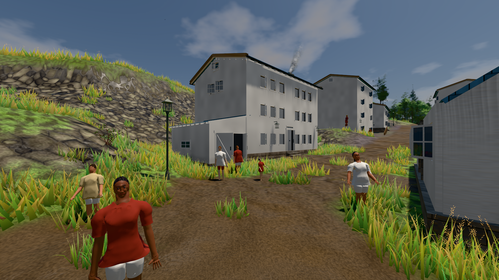

# GPU-PROBE 402c95d2 — GRÜN

Zweig `klang-leib` · Kopf 402c95d2a76c601c334851718e27f5e6a49c2fdd · Läufer radeon-890m · 24.11. 04:11 · Wanduhr ab Push 756 s · Lauf https://github.com/MiguellD/AnazhRealm/actions/runs/45316243798

Ruf: `gate:klang-zensus bild:dorf@0.5 gate:webgl-probe`

## Läufer radeon-890m — GRÜN

GPU AMD Radeon(TM) 890M Graphics · node_modules bleiben (package-lock c7645867)
Schloss /c/Users/micha/AppData/Local/Temp/claude/gpu-schloss hält „ci-runner 45316243798/1 probe“
- Hook 2026-11-24 04:00:52 start ci-runner 45316243798/1 probe: Schloss genommen (refs/heads/klang-leib 402c95d2a76c601c334851718e27f5e6a49c2fdd ws=C:\actions-runner\_work\AnazhRealm\AnazhRealm)

### gate:klang-zensus — GRÜN · 274 s · Läufer radeon-890m

Adapter: ungenannt (die Probe nannte keinen Browser-Adapter)

```text
── (Ra) DER RAUM AM OHR: 24/24 Proben GRÜN · tier -90° 3 m -12.9/-23.5 dB · Lag -38/-31.5 · tier -90° 8 m -12.8/-32.0 dB · Lag -39/-31.5 · tier -90° 20 m -12.7/-40.1 dB · Lag -39/-31.5 · tier 90° 3 m 12.9/-23.5 dB · Lag 38/31.5 · tier 90° 8 m 12.8/-32.0 dB · Lag 38/31.5 · tier 90° 20 m 12.7/-40.1 dB · Lag 39/31.5 · tier -30° 3 m -10.4/-23.4 dB · Lag -17/-12.5 · tier -30° 8 m -10.4/-31.9 dB · Lag -17/-12.5 · tier -30° 20 m -10.5/-40.0 dB · Lag -17/-12.5 · tier 30° 3 m 10.6/-23.4 dB · Lag 17/12.5 · tier 30° 8 m 10.6/-31.9 dB · Lag 17/12.5 · tier 30° 20 m 1
── (V) DER WEG ZUM OHR: 18/18 Proben GRÜN · -10 °C 3 m Einsatz 518/443 · -10 °C 20 m Einsatz 3024/2952 · -10 °C 50 m Einsatz 7453/7381 · 20 °C 3 m Einsatz 495/420 · 20 °C 20 m Einsatz 2870/2797 · 20 °C 50 m Einsatz 7066/6993 · 35 °C 3 m Einsatz 481/409 · 35 °C 20 m Einsatz 2800/2728 · 35 °C 50 m Einsatz 6893/6820 · Luft 500 Hz 300 m 0.8/0.8 dB · Luft 1000 Hz 300 m 1.5/1.5 dB · Luft 2000 Hz 300 m 3.2/2.7 dB · Luft 4000 Hz 300 m 8.7/6.9 dB · Luft 500 Hz 1000 m 2.7/2.8 dB · Luft 1000 Hz 1000 m 5.2/5.0 dB · Luft 2000 Hz 1000 m 10.5/9.0 dB · Luft 500 Hz 3000 m 8.1/8.4
   ✅ S1–S23 nennen jeden Täter beim Namen
✅ GRÜN — Klang-Zensus
```

### bild:dorf@0.5 — GRÜN · 82 s · Läufer radeon-890m

Adapter: [linse-gpu] amd/rdna-3

```text
Kamera des Spiels → Blick (12.9 m): -715.86 49.01 -932.69 -702.99 49.01 -931.86
 "abnahme": "ABNAHME GRÜN · beweis · Sicht 0.0 % · Leib im Vordergrund 4.2 % (Leib bewohner 4.2 %) · Leiber näher als 6 m: 1 von 1 ganz (7 Teile) · Ziel Blickziel im Bild frei 12.9 m · Luma 94.4 σ 30.7 schwarz 0.1 % weiß 0.0 % · Stand 18.546.388 · Bühne summer sunny 0.50 Tiere gehalten · Gerät WebGPU amd rdna-3 · Inhalt bauSatz 20.2 % (≥ 2.0 %) Luma 95",
```



### gate:webgl-probe — GRÜN · 32 s · Läufer radeon-890m

Adapter: [linse-gpu] webgl2/AMD Radeon(TM) 890M Graphics (0x0000150E) Direct3D11 vs_5_0 ps_5_0

```text
✅ GRÜN — die Kein-WebGPU-Geschichte ist BEWIESEN: der erzwungene WebGL2-Rückfall bootet eine LEBENDE, sichtbare Welt; die WGSL-Konsumenten + Bundles ruhen hinter der EINEN Backend-Wand, der Rückfall ist LAUT benannt, der Fern-Ring trägt auf CPU.
```
