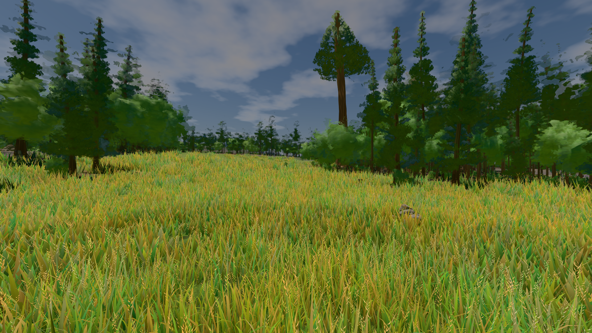

# GPU-PROBE 2ab011ec — GRÜN

Zweig `klima-kontinent` · Kopf 2ab011eca1c24bca3159358025bcc186d49eaac1 · Läufer omen-gtx1060 · 24.11. 06:33 · Wanduhr ab Push 840 s · Lauf https://github.com/MiguellD/AnazhRealm/actions/runs/45332462430

Ruf: `bild:wiese@0.5 gate:studio-begehen gate:kopplung gate:wetter-wache gate:webgl-probe`

## Läufer omen-gtx1060 — GRÜN

GPU NVIDIA GeForce GTX 1060 · node_modules bleiben (package-lock 12b68ea2)
Schloss /c/Users/micha/AppData/Local/Temp/claude/gpu-schloss hält „ci-runner 45332462430/1 probe“
- Hook 2026-11-24 06:19:31 start ci-runner 45332462430/1 probe: wartet auf Schloss von 'omen-punkte-gtx-sitzung'
- Hook 2026-11-24 06:20:47 start ci-runner 45332462430/1 probe: verwaistes Schloss 'omen-punkte-gtx-sitzung' geloest - sein Halter pid 7740 lebt nicht
- Hook 2026-11-24 06:20:47 start ci-runner 45332462430/1 probe: Schloss genommen (refs/heads/klima-kontinent 2ab011eca1c24bca3159358025bcc186d49eaac1 ws=C:\actions-runner\_work\AnazhRealm\AnazhRealm)

### bild:wiese@0.5 — GRÜN · 80 s · Läufer omen-gtx1060

Adapter: [linse-gpu] nvidia/pascal

```text
Kamera des Spiels → Blick (10.0 m): -280.40 29.71 -1045.60 -289.61 29.71 -1049.50
 "abnahme": "ABNAHME GRÜN · beweis · Sicht 0.0 % · Ziel Blickziel im Bild frei 10 m · Luma 99.2 σ 35.5 schwarz 0.0 % weiß 0.0 % · Stand 18.546.392 · Bühne summer sunny 0.50 Tiere gehalten · Gerät WebGPU nvidia pascal · Inhalt nahWiese 48.5 % (≥ 15.0 %) h 107° Luma 123",
```



### gate:studio-begehen — GRÜN · 285 s · Läufer omen-gtx1060

Adapter: [linse-gpu] nvidia/pascal

```text
  ✅ Selbsttest „huelle" macht B1 Hülle nach Promotion + B1 Hülle nach Demotion rot — B1 Hülle nach Promotion: 10 von 10 Häusern zu | B1 Hülle nach Demotion: 0 von 2 Häusern (Geister)
  ✅ Selbsttest „kopf" macht B3 Kopf rot — B3 Kopf: 27 von 120 Treppen-Läufen enden im Solid
  ✅ Selbsttest „kappe" macht B3 Steigen rot — B3 Steigen: 21 von 24 Treppen erreichen ihre Höhe (EG→OG 9/9 · OG→OG 12/12 · Speicher 0/3)
  ✅ Selbsttest „spur" macht B3 Steigen rot — B3 Steigen: 15 von 24 Treppen erreichen ihre Höhe (EG→OG 9/9 · OG→OG 3/12 · Speicher 3/3)
  ✅ Selbsttest „austritt" macht B3 Kopfraum rot — B3 Kopfraum: 14 Austritte unter 1.7 m (min 0.99 m — der Kopf steht im Dach: #0 635014 provenzalisch/kirche sattel speicher 1.69 · #0 635014 provenzalisch/kirche sattel speicher 1.68 · #2 723323 provenzalisch/pfarrhaus sattel speicher 1.2 · #2 723323 provenzalisch/pfarrhaus sattel speicher 1.21 · #3 773412 italienisch/wohnhaus sattel speicher 1 · #3 773412 italienisch/wohnhaus sattel speicher 0.99 · #8 351993 provenzalisch/wohnhaus sattel speicher 1.26 · #8 351993 provenzalisch/wohnhaus sattel speicher 1.15 · #8 351993 provenzali
  ✅ Selbsttest „dachlos" macht B3 Dach rot — B3 Dach: 7 Speicher-Austritte ohne Dach über dem Kopf (der Lauf steigt durch das Dach)
  ✅ Selbsttest „ruecken" macht B3 Speicher rot — B3 Speicher: 2 Häuser mit Dachraum ohne Speicherlauf, obwohl am First Kopfraum steht (#0 635014 provenzalisch/kirche Speicher zu: First 2.68 m, Stufe 0.2 m, Stehraum 3.21 m · #2 723323 provenzalisch/pfarrhaus Speicher zu: First 2.80 m, Stufe 0.2 m, Stehraum 3.54 m)
  ✅ Selbsttest „platte" macht B4 Keller-Decke rot — B4 Keller-Decke = Boden-Platte in 7 von 8
  ✅ Selbsttest „flach" macht B5 Weltgrund rot — B5 Weltgrund: die Häuser stehen eben (Spanne 0 m)
✅ gate:studio-begehen grün
```

### gate:kopplung — GRÜN · 17 s · Läufer omen-gtx1060

Adapter: ungenannt (die Probe nannte keinen Browser-Adapter)

```text
  ✅ ALLE KOPPLUNGS-INVARIANTEN OK — Wände gleiten (PM_ClipVelocity), Steilhang rutscht, Wind hat EINE Richtung, Gras weicht aus
```

### gate:wetter-wache — GRÜN · 131 s · Läufer omen-gtx1060

Adapter: ungenannt (die Probe nannte keinen Browser-Adapter)

```text
✅ SELBSTTEST GRÜN — jeder injizierte Täter fällt rot und wird beim Namen genannt.
  Halt · emotion    GRUEN  sunny → sunny, Uhr -1000000000; verweigert {"rule:emotion:sorrow → rainy":1}
  Halt · nexus      GRUEN  sunny → sunny, Uhr -1000000000; verweigert {"nexus → stormy":2}
  Halt · gesetz     GRUEN  sunny → sunny, Uhr -1000000000; verweigert {"rule:human → rainy":1}
  Halt · mensch     GRUEN  sunny → sunny, Uhr -1000000000; verweigert {"human → rainy":1}
  Halt · mitspieler GRUEN  sunny → sunny, Uhr -1000000000; verweigert {"remote:peer-wache → stormy":1}
  Halt · autoZug    GRUEN  sunny → sunny, Uhr -1000000000; verweigert {}
  Gesetz · GRUEN  Uhr 12:00 → 12:57 (Gang 144.0 s in 1440 Takten; 0 fremde Schreiber), Wetter sunny → sunny (0 Schreiber, 0 Züge)
  Band   · GRUEN  Uhr 12:57 → 13:55 (Gang 144.0 s in 1440 Takten; 0 fremde Schreiber), Wetter frei → stormy (1 Schreiber, 1 Züge)
✅ GRÜN — unter der Bühne dreht kein Schreiber das Wetter; frei gehen Uhr und Wetter nach dem Wort des Spielers, die Welt wünscht nur, jeder Schreiber steht beim Namen.
```

### gate:webgl-probe — GRÜN · 56 s · Läufer omen-gtx1060

Adapter: [linse-gpu] webgl2/NVIDIA GeForce GTX 1060 (0x00001C60) Direct3D11 vs_5_0 ps_5_0

```text
✅ GRÜN — die Kein-WebGPU-Geschichte ist BEWIESEN: der erzwungene WebGL2-Rückfall bootet eine LEBENDE, sichtbare Welt; die WGSL-Konsumenten + Bundles ruhen hinter der EINEN Backend-Wand, der Rückfall ist LAUT benannt, der Fern-Ring trägt auf CPU.
```
