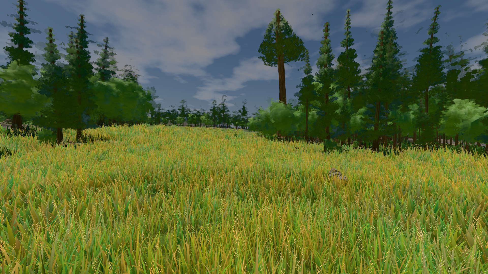

# GPU-PROBE 40eb5720 — GRÜN

Zweig `klima-kontinent` · Kopf 40eb5720147ec12bc46dc1cd9412698f58b7f612 · Läufer gtx1050-desktop · 24.11. 05:47 · Wanduhr ab Push 1539 s · Lauf https://github.com/MiguellD/AnazhRealm/actions/runs/45325849771

Ruf: `bild:wiese@0.5 gate:studio-begehen gate:kopplung gate:wetter-wache gate:webgl-probe`

## Läufer gtx1050-desktop — GRÜN

GPU NVIDIA GeForce GTX 1050 · node_modules bleiben (package-lock 70960776)
Schloss /c/Users/User/AppData/Local/Temp/claude/gpu-schloss hält „ci-runner 45325849771/1 probe“
- Hook 2026-11-24 05:22:24 start ci-runner 45325849771/1 probe: Schloss genommen (refs/heads/klima-kontinent 40eb5720147ec12bc46dc1cd9412698f58b7f612 ws=C:\actions-runner\_work\AnazhRealm\AnazhRealm)

### bild:wiese@0.5 — GRÜN · 146 s · Läufer gtx1050-desktop

Adapter: [linse-gpu] nvidia/pascal

```text
Kamera des Spiels → Blick (10.0 m): -280.40 29.71 -1045.60 -289.61 29.71 -1049.50
 "abnahme": "ABNAHME GRÜN · beweis · Sicht 0.0 % · Ziel Blickziel im Bild frei 10 m · Luma 99.2 σ 35.5 schwarz 0.0 % weiß 0.0 % · Stand 18.546.389 · Bühne summer sunny 0.50 Tiere gehalten · Gerät WebGPU nvidia pascal · Inhalt nahWiese 48.5 % (≥ 15.0 %) h 107° Luma 123",
```



### gate:studio-begehen — GRÜN · 688 s · Läufer gtx1050-desktop

Adapter: [linse-gpu] nvidia/pascal

```text
  ✅ Selbsttest „ruecken" macht B3 Speicher rot — B3 Speicher: 2 Häuser mit Dachraum ohne Speicherlauf, obwohl am First Kopfraum steht (#0 635014 provenzalisch/kirche Speicher zu: First 2.68 m, Stufe 0.2 m, Stehraum 3.21 m · #2 723323 provenzalisch/pfarrhaus Speicher zu: First 2.80 m, Stufe 0.2 m, Stehraum 3.54 m)
[stall-akte] Stderr [3572:12528:1124/052849.833:ERROR:services\on_device_model\public\cpp\service_client.cc:37] Unexpected on_device_model service disconnect; reason: 1, description: Error loading backend.
[stall-akte] Stderr [3572:10968:1124/053116.586:ERROR:google_apis\gcm\engine\mcs_client.cc:702]   Error code: 401  Error message: Authentication Failed: wrong_secret
  ✅ Selbsttest „platte" macht B4 Keller-Decke rot — B4 Keller-Decke = Boden-Platte in 7 von 8
[stall-akte] Stderr [3572:12528:1124/052849.833:ERROR:services\on_device_model\public\cpp\service_client.cc:37] Unexpected on_device_model service disconnect; reason: 1, description: Error loading backend.
[stall-akte] Stderr [3572:10968:1124/053116.586:ERROR:google_apis\gcm\engine\mcs_client.cc:702]   Error code: 401  Error message: Authentication Failed: wrong_secret
  ✅ Selbsttest „flach" macht B5 Weltgrund rot — B5 Weltgrund: die Häuser stehen eben (Spanne 0 m)
[stall-akte] Stderr [3572:12528:1124/052849.833:ERROR:services\on_device_model\public\cpp\service_client.cc:37] Unexpected on_device_model service disconnect; reason: 1, description: Error loading backend.
[stall-akte] Stderr [3572:10968:1124/053116.586:ERROR:google_apis\gcm\engine\mcs_client.cc:702]   Error code: 401  Error message: Authentication Failed: wrong_secret
✅ gate:studio-begehen grün
```

### gate:kopplung — GRÜN · 49 s · Läufer gtx1050-desktop

Adapter: ungenannt (die Probe nannte keinen Browser-Adapter)

```text
  ✅ ALLE KOPPLUNGS-INVARIANTEN OK — Wände gleiten (PM_ClipVelocity), Steilhang rutscht, Wind hat EINE Richtung, Gras weicht aus
```

### gate:wetter-wache — GRÜN · 320 s · Läufer gtx1050-desktop

Adapter: ungenannt (die Probe nannte keinen Browser-Adapter)

```text
✅ SELBSTTEST GRÜN — jeder injizierte Täter fällt rot und wird beim Namen genannt.
  Halt · emotion    GRUEN  sunny → sunny, Uhr -1000000000; verweigert {"rule:emotion:sorrow → rainy":1}
  Halt · nexus      GRUEN  sunny → sunny, Uhr -1000000000; verweigert {"nexus → stormy":2}
  Halt · gesetz     GRUEN  sunny → sunny, Uhr -1000000000; verweigert {"rule:human → rainy":1}
  Halt · mensch     GRUEN  sunny → sunny, Uhr -1000000000; verweigert {"human → rainy":1}
  Halt · mitspieler GRUEN  sunny → sunny, Uhr -1000000000; verweigert {"remote:peer-wache → stormy":1}
  Halt · autoZug    GRUEN  sunny → sunny, Uhr -1000000000; verweigert {}
  Gesetz · GRUEN  Uhr 12:00 → 12:57 (Gang 144.0 s in 1440 Takten; 0 fremde Schreiber), Wetter sunny → sunny (0 Schreiber, 0 Züge)
  Band   · GRUEN  Uhr 12:57 → 13:55 (Gang 144.0 s in 1440 Takten; 0 fremde Schreiber), Wetter frei → stormy (1 Schreiber, 1 Züge)
✅ GRÜN — unter der Bühne dreht kein Schreiber das Wetter; frei gehen Uhr und Wetter nach dem Wort des Spielers, die Welt wünscht nur, jeder Schreiber steht beim Namen.
```

### gate:webgl-probe — GRÜN · 117 s · Läufer gtx1050-desktop

Adapter: [linse-gpu] webgl2/NVIDIA GeForce GTX 1050 (0x00001C81) Direct3D11 vs_5_0 ps_5_0

```text
✅ GRÜN — die Kein-WebGPU-Geschichte ist BEWIESEN: der erzwungene WebGL2-Rückfall bootet eine LEBENDE, sichtbare Welt; die WGSL-Konsumenten + Bundles ruhen hinter der EINEN Backend-Wand, der Rückfall ist LAUT benannt, der Fern-Ring trägt auf CPU.
```
