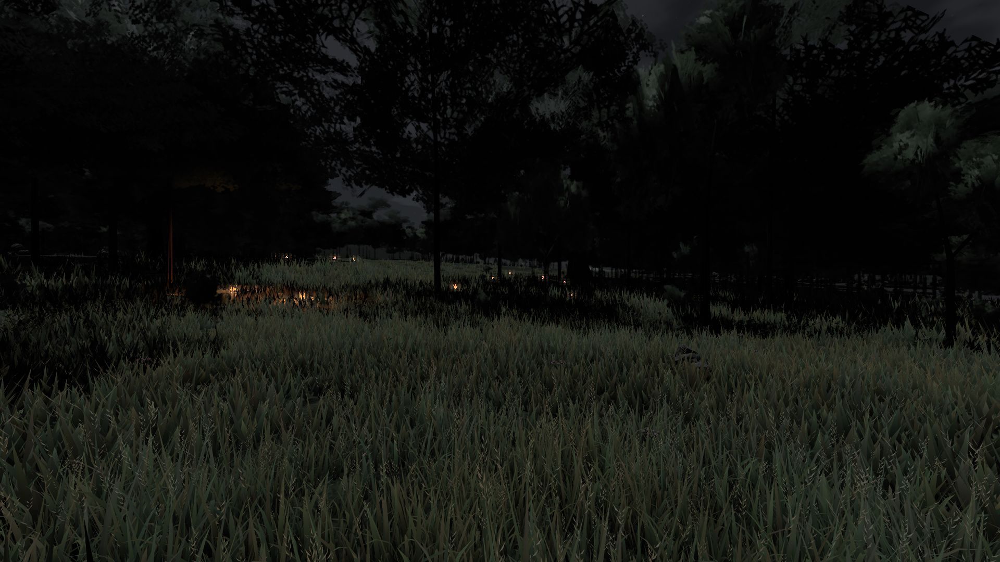

# GPU-PROBE 3c488c4d — GRÜN

Zweig `kosmos-umfang` · Kopf 3c488c4d4a8a592bd376a9b0fd22128a9b1a1520 · Läufer radeon-890m · 19.11. 22:39 · Wanduhr ab Push 379 s · Lauf https://github.com/MiguellD/AnazhRealm/actions/runs/44619892113

Ruf: `bild:wiese@0.02`

## Läufer radeon-890m — GRÜN

GPU AMD Radeon(TM) 890M Graphics · npm ci 61 s (package-lock bd5d6c75)
Schloss /c/Users/micha/AppData/Local/Temp/claude/gpu-schloss hält „ci-runner 44619892113/1 probe“
- Hook 2026-11-19 22:33:52 start ci-runner 44619892113/1 probe: Schloss genommen (refs/heads/kosmos-umfang 3c488c4d4a8a592bd376a9b0fd22128a9b1a1520 ws=C:\actions-runner\_work\AnazhRealm\AnazhRealm)

### bild:wiese@0.02 — GRÜN · 75 s · Läufer radeon-890m

Adapter: [linse-gpu] amd/rdna-3

```text
Kamera des Spiels → Blick (10.0 m): -280.40 29.71 -1045.60 -289.61 29.71 -1049.50
 "abnahme": "ABNAHME GRÜN · beweis · Sicht 0.0 % · Ziel Blickziel im Bild frei 10 m · Luma 19.1 σ 18.1 schwarz 35.0 % weiß 0.0 % · Stand 18.546.345 · Bühne summer sunny 0.02 Tiere gehalten · Gerät WebGPU amd rdna-3 · Inhalt nahWiese 48.2 % (≥ 15.0 %) (Nacht: Farbe ungefordert)",
```


