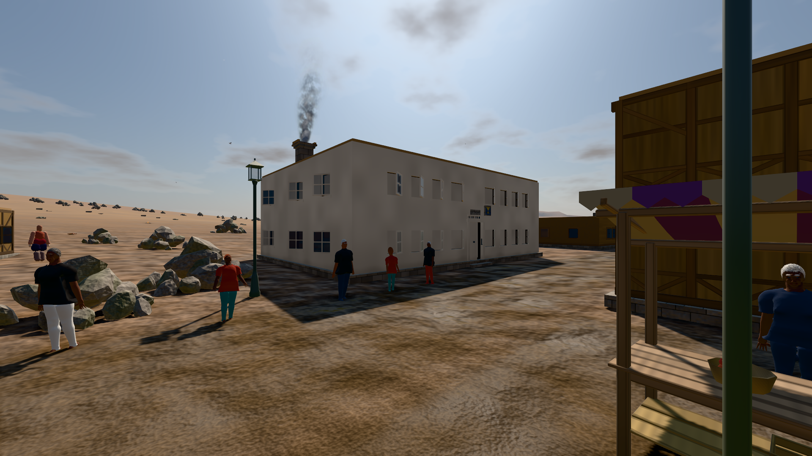

# GPU-PROBE 5b21a935 — GRÜN

Zweig `kultur-aus-klima` · Kopf 5b21a935da255bc667a2d1e58b1eda8586d09bef · Läufer radeon-890m · 26.11. 09:31 · Wanduhr ab Push 1206 s · Lauf https://github.com/MiguellD/AnazhRealm/actions/runs/45781041929

Ruf: `gate:pruefbuehne-licht gate:weltbild-frost:echt gate:studio-begehen bild:dorf-trocken@0.42 gate:webgl-probe`

## Läufer radeon-890m — GRÜN

GPU AMD Radeon(TM) 890M Graphics · npm ci 57 s (package-lock 15400fe9)
Schloss /c/Users/micha/AppData/Local/Temp/claude/gpu-schloss hält „ci-runner 45781041929/1 probe“
- Hook 2026-11-26 09:16:56 start ci-runner 45781041929/1 probe: verwaistes Schloss 'punkte-radeon-sitzungpid=8252' geloest - Halter pid=8252 lebt nicht
- Hook 2026-11-26 09:16:57 start ci-runner 45781041929/1 probe: Schloss genommen (refs/heads/kultur-aus-klima 5b21a935da255bc667a2d1e58b1eda8586d09bef ws=C:\actions-runner\_work\AnazhRealm\AnazhRealm)

### gate:pruefbuehne-licht — GRÜN · 73 s · Läufer radeon-890m

Adapter: [linse-gpu] amd/rdna-3

```text
  S0 BODEN-PROGRAMM 1/1: 108011 Zeichen WGSL (gebuchter Stand 108011, ±0 — Auskunft, kein Urteil) · Pipeline asynchron → GRÜN · kalt 786 · 774 · 780 · 742 · 785 · 763 · 766 · 723 · 742 ms, Median 766 ms · ÷ K17 derselben Sitzung 0,85 (Auskunft, kein Zeit-Urteil)
  SELBSTTEST S0 NACHT (die Sicht des Mondes): getroffen — ohne Mond-Sicht „S0 Nacht: das Licht der Nacht trifft keinen Boden 1–3 m (Mond-Sicht 0 an jedem Pixel des Rings, Mond 22.08°)“ · schwarz 8 % im Licht → ROT · schwarz 8 % allein im Schatten grün
✅ S0 BILD GRÜN: die Feuerstelle trägt den Feuerkreis aus 2 m in der Ausgabe · Nacht {"luma":44.2,"schwarz":0,"gesetz":48.52} (34 s, amd/rdna-3 · Holz kienspan)
```

### gate:weltbild-frost:echt — GRÜN · 142 s · Läufer radeon-890m

Adapter: [linse-gpu] amd/rdna-3

```text
  ✅ P2 kein writeBuffer schief: der Pfad und ein Index ungerader Länge der Ich-Bühne — 292147 writeBuffer, keiner schief
  ✅ T1 die Index-Wache nennt den Index über der Vertex-Zahl beim Namen — Vendor- und Storage-Index — gezeichnet nach 72 Bildern · Scene/frost-taeter-bereich: Index 3 ≥ 3 Vertices im gezeichneten Bereich | Scene/frost-taeter-speicher: Index 3 ≥ 3 Vertices im gezeichneten Bereich
  ✅ T3 die Puffer-Wache nennt den schiefen writeBuffer beim Namen, WebGPU wirft — frost-taeter-puffer · Uint16Array · Versatz 0 · 6 B · q.writeBuffer (stamm/dirigent-ankunft.js:253:36) < pptr:;page.%3Ccomputed%3E%20(C%3A%5Cactions-runner%5C_work%5CAnazhRealm%5Cgpu-probe%5Cscripts%5Clib%5Cwelt-boot.cjs%3A1136%3A22):6:23 · geworfen: Failed to execute 'writeBuffer' on 'GPUQueue': Number of bytes to write must be a multiple of 4
  ✅ T4 ein fremder Fehler im Bau einer Pipeline markiert keine Pipeline — der Abgriff schließt r184s Bereich, die GPU-Wache zählt den Fehler — 1 Bauten, 1 fremde Validierungen, 1 Bereiche geschlossen, GPU-Wache +1, Marken: keine
  ✅ T4 der Mutant (main 6699a813: r184s Fehler-Bereich bleibt über das Versprechen des Baus offen) markiert die Pipeline des Täters — 1 Bauten, 1 fremde Validierungen, 0 Bereiche geschlossen, GPU-Wache +1, Marken: renderPipeline_frost-taeter-fremd-mutant_3419 · T4 mit beiden Läufen in 2420 ms
  ✅ T2 die Index-Wache nennt den geweiteten Index beim Pfad — Group/BundleGroup/Group/mensch/torso/head/Mesh: 7962 × Uint32Array = 31848 B gebunden, der Puffer trägt 15924 B
  ✅ T2 die GPU-Wache des Spiels zählt die Validierung — {"n":295}
  ✅ T2 der eigene Hörer hört die Validierung (Device oder r184-Fehler-Bereich) — 586 Meldungen: konsole: THREE.Write range (bufferOffset: 0, size: 16) does not fit in [Buffer "frost-taeter-fremd"] size (8). | konsole: Index range (first: 0, count: 7962, format: IndexFormat::Uint32) does not fit in index buffer size (15924).
  ✅ T2 die Bild-Probe erkennt das stehende Bild — 0.00 % der Blöcke bewegt
✅ GRÜN — DIE FROST-WAND steht — durch Werkstatt, Ich- und Hof-Bühne trägt jeder Index-Puffer der Welt-GPU sein Format, kein Device meldet, das Bild folgt der Kamera; die Täter (Index über der Vertex-Zahl, ein fremd geweiteter Mensch-Index) nennen die Wachen beim Namen, ein fremder Fehler im Bau einer Pipeline markiert keine, und das stehende Bild wird erkannt.
```

### gate:studio-begehen — GRÜN · 170 s · Läufer radeon-890m

Adapter: [linse-gpu] amd/rdna-3

```text
  ✅ Selbsttest „huelle" macht B1 Hülle nach Promotion + B1 Hülle nach Demotion rot — B1 Hülle nach Promotion: 10 von 10 Häusern zu | B1 Hülle nach Demotion: 0 von 2 Häusern (Geister)
  ✅ Selbsttest „kopf" macht B3 Kopf rot — B3 Kopf: 27 von 120 Treppen-Läufen enden im Solid
  ✅ Selbsttest „kappe" macht B3 Steigen rot — B3 Steigen: 21 von 24 Treppen erreichen ihre Höhe (EG→OG 9/9 · OG→OG 12/12 · Speicher 0/3)
  ✅ Selbsttest „spur" macht B3 Steigen rot — B3 Steigen: 15 von 24 Treppen erreichen ihre Höhe (EG→OG 9/9 · OG→OG 3/12 · Speicher 3/3)
  ✅ Selbsttest „austritt" macht B3 Kopfraum rot — B3 Kopfraum: 14 Austritte unter 1.7 m (min 0.99 m — der Kopf steht im Dach: #0 635014 provenzalisch/kirche sattel speicher 1.69 · #0 635014 provenzalisch/kirche sattel speicher 1.68 · #2 723323 provenzalisch/pfarrhaus sattel speicher 1.2 · #2 723323 provenzalisch/pfarrhaus sattel speicher 1.21 · #3 773412 italienisch/wohnhaus sattel speicher 1 · #3 773412 italienisch/wohnhaus sattel speicher 0.99 · #8 351993 provenzalisch/wohnhaus sattel speicher 1.26 · #8 351993 provenzalisch/wohnhaus sattel speicher 1.15 · #8 351993 provenzali
  ✅ Selbsttest „dachlos" macht B3 Dach rot — B3 Dach: 7 Speicher-Austritte ohne Dach über dem Kopf (der Lauf steigt durch das Dach)
  ✅ Selbsttest „ruecken" macht B3 Speicher rot — B3 Speicher: 2 Häuser mit Dachraum ohne Speicherlauf, obwohl am First Kopfraum steht (#0 635014 provenzalisch/kirche Speicher zu: First 2.68 m, Stufe 0.2 m, Stehraum 3.21 m · #2 723323 provenzalisch/pfarrhaus Speicher zu: First 2.80 m, Stufe 0.2 m, Stehraum 3.54 m)
  ✅ Selbsttest „platte" macht B4 Keller-Decke rot — B4 Keller-Decke = Boden-Platte in 7 von 8
  ✅ Selbsttest „flach" macht B5 Weltgrund rot — B5 Weltgrund: die Häuser stehen eben (Spanne 0 m)
✅ gate:studio-begehen grün
```

### bild:dorf-trocken@0.42 — GRÜN · 96 s · Läufer radeon-890m

Adapter: [linse-gpu] amd/rdna-3

```text
Kamera des Spiels → Blick (11.9 m): -159.80 53.01 61.13 -151.82 53.01 52.30
 "abnahme": "ABNAHME GRÜN · beweis · Sicht 0.0 % · Leib im Vordergrund 1.2 % (Leib bewohner 1.2 %) · Leiber näher als 6 m: 1 von 1 ganz (6 Teile) · Ziel Blickziel im Bild frei 11.9 m · Luma 104.4 σ 60.8 schwarz 0.5 % weiß 0.0 % · Stand 18.546.429 · Bühne summer sunny 0.42 Tiere gehalten · Gerät WebGPU amd rdna-3 · Inhalt bauSatz 28.0 % (≥ 2.0 %) Luma 59",
```



### gate:webgl-probe — GRÜN · 69 s · Läufer radeon-890m

Adapter: [linse-gpu] webgl2/AMD Radeon(TM) 890M Graphics (0x0000150E) Direct3D11 vs_5_0 ps_5_0

```text
✅ GRÜN — die Kein-WebGPU-Geschichte ist BEWIESEN: der erzwungene WebGL2-Rückfall bootet eine LEBENDE, sichtbare Welt; die WGSL-Konsumenten + Bundles ruhen hinter der EINEN Backend-Wand, der Rückfall ist LAUT benannt, der Fern-Ring trägt auf CPU.
```
