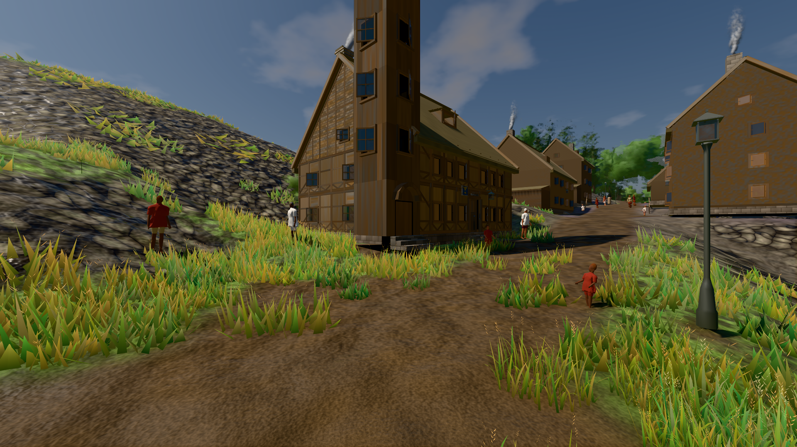

# GPU-PROBE 85c5d75a — GRÜN

Zweig `kunst-am-leib` · Kopf 85c5d75a89cd87c9a701889a8aa04edbdeb8d76f · Läufer omen-gtx1060 · 27.11. 15:07 · Wanduhr ab Push 2457 s · Lauf https://github.com/MiguellD/AnazhRealm/actions/runs/46007069499

Ruf: `gate:stand-takt gate:mensch-zuege bild:dorf@0.5 gate:webgl-probe`

## Läufer omen-gtx1060 — GRÜN

GPU NVIDIA GeForce GTX 1060 · npm ci 45 s (package-lock a873c59e)
Schloss /c/Users/micha/AppData/Local/Temp/claude/gpu-schloss hält „ci-runner 46007069499/1 probe“
- Hook 2026-11-27 14:41:16 start ci-runner 46007069499/1 probe: Schloss genommen (refs/heads/kunst-am-leib 85c5d75a89cd87c9a701889a8aa04edbdeb8d76f ws=C:\actions-runner\_work\AnazhRealm\AnazhRealm)

### gate:stand-takt — GRÜN · 285 s · Läufer omen-gtx1060

Adapter: ungenannt (die Probe nannte keinen Browser-Adapter)

```text
  ✅ Selbsttest „ein Sprung des Auges (40 m, ohne Takt) lässt die Welt stehen (die Basis)" → rot: FIXPUNKT: die Welt hieß stehend — Sprung: Stufen-Wahl und Streu gingen noch
  ✅ Selbsttest „die Sonde ohne Bestand" → rot: SONDE: Abschnitt der vorigen Kamera, trifft Rinde baum_tanne
  ✅ Selbsttest „Pegel-Stufen" → rot: WASSERNETZ OHNE FIXPUNKT: 37 Wechsel nach dem Stand, zuletzt Chunk -11,-22, Ecke (-462.5, -907.4)
  ✅ Selbsttest „Pendel ungesehen" → rot: BLIND: der Pendel des Pegels wechselt kein Netz
  ✅ Selbsttest „keine Netz-Wache" → rot: LEER: keine Netz-Wache am Bach
✅ SELBSTTEST GRÜN — jeder injizierte Täter fällt rot und wird beim Namen genannt.
✅ SELBSTTEST GRÜN — die Tat-, Nachwuchs-, Brand-, Sukzessions-, Narbe- und Lava-Linse nennen jeden Täter.
  pageErrors: []
✅ GRÜN — STAND-TAKT — im Stand geht kein Fege-Takt und keine langsame Simulation, die gebrochene Wache findet nichts Verschlafenes, ein Bau und jedes Sim-Ereignis wecken, Gehen und Strom arbeiten.
✅ NARBE GRÜN — die Narbe folgt der Front, die Zelle brennt, bis ihre Front sie deckt, das Licht steht bei den Flammen, der Boden liest die Asche-Zeile, die Front ist ein geschlossener Saum, die Zungen pulsen, der Brand leuchtet nachts als Flammen-Fläche, Asche und Rauch tragen die Masse des Holzes; die Lava zündet die Betten um sie auf der Länge ihres Rands, kein Halm steht auf ihrer Decke, sie leuchtet als Flammen-Fläche; die Uhr des Spielers bewegt keinen Prozess, der Sprung der Welt-Uhr ist geschlossen
```

### gate:mensch-zuege — GRÜN · 39 s · Läufer omen-gtx1060

Adapter: ungenannt (die Probe nannte keinen Browser-Adapter)

```text
[Selbsttest] Täter das Alter 0,05–0,5 wie vorher: ROT — Anteil unter 15 J 0.000 < 0,35 — Täter: stamm/koerper-leib.js _rollHumanoidGenome, das Alter nicht aus koerper epochenAlter (ALTER_GESETZ.pyramide)
[Selbsttest] Täter die Wahl ohne Lebensphase: ROT — 50 Kinder in der Gestalt eines Erwachsenen — Täter: stamm/siedlung-bewohner.js _bewohnerAbstand ohne koerper alterAbstand (die Lebensphase)
[Selbsttest] Täter der Wuchs ohne Höhe: ROT — Wuchs außer Band [{"J":2,"hoehe":1,"soll":0.507,"kopf":1.607,"kopfSoll":0.82},{"J":4,"hoehe":1,"soll":0.593,"kopf":1.433,"kopfSoll":0.86},{"J":6,"hoehe":1,"soll
[Selbsttest] Täter das Kind ohne Reife: ROT — Kind-Gestalten unter 10 J mit der Form eines Geschlechts [[3.7,0.229],[7.6,0.927]] (J, sex) — Täter: koerper alterGeschlecht / alterLeib (reife)
[Selbsttest] Täter das Spiel vor der eigenen Tür: ROT — die Kinder blind: 11 helfen, 0 spielen am Platz (Täter: koerper tagesBindung / tagesPlan rollen.kind, TAGES_GESETZ.kindHilftAbJ · kindArbeitMaxH) · 139 Kinder s
[Selbsttest] Täter das Kind an fremdem Werk (das Haus ohne Werk): ROT — 10 Kinder an fremdem Werk: 1718897338 (10 J, wohnhaus) · 2571784318 (14 J, wohnhaus) · 4195461234 (10 J, wohnhaus) (Täter: koerper tagesBindung / tagesPlan roll
[Selbsttest] Täter das Kind ohne Altersgrenze: ROT — 15 Kinder helfen unter 9 J: 156870951 (5 J, schmiede) · 604648159 (1 J, schmiede) · 2367527277 (1 J, schmiede) (Täter: koerper tagesBindung / tagesPlan rollen.k
[Selbsttest] Täter das Kind im Akt des Meisters: ROT — 11 Kinder im Akt des Meisters („arbeit“): 949870511 (13 J, schmiede) · 2905877275 (11 J, schmiede) · 3785696893 (13 J, schmiede) (Täter: koerper tagesBindung / 
✅ Selbsttest: alle 10 Täter des Zugs und die 8 des Alters (Alter wie vorher, Wahl ohne Lebensphase, Wuchs ohne Höhe, Kind ohne Reife, Spiel vor der Tür, Kind an fremdem Werk, ohne Altersgrenze, im Akt des Meisters) fallen ROT an ihrer Zeile.
✅ DER ZUG ÄNDERT DEN TAG — 0.95 der ersten 20 und 0.92 aller 100 blind ihrem Zug zugeordnet, jeder Zug ≥ 0,6, bit-gleich · DAS ALTER DER EPOCHE — 38.6 % unter 15 J (≥ 35 %), kein Kind in Erwachsenen-Gestalt, der Wuchs im Band
```

### bild:dorf@0.5 — GRÜN · 96 s · Läufer omen-gtx1060

Adapter: [linse-gpu] nvidia/pascal

```text
Kamera des Spiels → Blick (11.3 m): -720.31 44.15 -922.46 -709.17 44.15 -920.56
 "abnahme": "ABNAHME GRÜN · beweis · Sicht 0.0 % · Ziel Blickziel im Bild frei 11.3 m · Luma 81.7 σ 29.7 schwarz 0.4 % weiß 0.0 % · Stand 18.546.453 · Bühne summer sunny 0.50 Tiere gehalten · Gerät WebGPU nvidia pascal · Inhalt bauSatz 17.0 % (≥ 2.0 %) Luma 60",
```



### gate:webgl-probe — GRÜN · 64 s · Läufer omen-gtx1060

Adapter: [linse-gpu] webgl2/NVIDIA GeForce GTX 1060 (0x00001C60) Direct3D11 vs_5_0 ps_5_0

```text
✅ GRÜN — die Kein-WebGPU-Geschichte ist BEWIESEN: der erzwungene WebGL2-Rückfall bootet eine LEBENDE, sichtbare Welt; die WGSL-Konsumenten + Bundles ruhen hinter der EINEN Backend-Wand, der Rückfall ist LAUT benannt, der Fern-Ring trägt auf CPU.
```
