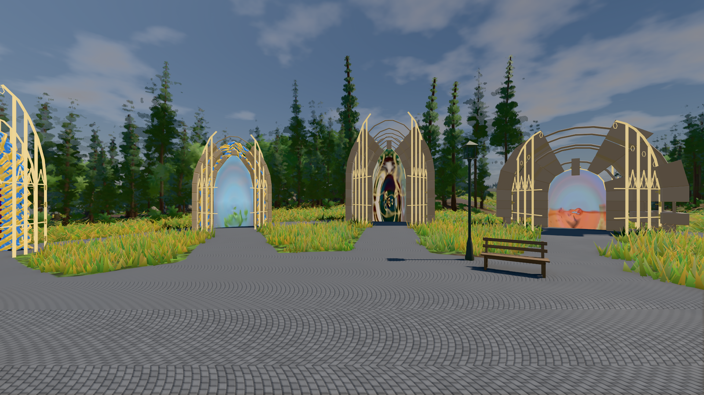

# GPU-PROBE 18f96a3c — GRÜN

Zweig `landmarken-geologie-2` · Kopf 18f96a3cb385556d6e76b59a17bedaf39dd960ea · Läufer gtx1050-desktop · 26.11. 01:47 · Wanduhr ab Push 2907 s · Lauf https://github.com/MiguellD/AnazhRealm/actions/runs/45725438634

Ruf: `gate:pruefbuehne-licht gate:weltbild-frost:echt gate:studio-begehen bild:genesis@0.5 gate:webgl-probe`

## Läufer gtx1050-desktop — GRÜN

GPU NVIDIA GeForce GTX 1050 · node_modules bleiben (package-lock 12cdff91)
Schloss /c/Users/User/AppData/Local/Temp/claude/gpu-schloss hält „ci-runner 45725438634/1 probe“
- Hook 2026-11-26 01:09:38 start ci-runner 45725438634/1 probe: Schloss genommen (refs/heads/landmarken-geologie-2 18f96a3cb385556d6e76b59a17bedaf39dd960ea ws=C:\actions-runner\_work\AnazhRealm\AnazhRealm)

### gate:pruefbuehne-licht — GRÜN · 168 s · Läufer gtx1050-desktop

Adapter: [linse-gpu] nvidia/pascal

```text
  S0 BODEN-PROGRAMM 1/1: 108011 Zeichen WGSL (gebuchter Stand 108011, ±0 — Auskunft, kein Urteil) · Pipeline asynchron → GRÜN · kalt 4403 · 4467 · 4347 · 4145 · 3014 · 2875 · 2589 · 2841 · 3119 ms, Median 3119 ms · ÷ K17 derselben Sitzung 0,82 (Auskunft, kein Zeit-Urteil)
  SELBSTTEST S0 NACHT (die Sicht des Mondes): getroffen — ohne Mond-Sicht „S0 Nacht: das Licht der Nacht trifft keinen Boden 1–3 m (Mond-Sicht 0 an jedem Pixel des Rings, Mond 22.08°)“ · schwarz 8 % im Licht → ROT · schwarz 8 % allein im Schatten grün
✅ S0 BILD GRÜN: die Feuerstelle trägt den Feuerkreis aus 2 m in der Ausgabe · Nacht {"luma":44.2,"schwarz":0,"gesetz":48.52} (118 s, nvidia/pascal · Holz kienspan)
```

### gate:weltbild-frost:echt — GRÜN · 797 s · Läufer gtx1050-desktop

Adapter: [linse-gpu] nvidia/pascal

```text
  ✅ P2 kein writeBuffer schief: der Pfad und ein Index ungerader Länge der Ich-Bühne — 788062 writeBuffer, keiner schief
  ✅ T1 die Index-Wache nennt den Index über der Vertex-Zahl beim Namen — Vendor- und Storage-Index — gezeichnet nach 39 Bildern · Scene/frost-taeter-bereich: Index 3 ≥ 3 Vertices im gezeichneten Bereich | Scene/frost-taeter-speicher: Index 3 ≥ 3 Vertices im gezeichneten Bereich
  ✅ T3 die Puffer-Wache nennt den schiefen writeBuffer beim Namen, WebGPU wirft — frost-taeter-puffer · Uint16Array · Versatz 0 · 6 B · q.writeBuffer (stamm/dirigent-ankunft.js:253:36) < pptr:;page.%3Ccomputed%3E%20(C%3A%5Cactions-runner%5C_work%5CAnazhRealm%5Cgpu-probe%5Cscripts%5Clib%5Cwelt-boot.cjs%3A1136%3A22):6:23 · geworfen: Failed to execute 'writeBuffer' on 'GPUQueue': Number of bytes to write must be a multiple of 4
  ✅ T4 ein fremder Fehler im Bau einer Pipeline markiert keine Pipeline — der Abgriff schließt r184s Bereich, die GPU-Wache zählt den Fehler — 2 Bauten, 2 fremde Validierungen, 2 Bereiche geschlossen, GPU-Wache +2, Marken: keine
  ✅ T4 der Mutant (main 6699a813: r184s Fehler-Bereich bleibt über das Versprechen des Baus offen) markiert die Pipeline des Täters — 1 Bauten, 1 fremde Validierungen, 0 Bereiche geschlossen, GPU-Wache +1, Marken: renderPipeline_frost-taeter-fremd-mutant_3441 · T4 mit beiden Läufen in 4030 ms
  ✅ T2 die Index-Wache nennt den geweiteten Index beim Pfad — Group/BundleGroup/Group/mensch/torso/head/Mesh: 7962 × Uint32Array = 31848 B gebunden, der Puffer trägt 15924 B
  ✅ T2 die GPU-Wache des Spiels zählt die Validierung — {"n":192}
  ✅ T2 der eigene Hörer hört die Validierung (Device oder r184-Fehler-Bereich) — 378 Meldungen: konsole: Write range (bufferOffset: 0, size: 16) does not fit in [Buffer "frost-taeter-fremd"] size (8). | konsole: THREE.Write range (bufferOffset: 0, size: 16) does not fit in [Buffer "frost-taeter-fremd"] size (8).
  ✅ T2 die Bild-Probe erkennt das stehende Bild — 0.38 % der Blöcke bewegt
✅ GRÜN — DIE FROST-WAND steht — durch Werkstatt, Ich- und Hof-Bühne trägt jeder Index-Puffer der Welt-GPU sein Format, kein Device meldet, das Bild folgt der Kamera; die Täter (Index über der Vertex-Zahl, ein fremd geweiteter Mensch-Index) nennen die Wachen beim Namen, ein fremder Fehler im Bau einer Pipeline markiert keine, und das stehende Bild wird erkannt.
```

### gate:studio-begehen — GRÜN · 659 s · Läufer gtx1050-desktop

Adapter: [linse-gpu] nvidia/pascal

```text
[stall-akte] Stderr [8568:4360:1126/012949.810:ERROR:services\on_device_model\public\cpp\service_client.cc:37] Unexpected on_device_model service disconnect; reason: 1, description: Error loading backend.
  ✅ Selbsttest „dachlos" macht B3 Dach rot — B3 Dach: 7 Speicher-Austritte ohne Dach über dem Kopf (der Lauf steigt durch das Dach)
[stall-akte] Stderr [8568:4360:1126/012949.810:ERROR:services\on_device_model\public\cpp\service_client.cc:37] Unexpected on_device_model service disconnect; reason: 1, description: Error loading backend.
  ✅ Selbsttest „ruecken" macht B3 Speicher rot — B3 Speicher: 2 Häuser mit Dachraum ohne Speicherlauf, obwohl am First Kopfraum steht (#0 635014 provenzalisch/kirche Speicher zu: First 2.68 m, Stufe 0.2 m, Stehraum 3.21 m · #2 723323 provenzalisch/pfarrhaus Speicher zu: First 2.80 m, Stufe 0.2 m, Stehraum 3.54 m)
[stall-akte] Stderr [8568:4360:1126/012949.810:ERROR:services\on_device_model\public\cpp\service_client.cc:37] Unexpected on_device_model service disconnect; reason: 1, description: Error loading backend.
  ✅ Selbsttest „platte" macht B4 Keller-Decke rot — B4 Keller-Decke = Boden-Platte in 7 von 8
[stall-akte] Stderr [8568:4360:1126/012949.810:ERROR:services\on_device_model\public\cpp\service_client.cc:37] Unexpected on_device_model service disconnect; reason: 1, description: Error loading backend.
  ✅ Selbsttest „flach" macht B5 Weltgrund rot — B5 Weltgrund: die Häuser stehen eben (Spanne 0 m)
[stall-akte] Stderr [8568:4360:1126/012949.810:ERROR:services\on_device_model\public\cpp\service_client.cc:37] Unexpected on_device_model service disconnect; reason: 1, description: Error loading backend.
✅ gate:studio-begehen grün
```

### bild:genesis@0.5 — GRÜN · 153 s · Läufer gtx1050-desktop

Adapter: [linse-gpu] nvidia/pascal

```text
Kamera des Spiels → Blick (10.0 m): 0.00 92.40 0.00 -10.00 92.40 0.00
 "abnahme": "ABNAHME GRÜN · beweis · Sicht 0.0 % · Ziel Blickziel im Bild frei 10 m · Luma 108.4 σ 31.9 schwarz 0.0 % weiß 0.0 % · Stand 18.546.425 · Bühne summer sunny 0.50 Tiere gehalten · Gerät WebGPU nvidia pascal · Inhalt bodenSatz 36.6 % (≥ 15.0 %) Luma 110, portal-membran 2.7 % (≥ 0.3 %) Luma 140",
```



### gate:webgl-probe — GRÜN · 160 s · Läufer gtx1050-desktop

Adapter: [linse-gpu] webgl2/NVIDIA GeForce GTX 1050 (0x00001C81) Direct3D11 vs_5_0 ps_5_0

```text
[stall-akte] Stderr [8920:13504:1126/014114.624:ERROR:google_apis\gcm\engine\mcs_client.cc:702]   Error code: 401  Error message: Authentication Failed: wrong_secret
✅ GRÜN — die Kein-WebGPU-Geschichte ist BEWIESEN: der erzwungene WebGL2-Rückfall bootet eine LEBENDE, sichtbare Welt; die WGSL-Konsumenten + Bundles ruhen hinter der EINEN Backend-Wand, der Rückfall ist LAUT benannt, der Fern-Ring trägt auf CPU.
```
