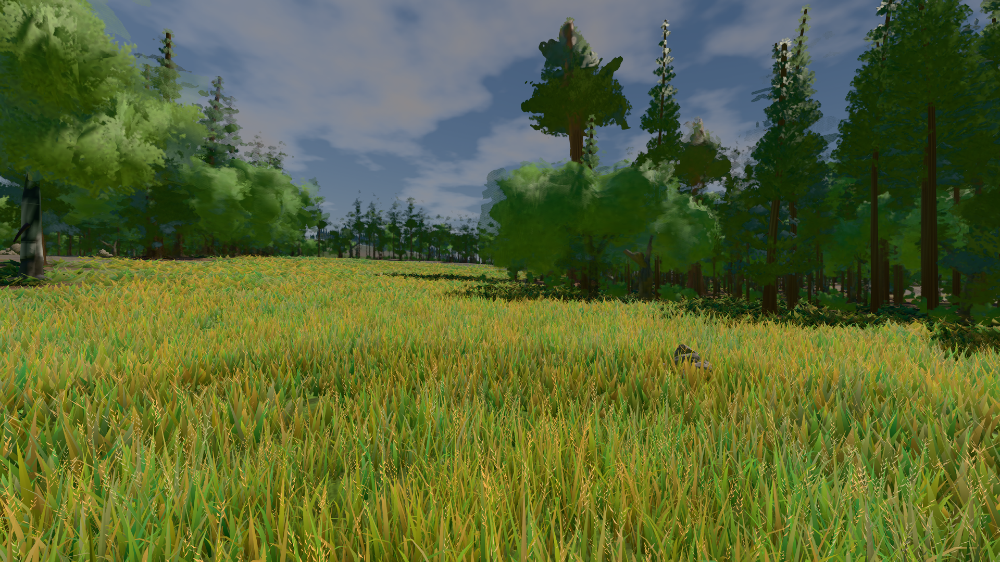
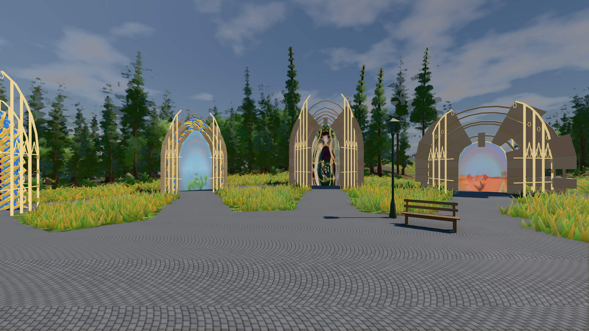

# GPU-PROBE d9513b67 — GRÜN

Zweig `landmarken-geologie` · Kopf d9513b67b2f7cfbc89c875ea8569335a29f732b1 · Läufer gtx1050-desktop · 26.11. 01:08 · Wanduhr ab Push 789 s · Lauf https://github.com/MiguellD/AnazhRealm/actions/runs/45724962115

Ruf: `bild:wiese@0.5 bild:genesis@0.5 gate:webgl-probe`

## Läufer gtx1050-desktop — GRÜN

GPU NVIDIA GeForce GTX 1050 · node_modules bleiben (package-lock 12cdff91)
Schloss /c/Users/User/AppData/Local/Temp/claude/gpu-schloss hält „ci-runner 45724962115/1 probe“
- Hook 2026-11-26 00:55:57 start ci-runner 45724962115/1 probe: Schloss genommen (refs/heads/landmarken-geologie d9513b67b2f7cfbc89c875ea8569335a29f732b1 ws=C:\actions-runner\_work\AnazhRealm\AnazhRealm)

### bild:wiese@0.5 — GRÜN · 175 s · Läufer gtx1050-desktop

Adapter: [linse-gpu] nvidia/pascal

```text
Kamera des Spiels → Blick (10.0 m): -280.40 29.71 -1045.60 -289.61 29.71 -1049.50
 "abnahme": "ABNAHME GRÜN · beweis · Sicht 0.0 % · Ziel Blickziel im Bild frei 10 m · Luma 96.6 σ 37.2 schwarz 0.0 % weiß 0.0 % · Stand 18.546.425 · Bühne summer sunny 0.50 Tiere gehalten · Gerät WebGPU nvidia pascal · Inhalt nahWiese 48.4 % (≥ 15.0 %) h 107° Luma 119",
```



### bild:genesis@0.5 — GRÜN · 130 s · Läufer gtx1050-desktop

Adapter: [linse-gpu] nvidia/pascal

```text
Kamera des Spiels → Blick (10.0 m): 0.00 92.40 0.00 -10.00 92.40 0.00
 "abnahme": "ABNAHME GRÜN · beweis · Sicht 0.0 % · Ziel Blickziel im Bild frei 10 m · Luma 108.4 σ 31.9 schwarz 0.0 % weiß 0.0 % · Stand 18.546.425 · Bühne summer sunny 0.50 Tiere gehalten · Gerät WebGPU nvidia pascal · Inhalt bodenSatz 36.6 % (≥ 15.0 %) Luma 110, portal-membran 2.7 % (≥ 0.3 %) Luma 140",
```



### gate:webgl-probe — GRÜN · 186 s · Läufer gtx1050-desktop

Adapter: [linse-gpu] webgl2/NVIDIA GeForce GTX 1050 (0x00001C81) Direct3D11 vs_5_0 ps_5_0

```text
[stall-akte] Stderr [1620:8712:1126/010316.605:ERROR:google_apis\gcm\engine\mcs_client.cc:702]   Error code: 401  Error message: Authentication Failed: wrong_secret
✅ GRÜN — die Kein-WebGPU-Geschichte ist BEWIESEN: der erzwungene WebGL2-Rückfall bootet eine LEBENDE, sichtbare Welt; die WGSL-Konsumenten + Bundles ruhen hinter der EINEN Backend-Wand, der Rückfall ist LAUT benannt, der Fern-Ring trägt auf CPU.
```
