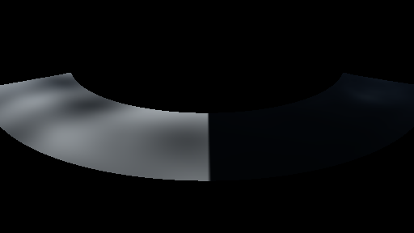
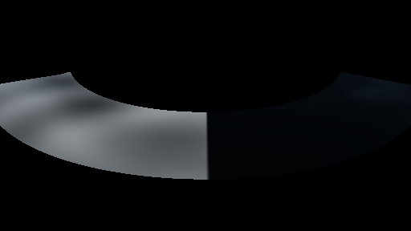

# GPU-PROBE 106b754a — GRÜN

Zweig `laub-kante-3` · Kopf 106b754ad3d07e9d2431e5cfcc7ed9998f0ca809 · Läufer gtx1050-desktop · 19.11. 20:25 · Wanduhr ab Push 718 s · Lauf https://github.com/MiguellD/AnazhRealm/actions/runs/44596160203

Ruf: `gate:post-kette gate:wasser-leben:bild`

## Läufer gtx1050-desktop — GRÜN

GPU NVIDIA GeForce GTX 1050 · npm ci 47 s (package-lock 5b670d1f)
Schloss /c/Users/User/AppData/Local/Temp/claude/gpu-schloss hält „ci-runner 44596160203/1 probe“
- Hook 2026-11-19 20:17:46 start ci-runner 44596160203/1 probe: wartet auf Schloss von 'hand werkbank dorf (Claude)'
- Hook 2026-11-19 20:20:25 start ci-runner 44596160203/1 probe: Schloss genommen (refs/heads/laub-kante-3 106b754ad3d07e9d2431e5cfcc7ed9998f0ca809 ws=C:\actions-runner\_work\AnazhRealm\AnazhRealm)

### gate:post-kette — GRÜN · 46 s · Läufer gtx1050-desktop

Adapter: [linse-gpu] nvidia/pascal

```text
  ✅ Selbsttest „GPU-Validierung im Rauch" → rot: RAUCH: 1 GPU-Validierungs-Fehler: Binding size mismatch
  ✅ Selbsttest „Rauch-Probe bricht ab" → rot: RAUCH: ABBRUCH — TypeError: r._rauchZeichnen is not a function
  ✅ Selbsttest „Rauch-Probe fehlt" → rot: RAUCH: die Probe lief nicht
  ✅ Selbsttest „aus trägt die Farbsicht" → rot: ZUGANG: aus trägt den Knoten der Farbsicht (vp-0611g)
  ✅ Selbsttest „Tritanopie färbt den Himmel" → rot: ZUGANG: tritanopie färbt den Himmel {"himmel":9,"himmelPx":4700,"kiste":90,"kistePx":100}
  ✅ Selbsttest „Zugang blind" → rot: ZUGANG: blind {"himmel":["himmel"],"anTraegt":true,"tritanopie":{"himmel":0,"himmelPx":4700,"kiste":0,"kistePx":100}}
  ✅ Selbsttest „Zugang fehlt" → rot: ZUGANG: lief nicht
✅ SELBSTTEST GRÜN — jeder injizierte Täter fällt rot und wird beim Namen genannt.
  [21 s] Tor-Zielbild DUNKELROT (Wert [0.12,0.012,0.01], Belichtung 20000): Tag [94,8,2] (Farbton 3.9°, Sättigung 0.979) ↔ Nacht [93,8,2] (Farbton 4°, Sättigung 0.978) · Δ 1 je Kanal · MUTANTE-TOR ohne Umkehr [47,4,3] (Sättigung 0.936) · Δ 47
✅ GRÜN — fünf Wege durch die Weiche ohne Fehler (mit der Drift ohne r184s Abschied), der Direktpfad zeichnet mit Tiefe, die Post-Kette ohne Leinwand-Tiefe und ohne Rahmen-Ziel; die Ausgabe tastet unbedingt 9×, 9× nur hinter ihrer Stärke; die Godrays tragen mit der Sonne im Bild (79.07 % der Pixel gegen 0 % Rauschen), ihr Schacht lief 309× mit und 0× ohne Stärke; das Wasser liest das Tiefen-Abbild wie r184s Tiefe ([70.6,76.6,82.5] gegen [70.6,76.6,82.5], ohne Grund [4.5,29.1,43.9]); das Dunkel trägt (Luma 33 bei Belichtung 1, 33 bei 4, die Nacht 8); die Flamme steht vor dem Auge de
```

### gate:wasser-leben:bild — GRÜN · 55 s · Läufer gtx1050-desktop

Adapter: [linse-gpu] nvidia/pascal

```text
  ✅ B8 Weißkappe: Flaute 0.00 % · Wind 0,8 4.21 % der See · B9 Glanz der Zenit-Sonne: frei 37.36 · hinter dem Grat 3.67 (Luma-Mittel der Mitte)
WASSER-LEBEN GRÜN
```






