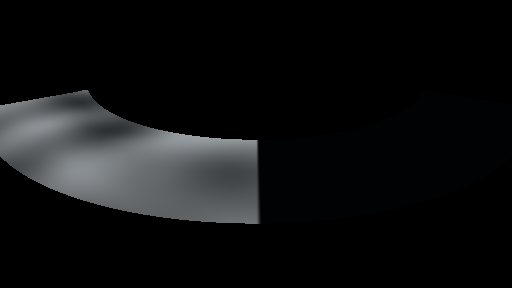
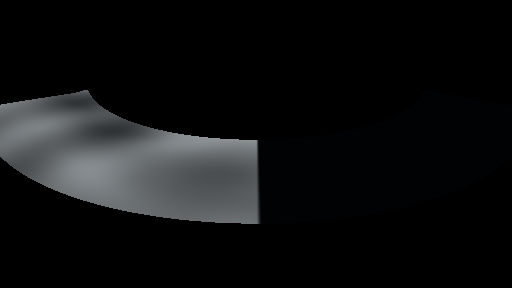
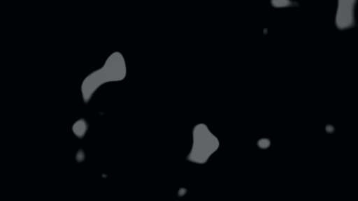

# GPU-PROBE 6b22f2d0 — ROT

Zweig `laub-kante-3` · Kopf 6b22f2d093f348193de44105d3138cd24b1bc3a4 · Läufer radeon-890m · 20.11. 02:07 · Wanduhr ab Push 320 s · Lauf https://github.com/MiguellD/AnazhRealm/actions/runs/44650538085

Ruf: `gate:post-kette gate:wasser-leben:bild`

## Läufer radeon-890m — ROT

GPU AMD Radeon(TM) 890M Graphics · node_modules bleiben (package-lock 20e3f8f6)
Schloss /c/Users/micha/AppData/Local/Temp/claude/gpu-schloss hält „ci-runner 44650538085/1 probe“
- Hook 2026-11-20 02:03:48 start ci-runner 44650538085/1 probe: Schloss genommen (refs/heads/laub-kante-3 6b22f2d093f348193de44105d3138cd24b1bc3a4 ws=C:\actions-runner\_work\AnazhRealm\AnazhRealm)

### gate:post-kette — GRÜN · 63 s · Läufer radeon-890m

Adapter: [linse-gpu] amd/rdna-3

```text
  ✅ Selbsttest „GPU-Validierung im Rauch" → rot: RAUCH: 1 GPU-Validierungs-Fehler: Binding size mismatch
  ✅ Selbsttest „Rauch-Probe bricht ab" → rot: RAUCH: ABBRUCH — TypeError: r._rauchZeichnen is not a function
  ✅ Selbsttest „Rauch-Probe fehlt" → rot: RAUCH: die Probe lief nicht
  ✅ Selbsttest „aus trägt die Farbsicht" → rot: ZUGANG: aus trägt den Knoten der Farbsicht (vp-0611g)
  ✅ Selbsttest „Tritanopie färbt den Himmel" → rot: ZUGANG: tritanopie färbt den Himmel {"himmel":9,"himmelPx":4700,"kiste":90,"kistePx":100}
  ✅ Selbsttest „Zugang blind" → rot: ZUGANG: blind {"himmel":["himmel"],"anTraegt":true,"tritanopie":{"himmel":0,"himmelPx":4700,"kiste":0,"kistePx":100}}
  ✅ Selbsttest „Zugang fehlt" → rot: ZUGANG: lief nicht
✅ SELBSTTEST GRÜN — jeder injizierte Täter fällt rot und wird beim Namen genannt.
  [16 s] Tor-Zielbild DUNKELROT (Wert [0.12,0.012,0.01], Belichtung 20000): Tag [94,8,2] (Farbton 3.9°, Sättigung 0.979) ↔ Nacht [93,8,2] (Farbton 4°, Sättigung 0.978) · Δ 1 je Kanal · MUTANTE-TOR ohne Umkehr [47,4,3] (Sättigung 0.936) · Δ 47
✅ GRÜN — fünf Wege durch die Weiche ohne Fehler (mit der Drift ohne r184s Abschied), der Direktpfad zeichnet mit Tiefe, die Post-Kette ohne Leinwand-Tiefe und ohne Rahmen-Ziel; die Ausgabe tastet unbedingt 9×, 9× nur hinter ihrer Stärke; die Godrays tragen mit der Sonne im Bild (73.34 % der Pixel gegen 0 % Rauschen), ihr Schacht lief 14× mit und 0× ohne Stärke; das Wasser liest das Tiefen-Abbild wie r184s Tiefe ([103.4,106.4,107.8] gegen [103.4,106.4,107.8], ohne Grund [0.9,25.2,33.4]); das Dunkel trägt (Luma 33 bei Belichtung 1, 33 bei 4, die Nacht 8); die Flamme steht vor dem Au
```

### gate:wasser-leben:bild — ROT · 67 s · Läufer radeon-890m

Adapter: [linse-gpu] amd/rdna-3 · WASSER-LEBEN ROT (1):

```text
  ✅ B8 Weißkappe: Flaute 0.00 % · Wind 0,8 4.13 % der See · B9 Glanz der Zenit-Sonne: frei 33.73 · hinter dem Grat 0 (Luma-Mittel der Mitte)
WASSER-LEBEN ROT (1):
  ❌ B4 REGEN: {"litAnteil":0,"schlieren":0,"neigung":0,"lage":{"uhr":0.5,"uLicht":[0,0,0]}}
```







