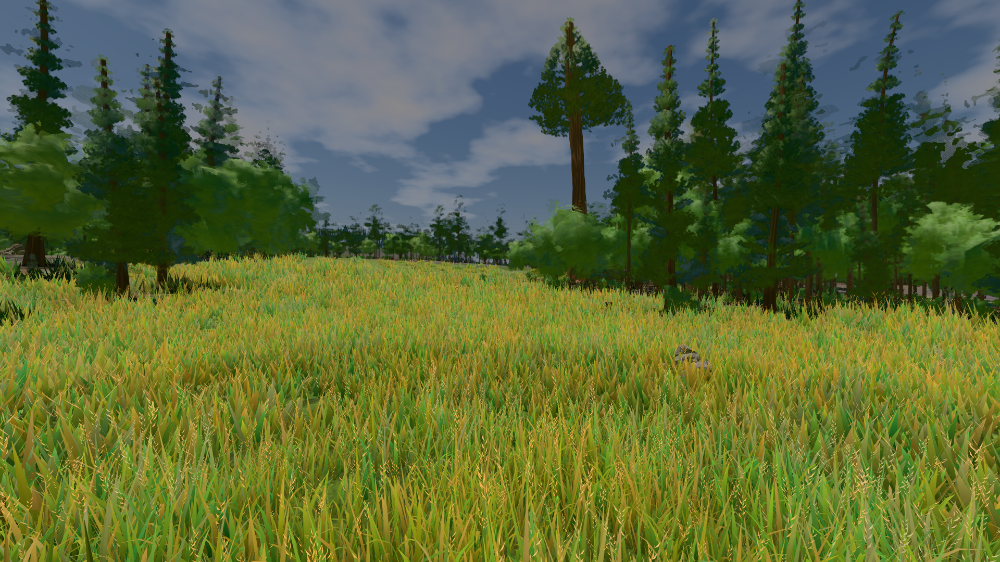

# GPU-PROBE e26a020b — GRÜN

Zweig `laub-kante-5` · Kopf e26a020b2fd6780bb941c5d2f68da3f5d5b38d3f · Läufer radeon-890m · 20.11. 15:22 · Wanduhr ab Push 1549 s · Lauf https://github.com/MiguellD/AnazhRealm/actions/runs/44748723430

Ruf: `bild:wiese@0.5 gate:pruefbuehne-licht gate:weltbild-frost:echt`

## Läufer radeon-890m — GRÜN

GPU AMD Radeon(TM) 890M Graphics · node_modules bleiben (package-lock e5aaa49c)
Schloss /c/Users/micha/AppData/Local/Temp/claude/gpu-schloss hält „ci-runner 44748723430/1 probe“
- Hook 2026-11-20 15:01:46 start ci-runner 44748723430/1 probe: wartet auf Schloss von 'punkte-radeon-sitzungpid=3452'
- Hook 2026-11-20 15:05:54 start ci-runner 44748723430/1 probe: Schloss genommen (refs/heads/laub-kante-5 e26a020b2fd6780bb941c5d2f68da3f5d5b38d3f ws=C:\actions-runner\_work\AnazhRealm\AnazhRealm)

### bild:wiese@0.5 — GRÜN · 68 s · Läufer radeon-890m

Adapter: [linse-gpu] amd/rdna-3

```text
Kamera des Spiels → Blick (10.0 m): -280.40 29.71 -1045.60 -289.61 29.71 -1049.50
 "abnahme": "ABNAHME GRÜN · beweis · Sicht 0.0 % · Ziel Blickziel im Bild frei 10 m · Luma 99.3 σ 35.6 schwarz 0.0 % weiß 0.0 % · Stand 18.546.351 · Bühne summer sunny 0.50 Tiere gehalten · Gerät WebGPU amd rdna-3 · Inhalt nahWiese 48.4 % (≥ 15.0 %) h 107° Luma 123",
```



### gate:pruefbuehne-licht — GRÜN · 54 s · Läufer radeon-890m

Adapter: [linse-gpu] amd/rdna-3

```text
  S0 BODEN-PROGRAMM 1/1: 101568 Zeichen WGSL (Ratsche ≤ 104162) · Pipeline asynchron → GRÜN · kalt 1040 · 804 · 750 · 831 · 884 · 703 · 750 · 929 · 708 ms, Median 804 ms · ÷ K17 derselben Sitzung 0,85 (Auskunft, kein Zeit-Urteil)
✅ S0 BILD GRÜN: die Feuerstelle trägt den Feuerkreis aus 2 m in der Ausgabe · Nacht {"luma":22.3,"schwarz":0} (31 s, amd/rdna-3 · Holz kienspan)
```

### gate:weltbild-frost:echt — GRÜN · 133 s · Läufer radeon-890m

Adapter: [linse-gpu] amd/rdna-3

```text
  ✅ S6 der JS-Speicher fällt mit dem Abschied zurück — 264.5 → 268.5 MB nach 10 Erscheinungen und Abschied (Soll ≤ +20 MB)
  ✅ Nachlauf: kein verspätetes Wort einer Validierung
  ✅ P2 kein writeBuffer schief: der Pfad und ein Index ungerader Länge der Ich-Bühne — 281788 writeBuffer, keiner schief
  ✅ T1 die Index-Wache nennt den Index über der Vertex-Zahl beim Namen — Vendor- und Storage-Index — gezeichnet nach 70 Bildern · Scene/frost-taeter-bereich: Index 3 ≥ 3 Vertices im gezeichneten Bereich | Scene/frost-taeter-speicher: Index 3 ≥ 3 Vertices im gezeichneten Bereich
  ✅ T3 die Puffer-Wache nennt den schiefen writeBuffer beim Namen, WebGPU wirft — frost-taeter-puffer · Uint16Array · Versatz 0 · 6 B · q.writeBuffer (stamm/dirigent-ankunft.js:253:36) < pptr:;page.%3Ccomputed%3E%20(C%3A%5Cactions-runner%5C_work%5CAnazhRealm%5Cgpu-probe%5Cscripts%5Clib%5Cwelt-boot.cjs%3A1027%3A22):6:23 · geworfen: Failed to execute 'writeBuffer' on 'GPUQueue': Number of bytes to write must be a multiple of 4
  ✅ T2 die Index-Wache nennt den geweiteten Index beim Pfad — Group/BundleGroup/Group/mensch/torso/head/Mesh: 7962 × Uint32Array = 31848 B gebunden, der Puffer trägt 15924 B
  ✅ T2 die GPU-Wache des Spiels zählt die Validierung — {"n":222}
  ✅ T2 der eigene Hörer hört die Validierung (Device oder r184-Fehler-Bereich) — 443 Meldungen: device 0: Index range (first: 0, count: 7962, format: IndexFormat::Uint32) does not fit in index buffer size (15924). | device 0: [Invalid RenderBundle from RenderBundleEncoder "renderBundleEncoder"] is invalid due to a previous error.
  ✅ T2 die Bild-Probe erkennt das stehende Bild — 0.00 % der Blöcke bewegt
✅ GRÜN — DIE FROST-WAND steht — durch Werkstatt, Ich- und Hof-Bühne trägt jeder Index-Puffer der Welt-GPU sein Format, kein Device meldet, das Bild folgt der Kamera; die Täter (Index über der Vertex-Zahl, ein fremd geweiteter Mensch-Index) nennen die Wachen beim Namen, und das stehende Bild wird erkannt.
```
