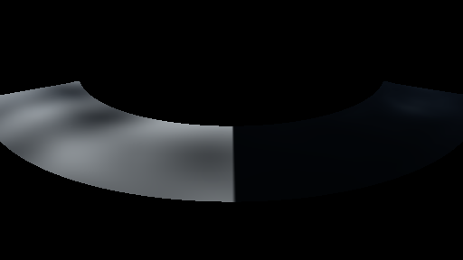
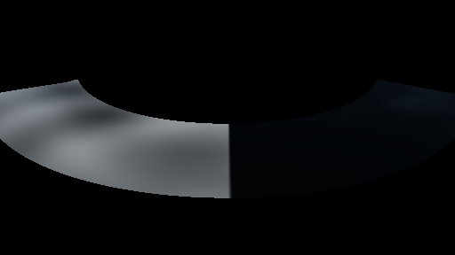

# GPU-PROBE 4719f3fb — GRÜN

Zweig `licht-eine-skala` · Kopf 4719f3fb8ed92d9cbde68ec1c1b135ae620af067 · Läufer omen-gtx1060 · 19.11. 17:21 · Wanduhr ab Push 288 s · Lauf https://github.com/MiguellD/AnazhRealm/actions/runs/44564195747

Ruf: `gate:wasser-leben:bild`

## Läufer omen-gtx1060 — GRÜN

GPU NVIDIA GeForce GTX 1060 · node_modules bleiben (package-lock b38d03a8)
Schloss /c/Users/micha/AppData/Local/Temp/claude/gpu-schloss hält „ci-runner 44564195747/1 probe“
- Hook 2026-11-19 17:18:11 start ci-runner 44564195747/1 probe: wartet auf Schloss von 'omen-punkte-gtx-sitzung'
- Hook 2026-11-19 17:18:56 start ci-runner 44564195747/1 probe: Schloss genommen (refs/heads/licht-eine-skala 4719f3fb8ed92d9cbde68ec1c1b135ae620af067 ws=C:\actions-runner\_work\AnazhRealm\AnazhRealm)

### gate:wasser-leben:bild — GRÜN · 49 s · Läufer omen-gtx1060

Adapter: [linse-gpu] nvidia/pascal

```text
  ✅ B8 Weißkappe: Flaute 0.00 % · Wind 0,8 4.21 % der See · B9 Glanz der Zenit-Sonne: frei 37.36 · hinter dem Grat 3.67 (Luma-Mittel der Mitte)
WASSER-LEBEN GRÜN
```






