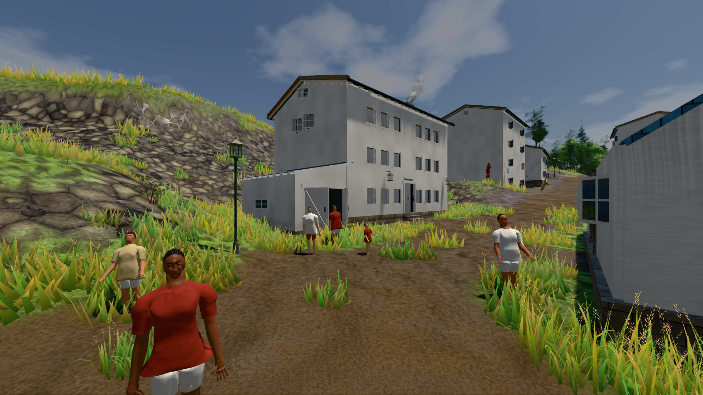
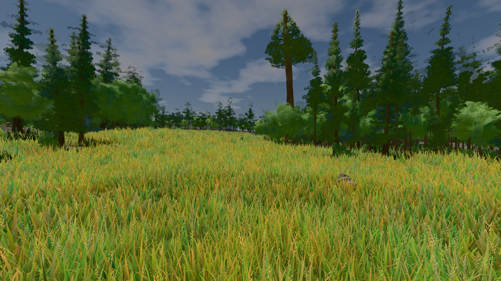

# GPU-PROBE 04d2d455 — GRÜN

Zweig `licht-stetig` · Kopf 04d2d455b7306d0d8991199fe4abd160f83cfba0 · Läufer omen-gtx1060 · 24.11. 06:49 · Wanduhr ab Push 1133 s · Lauf https://github.com/MiguellD/AnazhRealm/actions/runs/45333757460

Ruf: `gate:tag-achse:echt gate:pruefbuehne-licht bild:dorf@0.5 bild:wiese@0.5 gate:webgl-probe`

## Läufer omen-gtx1060 — GRÜN

GPU NVIDIA GeForce GTX 1060 · npm ci 36 s (package-lock 12b68ea2)
Schloss /c/Users/micha/AppData/Local/Temp/claude/gpu-schloss hält „ci-runner 45333757460/1 probe“
- Hook 2026-11-24 06:35:30 start ci-runner 45333757460/1 probe: Schloss genommen (refs/heads/licht-stetig 04d2d455b7306d0d8991199fe4abd160f83cfba0 ws=C:\actions-runner\_work\AnazhRealm\AnazhRealm)

### gate:tag-achse:echt — GRÜN · 149 s · Läufer omen-gtx1060

Adapter: ungenannt (die Probe nannte keinen Browser-Adapter)

```text
TAG genesis GRUEN: Karte 127.6 · Sprung -0.10 (Uhr 0.722) · Buckel 0.00 (Uhr 0) · Sonne 10° -0.97 EV R/B ×0.91 | -0.82 EV R/B ×1.04 · Nacht -1.82 EV Luma 52 · REF 1.42 (Uhr 0.202) · Sicht -0.05 (Uhr 0.5) · ASYNC 0.02 (Uhr 0.8) nach 3 Bildern (Mutant 11) · sofort 1.24 (Uhr 0.33) EV · nur die Wand (--kurz)
TAG wiese GRUEN: Karte 125.4 · Sprung -0.09 (Uhr 0.766) · Buckel 0.00 (Uhr 0) · Sonne 10° -1.16 EV R/B ×2.29 | -1.47 EV R/B ×0.87 · Nacht -3.39 EV Luma 35.3 · REF -0.25 (Uhr 0.72) · Sicht -0.06 (Uhr 0.27) · ASYNC 0.01 (Uhr 0.8) nach 3 Bildern (Mutant 9) · sofort -0.69 (Uhr 0.72) EV · nur die Wand (--kurz)
TAG-ACHSE GRUEN
```

### gate:pruefbuehne-licht — GRÜN · 65 s · Läufer omen-gtx1060

Adapter: [linse-gpu] nvidia/pascal

```text
  S0 BODEN-PROGRAMM 1/1: 103347 Zeichen WGSL (Ratsche ≤ 104162) · Pipeline asynchron → GRÜN · kalt 1732 · 1251 · 1287 · 1537 · 1569 · 1523 · 1153 · 1140 · 1158 ms, Median 1287 ms · ÷ K17 derselben Sitzung 0,75 (Auskunft, kein Zeit-Urteil)
✅ S0 BILD GRÜN: die Feuerstelle trägt den Feuerkreis aus 2 m in der Ausgabe · Nacht {"luma":21.8,"schwarz":0,"gesetz":22.76} (52 s, nvidia/pascal · Holz kienspan)
```

### bild:dorf@0.5 — GRÜN · 94 s · Läufer omen-gtx1060

Adapter: [linse-gpu] nvidia/pascal

```text
Kamera des Spiels → Blick (12.9 m): -715.86 49.01 -932.69 -702.99 49.01 -931.86
 "abnahme": "ABNAHME GRÜN · beweis · Sicht 0.0 % · Leib im Vordergrund 4.0 % (Leib bewohner 4.0 %) · Leiber näher als 6 m: 1 von 1 ganz (7 Teile) · Ziel Blickziel im Bild frei 12.9 m · Luma 94.3 σ 30.4 schwarz 0.1 % weiß 0.0 % · Stand 18.546.392 · Bühne summer sunny 0.50 Tiere gehalten · Gerät WebGPU nvidia pascal · Inhalt bauSatz 20.2 % (≥ 2.0 %) Luma 95",
```



### bild:wiese@0.5 — GRÜN · 59 s · Läufer omen-gtx1060

Adapter: [linse-gpu] nvidia/pascal

```text
Kamera des Spiels → Blick (10.0 m): -280.40 29.71 -1045.60 -289.61 29.71 -1049.50
 "abnahme": "ABNAHME GRÜN · beweis · Sicht 0.0 % · Ziel Blickziel im Bild frei 10 m · Luma 99.2 σ 35.5 schwarz 0.0 % weiß 0.0 % · Stand 18.546.392 · Bühne summer sunny 0.50 Tiere gehalten · Gerät WebGPU nvidia pascal · Inhalt nahWiese 48.5 % (≥ 15.0 %) h 107° Luma 123",
```



### gate:webgl-probe — GRÜN · 60 s · Läufer omen-gtx1060

Adapter: [linse-gpu] webgl2/NVIDIA GeForce GTX 1060 (0x00001C60) Direct3D11 vs_5_0 ps_5_0

```text
✅ GRÜN — die Kein-WebGPU-Geschichte ist BEWIESEN: der erzwungene WebGL2-Rückfall bootet eine LEBENDE, sichtbare Welt; die WGSL-Konsumenten + Bundles ruhen hinter der EINEN Backend-Wand, der Rückfall ist LAUT benannt, der Fern-Ring trägt auf CPU.
```
