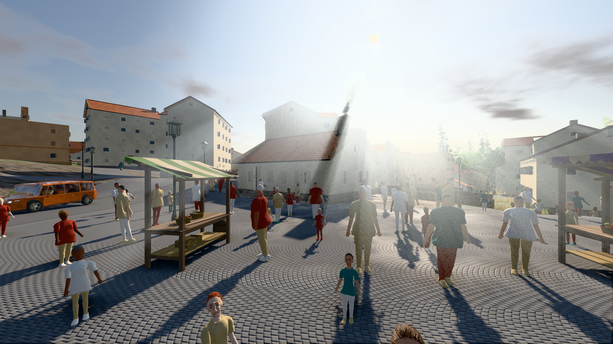

# GPU-PROBE 104df2e5 — GRÜN

Zweig `menge-bild` · Kopf 104df2e5f2ed2103e0fa5779b55d6b6886543226 · Läufer omen-gtx1060 · 25.11. 07:05 · Wanduhr ab Push 1018 s · Lauf https://github.com/MiguellD/AnazhRealm/actions/runs/45556117744

Ruf: `bild:stadt-voll@0.333 gate:kamera-leib:echt gate:webgl-probe`

## Läufer omen-gtx1060 — GRÜN

GPU NVIDIA GeForce GTX 1060 · npm ci 67 s (package-lock 21312b79)
Schloss /c/Users/micha/AppData/Local/Temp/claude/gpu-schloss hält „ci-runner 45556117744/1 probe“
- Hook 2026-11-25 06:48:55 start ci-runner 45556117744/1 probe: wartet auf Schloss von 'omen-punkte-gtx-sitzung'
- Hook 2026-11-25 06:58:52 start ci-runner 45556117744/1 probe: Schloss genommen (refs/heads/menge-bild 104df2e5f2ed2103e0fa5779b55d6b6886543226 ws=C:\actions-runner\_work\AnazhRealm\AnazhRealm)

### bild:stadt-voll@0.333 — GRÜN · 168 s · Läufer omen-gtx1060

Adapter: [linse-gpu] nvidia/pascal

```text
Kamera des Spiels → Blick (15.0 m): 842.49 57.57 451.79 857.26 57.57 449.21
 "abnahme": "ABNAHME GRÜN · beweis · Sicht 0.0 % · Leib im Vordergrund 4.7 % (Leib bewohner 4.7 %) · Leiber näher als 6 m: 3 von 3 ganz (15 Teile) · Ziel Blickziel im Bild frei 14.99 m · Luma 149.8 σ 68.3 schwarz 0.0 % weiß 1.9 % · Stand 18.546.411 · Bühne summer sunny 0.33 Tiere gehalten · Gerät WebGPU nvidia pascal · Inhalt bauSatz 19.3 % (≥ 2.0 %) Luma 148, bewohner 7.9 % (≥ 1.0 %) Luma 111",
```



### gate:kamera-leib:echt — GRÜN · 74 s · Läufer omen-gtx1060

Adapter: [linse-gpu] nvidia/pascal

```text
  ✅ K6 Strafe am Prüfplatz — A0 Kopf 0.8 % Leib 0.5 % (2368 px),A1 Kopf 0.0 % Leib 0.6 % (2495 px),A2 Kopf 0.0 % Leib 0.8 % (2580 px),A3 Kopf 0.0 % Leib 1.1 % (2527 px),D0 Kopf 0.0 % Leib 0.6 % (2311 px),D1 Kopf 0.0 % Leib 0.4 % (2355 px),D2 Kopf 1.5 % Leib 0.5 % (2502 px),D3 Kopf 0.0 % Leib 0.9 % (2496 px) · Rückstrahl 0.1 %
✅ GRÜN — die Kamera steckt nie in Laub, Strauch, Fels oder Boden.
```

### gate:webgl-probe — GRÜN · 51 s · Läufer omen-gtx1060

Adapter: [linse-gpu] webgl2/NVIDIA GeForce GTX 1060 (0x00001C60) Direct3D11 vs_5_0 ps_5_0

```text
✅ GRÜN — die Kein-WebGPU-Geschichte ist BEWIESEN: der erzwungene WebGL2-Rückfall bootet eine LEBENDE, sichtbare Welt; die WGSL-Konsumenten + Bundles ruhen hinter der EINEN Backend-Wand, der Rückfall ist LAUT benannt, der Fern-Ring trägt auf CPU.
```
