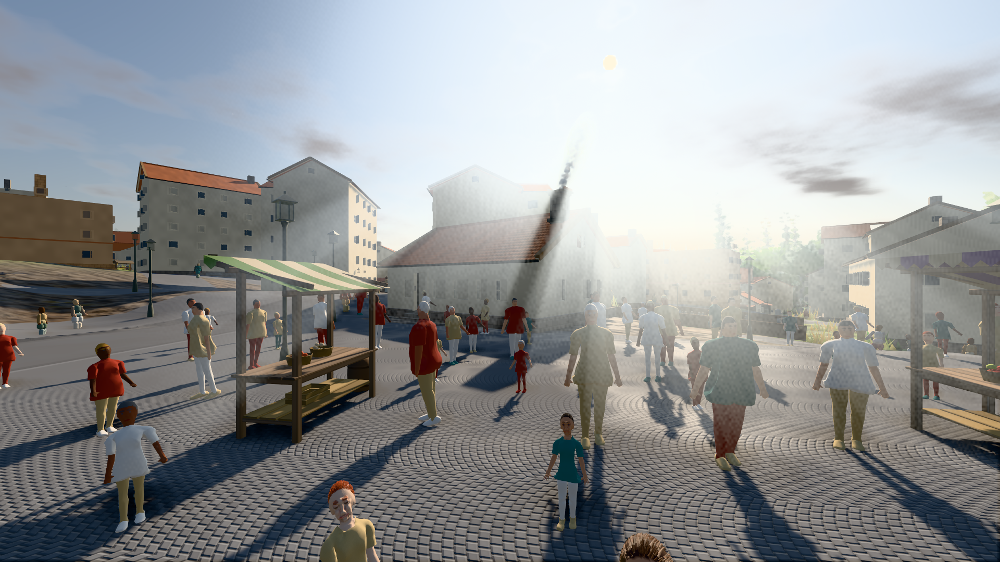

# GPU-PROBE 14862ad1 — GRÜN

Zweig `menge-bild` · Kopf 14862ad10573d4dc27c0f864134b14524b401b48 · Läufer omen-gtx1060 · 25.11. 07:31 · Wanduhr ab Push 451 s · Lauf https://github.com/MiguellD/AnazhRealm/actions/runs/45560343644

Ruf: `bild:stadt-voll@0.333 gate:kamera-leib:echt gate:webgl-probe`

## Läufer omen-gtx1060 — GRÜN

GPU NVIDIA GeForce GTX 1060 · node_modules bleiben (package-lock 21312b79)
Schloss /c/Users/micha/AppData/Local/Temp/claude/gpu-schloss hält „ci-runner 45560343644/1 probe“
- Hook 2026-11-25 07:24:38 start ci-runner 45560343644/1 probe: Schloss genommen (refs/heads/menge-bild 14862ad10573d4dc27c0f864134b14524b401b48 ws=C:\actions-runner\_work\AnazhRealm\AnazhRealm)

### bild:stadt-voll@0.333 — GRÜN · 184 s · Läufer omen-gtx1060

Adapter: [linse-gpu] nvidia/pascal

```text
Kamera des Spiels → Blick (15.0 m): 842.49 57.57 451.79 857.26 57.57 449.21
 "abnahme": "ABNAHME GRÜN · beweis · Sicht 0.0 % · Leib im Vordergrund 4.3 % (Leib bewohner 4.3 %) · Leiber näher als 6 m: 3 von 3 ganz (15 Teile) · Ziel Blickziel im Bild frei 14.99 m · Luma 151.2 σ 68.2 schwarz 0.0 % weiß 2.0 % · Stand 18.546.411 · Bühne summer sunny 0.33 Tiere gehalten · Gerät WebGPU nvidia pascal · Inhalt bauSatz 19.3 % (≥ 2.0 %) Luma 151, bewohner 7.8 % (≥ 1.0 %) Luma 115",
```



### gate:kamera-leib:echt — GRÜN · 79 s · Läufer omen-gtx1060

Adapter: [linse-gpu] nvidia/pascal

```text
  ✅ K6 Strafe am Prüfplatz — A0 Kopf 4.3 % Leib 0.9 % (2352 px),A1 Kopf 0.0 % Leib 0.1 % (2272 px),A2 Kopf 0.0 % Leib 1.5 % (2509 px),A3 Kopf 0.0 % Leib 0.2 % (2454 px),D0 Kopf 0.0 % Leib 0.4 % (2298 px),D1 Kopf 0.0 % Leib 0.3 % (2358 px),D2 Kopf 0.0 % Leib 0.3 % (2490 px),D3 Kopf 0.0 % Leib 1.0 % (2497 px) · Rückstrahl 0.1 %
✅ GRÜN — die Kamera steckt nie in Laub, Strauch, Fels oder Boden.
```

### gate:webgl-probe — GRÜN · 52 s · Läufer omen-gtx1060

Adapter: [linse-gpu] webgl2/NVIDIA GeForce GTX 1060 (0x00001C60) Direct3D11 vs_5_0 ps_5_0

```text
✅ GRÜN — die Kein-WebGPU-Geschichte ist BEWIESEN: der erzwungene WebGL2-Rückfall bootet eine LEBENDE, sichtbare Welt; die WGSL-Konsumenten + Bundles ruhen hinter der EINEN Backend-Wand, der Rückfall ist LAUT benannt, der Fern-Ring trägt auf CPU.
```
