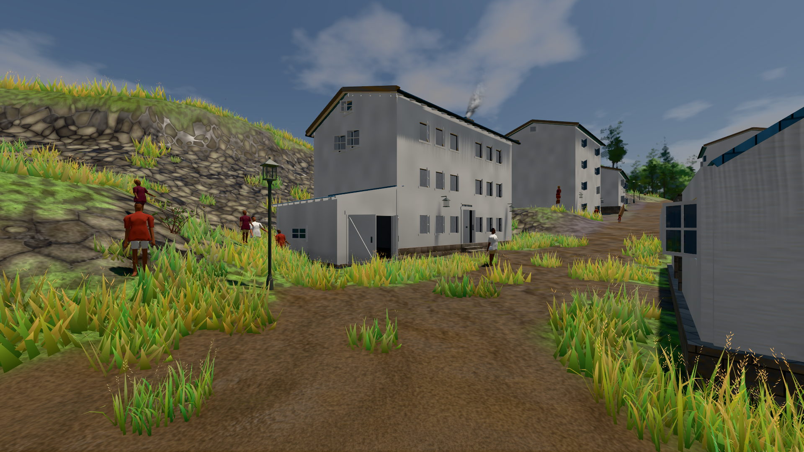

# GPU-PROBE 17f4e300 — GRÜN

Zweig `mensch-nah` · Kopf 17f4e3003ed298dfd0810bf10d7c7e87b6468c83 · Läufer omen-gtx1060 · 24.11. 08:45 · Wanduhr ab Push 451 s · Lauf https://github.com/MiguellD/AnazhRealm/actions/runs/45349442547

Ruf: `bild:dorf@0.5 gate:webgl-probe`

## Läufer omen-gtx1060 — GRÜN

GPU NVIDIA GeForce GTX 1060 · node_modules bleiben (package-lock 824358c7)
Schloss /c/Users/micha/AppData/Local/Temp/claude/gpu-schloss hält „ci-runner 45349442547/1 probe“
- Hook 2026-11-24 08:39:06 start ci-runner 45349442547/1 probe: Schloss genommen (refs/heads/mensch-nah 17f4e3003ed298dfd0810bf10d7c7e87b6468c83 ws=C:\actions-runner\_work\AnazhRealm\AnazhRealm)

### bild:dorf@0.5 — GRÜN · 87 s · Läufer omen-gtx1060

Adapter: [linse-gpu] nvidia/pascal

```text
Kamera des Spiels → Blick (12.9 m): -715.86 49.01 -932.69 -702.99 49.01 -931.86
 "abnahme": "ABNAHME GRÜN · beweis · Sicht 0.0 % · Ziel Blickziel im Bild frei 12.9 m · Luma 94.6 σ 28.8 schwarz 0.1 % weiß 0.0 % · Stand 18.546.396 · Bühne summer sunny 0.50 Tiere gehalten · Gerät WebGPU nvidia pascal · Inhalt bauSatz 20.3 % (≥ 2.0 %) Luma 94",
```



### gate:webgl-probe — GRÜN · 49 s · Läufer omen-gtx1060

Adapter: [linse-gpu] webgl2/NVIDIA GeForce GTX 1060 (0x00001C60) Direct3D11 vs_5_0 ps_5_0

```text
✅ GRÜN — die Kein-WebGPU-Geschichte ist BEWIESEN: der erzwungene WebGL2-Rückfall bootet eine LEBENDE, sichtbare Welt; die WGSL-Konsumenten + Bundles ruhen hinter der EINEN Backend-Wand, der Rückfall ist LAUT benannt, der Fern-Ring trägt auf CPU.
```
