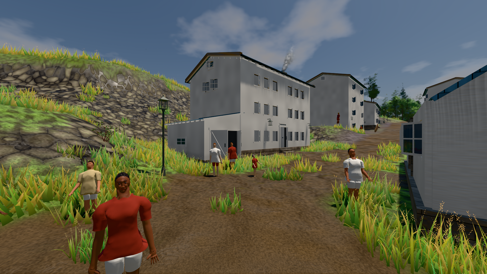

# GPU-PROBE 2527193d — GRÜN

Zweig `mensch-nah` · Kopf 2527193d90bc3445712661101019c28b764fd28a · Läufer omen-gtx1060 · 24.11. 08:18 · Wanduhr ab Push 1468 s · Lauf https://github.com/MiguellD/AnazhRealm/actions/runs/45343862125

Ruf: `bild:dorf@0.5 gate:webgl-probe`

## Läufer omen-gtx1060 — GRÜN

GPU NVIDIA GeForce GTX 1060 · npm ci 55 s (package-lock 1f0136ee)
Schloss /c/Users/micha/AppData/Local/Temp/claude/gpu-schloss hält „ci-runner 45343862125/1 probe“
- Hook 2026-11-24 07:58:52 start ci-runner 45343862125/1 probe: wartet auf Schloss von 'omen-punkte-gtx-sitzung'
- Hook 2026-11-24 08:04:55 start ci-runner 45343862125/1 probe: Schloss genommen (refs/heads/mensch-nah 2527193d90bc3445712661101019c28b764fd28a ws=C:\actions-runner\_work\AnazhRealm\AnazhRealm)

### bild:dorf@0.5 — GRÜN · 87 s · Läufer omen-gtx1060

Adapter: [linse-gpu] nvidia/pascal

```text
Kamera des Spiels → Blick (12.9 m): -715.86 49.01 -932.69 -702.99 49.01 -931.86
 "abnahme": "ABNAHME GRÜN · beweis · Sicht 0.0 % · Leib im Vordergrund 4.0 % (Leib bewohner 4.0 %) · Leiber näher als 6 m: 1 von 1 ganz (7 Teile) · Ziel Blickziel im Bild frei 12.9 m · Luma 94.3 σ 30.4 schwarz 0.1 % weiß 0.0 % · Stand 18.546.394 · Bühne summer sunny 0.50 Tiere gehalten · Gerät WebGPU nvidia pascal · Inhalt bauSatz 20.2 % (≥ 2.0 %) Luma 95",
```



### gate:webgl-probe — GRÜN · 54 s · Läufer omen-gtx1060

Adapter: [linse-gpu] webgl2/NVIDIA GeForce GTX 1060 (0x00001C60) Direct3D11 vs_5_0 ps_5_0

```text
✅ GRÜN — die Kein-WebGPU-Geschichte ist BEWIESEN: der erzwungene WebGL2-Rückfall bootet eine LEBENDE, sichtbare Welt; die WGSL-Konsumenten + Bundles ruhen hinter der EINEN Backend-Wand, der Rückfall ist LAUT benannt, der Fern-Ring trägt auf CPU.
```
