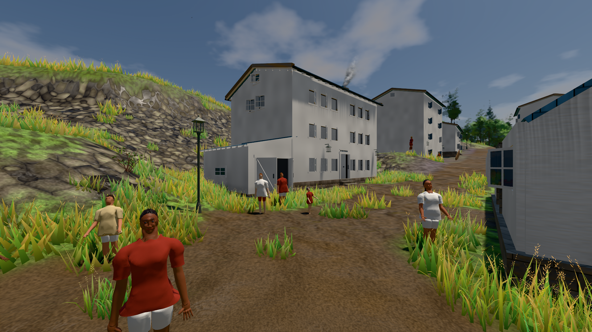

# GPU-PROBE bb7c53c9 — GRÜN

Zweig `mensch-nah` · Kopf bb7c53c9f03a97715d600fd05ab938b00362a074 · Läufer radeon-890m · 24.11. 06:03 · Wanduhr ab Push 395 s · Lauf https://github.com/MiguellD/AnazhRealm/actions/runs/45329877523

Ruf: `bild:dorf@0.5 gate:webgl-probe`

## Läufer radeon-890m — GRÜN

GPU AMD Radeon(TM) 890M Graphics · npm ci 61 s (package-lock 0e22d7b0)
Schloss /c/Users/micha/AppData/Local/Temp/claude/gpu-schloss hält „ci-runner 45329877523/1 probe“
- Hook 2026-11-24 05:57:45 start ci-runner 45329877523/1 probe: Schloss genommen (refs/heads/mensch-nah bb7c53c9f03a97715d600fd05ab938b00362a074 ws=C:\actions-runner\_work\AnazhRealm\AnazhRealm)

### bild:dorf@0.5 — GRÜN · 80 s · Läufer radeon-890m

Adapter: [linse-gpu] amd/rdna-3

```text
Kamera des Spiels → Blick (12.9 m): -715.86 49.01 -932.69 -702.99 49.01 -931.86
 "abnahme": "ABNAHME GRÜN · beweis · Sicht 0.0 % · Leib im Vordergrund 3.8 % (Leib bewohner 3.8 %) · Leiber näher als 6 m: 1 von 1 ganz (7 Teile) · Ziel Blickziel im Bild frei 12.9 m · Luma 94.4 σ 30.3 schwarz 0.1 % weiß 0.0 % · Stand 18.546.391 · Bühne summer sunny 0.50 Tiere gehalten · Gerät WebGPU amd rdna-3 · Inhalt bauSatz 20.2 % (≥ 2.0 %) Luma 95",
```



### gate:webgl-probe — GRÜN · 39 s · Läufer radeon-890m

Adapter: [linse-gpu] webgl2/AMD Radeon(TM) 890M Graphics (0x0000150E) Direct3D11 vs_5_0 ps_5_0

```text
✅ GRÜN — die Kein-WebGPU-Geschichte ist BEWIESEN: der erzwungene WebGL2-Rückfall bootet eine LEBENDE, sichtbare Welt; die WGSL-Konsumenten + Bundles ruhen hinter der EINEN Backend-Wand, der Rückfall ist LAUT benannt, der Fern-Ring trägt auf CPU.
```
