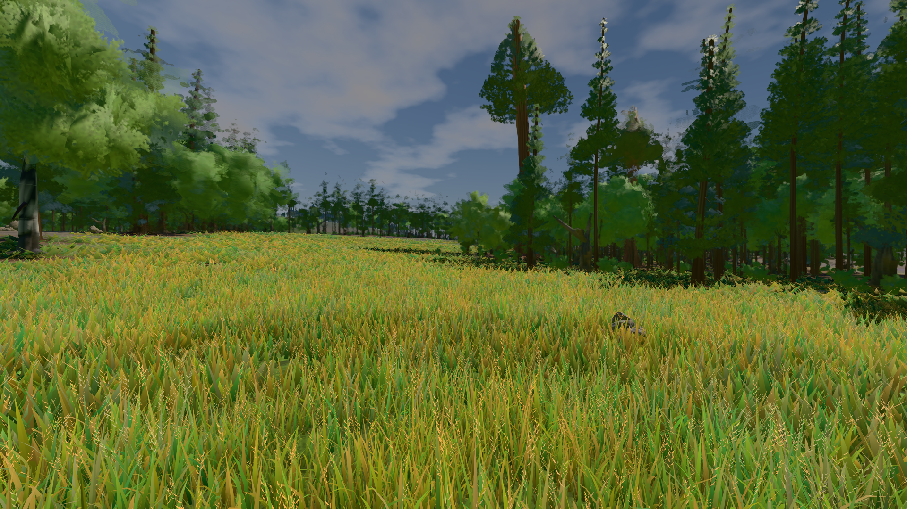

# GPU-PROBE 3ed41fa9 — ROT

Zweig `mischwald` · Kopf 3ed41fa91e3a14e81c65ec9d11e84c247a0c135f · Läufer gtx1050-desktop · 25.11. 18:11 · Wanduhr ab Push 2023 s · Lauf https://github.com/MiguellD/AnazhRealm/actions/runs/45655900973

Ruf: `bild:wiese gate:fernwald gate:webgl-probe`

## Läufer gtx1050-desktop — ROT

GPU NVIDIA GeForce GTX 1050 · node_modules bleiben (package-lock 61bdb59d)
Schloss /c/Users/User/AppData/Local/Temp/claude/gpu-schloss hält „ci-runner 45655900973/1 probe“
- Hook 2026-11-25 17:58:24 start ci-runner 45655900973/1 probe: Schloss genommen (refs/heads/mischwald 3ed41fa91e3a14e81c65ec9d11e84c247a0c135f ws=C:\actions-runner\_work\AnazhRealm\AnazhRealm)

### bild:wiese — GRÜN · 110 s · Läufer gtx1050-desktop

Adapter: [linse-gpu] nvidia/pascal

```text
Kamera des Spiels → Blick (10.0 m): -280.40 29.71 -1045.60 -289.61 29.71 -1049.50
 "abnahme": "ABNAHME GRÜN · beweis · Sicht 0.0 % · Ziel Blickziel im Bild frei 10 m · Luma 97.5 σ 36.5 schwarz 0.0 % weiß 0.0 % · Stand 18.546.419 · Bühne summer sunny 0.50 Tiere gehalten · Gerät WebGPU nvidia pascal · Inhalt nahWiese 48.4 % (≥ 15.0 %) h 107° Luma 119",
```



### gate:fernwald — ROT · 170 s · Läufer gtx1050-desktop

Adapter: ungenannt (die Probe nannte keinen Browser-Adapter) · ❌ D2 RIESE — Sichthöhe 110 m · im Band 165 m L1+L2 · jenseits 330 m L2 voll · zurück 165 m L2 voll · Takte ohne Gestalt 0/158

```text
  ✅ SELBSTTEST 5 (ein Haus ohne Grundriss macht F rot)
  ✅ H WALDMANTEL (die Krone folgt dem Seitenlicht) — 40 Rand-Bäume (13 am Trauf, mit Nachbarn), 24 im Innern · Kronen-Fuß der Trauf-Gestalt 0.101 H
  ✅ SELBSTTEST 9 (jeder Nachbar macht Bestand — H nennt den Rand-Baum mit kahlem Stamm) — 40 Rand-Bäume (13 am Trauf, mit Nachbarn), 24 im Innern · Täter (13): Rand-Baum mit kahlem Stamm zur offenen Seite: Eiche (-2123, -2153), 1 Nachbarn, Lücke 360°, Gestalt 2 statt 3 | Rand-Baum mit kahlem Stamm zur offenen Seite: Eiche (-1973, -2153), 1 Nachbarn, Lücke 360°, Gestalt 2 statt 3 | Rand-Baum mit kahlem Stamm zur offenen Seite: Eiche (-2123, -2123), 2 Nachbarn, Lücke 305°, Gestalt 2 statt 3
  ✅ SELBSTTEST 4 (ein Gedächtnis mit gekippter Gestalt macht E rot)
  ✅ G GEBURT (die Karte tritt an ihrem Rand ein und blendet in Takten ein) — Laub-Rand 240 m, 40 m Gang: 183 Eintritte im Saum, höchstens 39 je Schritt, Blende 0
  ✅ SELBSTTEST 6 (der Eintritt am Karten-Horizont macht G rot) — Laub-Rand 240 m, 40 m Gang: 404 Eintritte im Saum, höchstens 161 je Schritt · Täter: baum_birke 264 m, Rand 209, Stempel 2000 | baum_tanne 243 m, Rand 213, Stempel 1999 | grown_busch_hazel_v0 243 m, Rand 210, Stempel 1999 | baum_totholz 252 m, Rand 223, Stempel 2000 | grown_busch_hazel_v1 296 m, Rand 230, Stempel 2000 | grown_busch_hazel_v1 267 m, Rand 228, Stempel 2000
  ✅ SELBSTTEST 7 (eine Karte ohne Blende macht G rot) — baum_totholz 234 m, Rand 235, Stempel 0
  ✅ SELBSTTEST 8 (ein Ding verlässt den Bestand, seine Instanz bleibt — C nennt es „gegangen, aber gezeichnet“) — baum_tanne @ 450 m (Slots 1852/4929 1852/4929): gezeichnet true
  ✅ T keine Ausnahme im Spiel-Takt
❌ ROT — D2 RIESE
```

### gate:webgl-probe — GRÜN · 147 s · Läufer gtx1050-desktop

Adapter: [linse-gpu] webgl2/NVIDIA GeForce GTX 1050 (0x00001C81) Direct3D11 vs_5_0 ps_5_0

```text
[stall-akte] Stderr [4916:5816:1125/180416.818:ERROR:google_apis\gcm\engine\mcs_client.cc:702]   Error code: 401  Error message: Authentication Failed: wrong_secret
✅ GRÜN — die Kein-WebGPU-Geschichte ist BEWIESEN: der erzwungene WebGL2-Rückfall bootet eine LEBENDE, sichtbare Welt; die WGSL-Konsumenten + Bundles ruhen hinter der EINEN Backend-Wand, der Rückfall ist LAUT benannt, der Fern-Ring trägt auf CPU.
```
