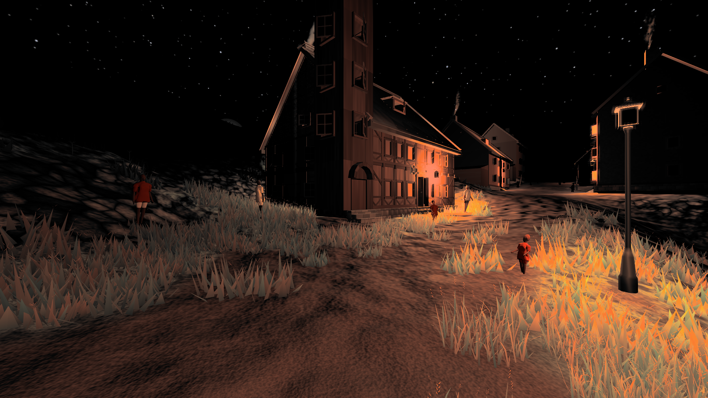

# GPU-PROBE 69e777d7 — GRÜN

Zweig `nacht-fenster-glas` · Kopf 69e777d7b133fb416ba58832ad25314a682c9e75 · Läufer gtx1050-desktop · 27.11. 05:41 · Wanduhr ab Push 1126 s · Lauf https://github.com/MiguellD/AnazhRealm/actions/runs/45939563933

Ruf: `gate:studio-begehen bild:dorf@0 gate:webgl-probe`

## Läufer gtx1050-desktop — GRÜN

GPU NVIDIA GeForce GTX 1050 · npm ci 63 s (package-lock 90c059e7)
Schloss /c/Users/User/AppData/Local/Temp/claude/gpu-schloss hält „ci-runner 45939563933/1 probe“
- Hook 2026-11-27 05:22:52 start ci-runner 45939563933/1 probe: Schloss genommen (refs/heads/nacht-fenster-glas 69e777d7b133fb416ba58832ad25314a682c9e75 ws=C:\actions-runner\_work\AnazhRealm\AnazhRealm)

### gate:studio-begehen — GRÜN · 559 s · Läufer gtx1050-desktop

Adapter: [linse-gpu] nvidia/pascal

```text
  ✅ Selbsttest „ruecken" macht B3 Speicher rot — B3 Speicher: 2 Häuser mit Dachraum ohne Speicherlauf, obwohl am First Kopfraum steht (#0 635014 provenzalisch/kirche Speicher zu: First 2.68 m, Stufe 0.2 m, Stehraum 3.21 m · #2 723323 provenzalisch/pfarrhaus Speicher zu: First 2.80 m, Stufe 0.2 m, Stehraum 3.54 m)
[stall-akte] Stderr [11136:15704:1127/052726.311:ERROR:services\on_device_model\public\cpp\service_client.cc:37] Unexpected on_device_model service disconnect; reason: 1, description: Error loading backend.
[stall-akte] Stderr [11136:16752:1127/052856.819:ERROR:components\system_cpu\cpu_probe_win.cc:134] PdhGetFormattedCounterValue failed: Error (0x3AFC) while retrieving error. (0x800007D6)
  ✅ Selbsttest „platte" macht B4 Keller-Decke rot — B4 Keller-Decke = Boden-Platte in 7 von 8
[stall-akte] Stderr [11136:15704:1127/052726.311:ERROR:services\on_device_model\public\cpp\service_client.cc:37] Unexpected on_device_model service disconnect; reason: 1, description: Error loading backend.
[stall-akte] Stderr [11136:16752:1127/052856.819:ERROR:components\system_cpu\cpu_probe_win.cc:134] PdhGetFormattedCounterValue failed: Error (0x3AFC) while retrieving error. (0x800007D6)
  ✅ Selbsttest „flach" macht B5 Weltgrund rot — B5 Weltgrund: die Häuser stehen eben (Spanne 0 m)
[stall-akte] Stderr [11136:15704:1127/052726.311:ERROR:services\on_device_model\public\cpp\service_client.cc:37] Unexpected on_device_model service disconnect; reason: 1, description: Error loading backend.
[stall-akte] Stderr [11136:16752:1127/052856.819:ERROR:components\system_cpu\cpu_probe_win.cc:134] PdhGetFormattedCounterValue failed: Error (0x3AFC) while retrieving error. (0x800007D6)
✅ gate:studio-begehen grün
```

### bild:dorf@0 — GRÜN · 270 s · Läufer gtx1050-desktop

Adapter: [linse-gpu] nvidia/pascal

```text
Kamera des Spiels → Blick (11.3 m): -720.31 44.15 -922.46 -709.17 44.15 -920.56
 "abnahme": "ABNAHME GRÜN · beweis · Sicht 0.0 % · Ziel Blickziel im Bild frei 11.3 m · Luma 37.8 σ 45 schwarz 39.9 % weiß 0.0 % · Stand 18.546.448 · Bühne summer sunny 0.00 Tiere gehalten · Gerät WebGPU nvidia pascal · Inhalt bauSatz 17.0 % (≥ 2.0 %) (Nacht: Farbe ungefordert)",
```



### gate:webgl-probe — GRÜN · 162 s · Läufer gtx1050-desktop

Adapter: [linse-gpu] webgl2/NVIDIA GeForce GTX 1050 (0x00001C81) Direct3D11 vs_5_0 ps_5_0

```text
✅ GRÜN — die Kein-WebGPU-Geschichte ist BEWIESEN: der erzwungene WebGL2-Rückfall bootet eine LEBENDE, sichtbare Welt; die WGSL-Konsumenten + Bundles ruhen hinter der EINEN Backend-Wand, der Rückfall ist LAUT benannt, der Fern-Ring trägt auf CPU.
```
