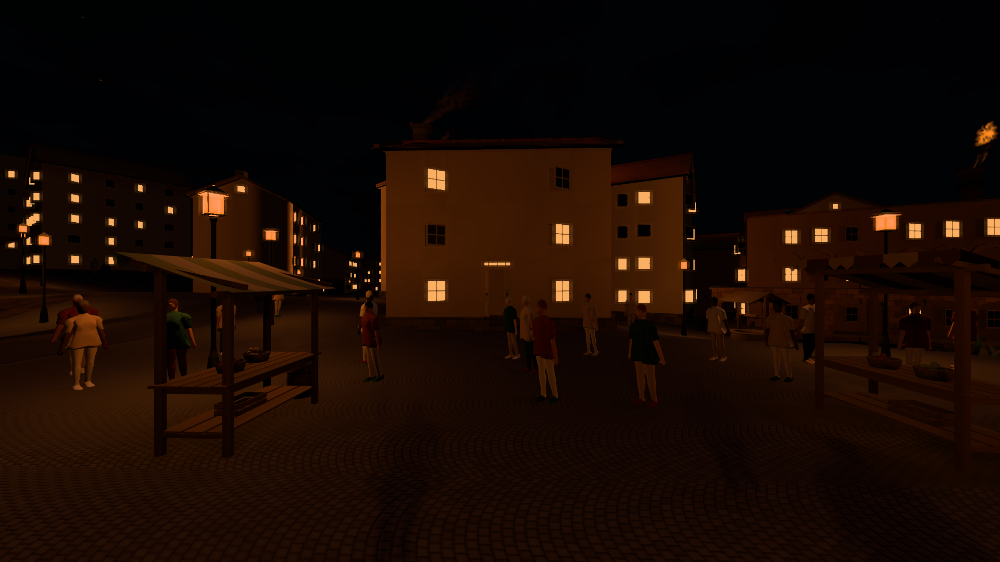

# GPU-PROBE f41a7c82 — GRÜN

Zweig `nacht-lichter-2` · Kopf f41a7c828f79f176e6bf0fa7488734b89c412082 · Läufer omen-gtx1060 · 21.11. 22:18 · Wanduhr ab Push 1175 s · Lauf https://github.com/MiguellD/AnazhRealm/actions/runs/44949072098

Ruf: `gate:nacht-licht:echt gate:tag-achse:echt bild:stadt-voll@0`

## Läufer omen-gtx1060 — GRÜN

GPU NVIDIA GeForce GTX 1060 · node_modules bleiben (package-lock 8432bea8)
Schloss /c/Users/micha/AppData/Local/Temp/claude/gpu-schloss hält „ci-runner 44949072098/1 probe“
- Hook 2026-11-21 22:08:48 start ci-runner 44949072098/1 probe: Schloss genommen (refs/heads/nacht-lichter-2 f41a7c828f79f176e6bf0fa7488734b89c412082 ws=C:\actions-runner\_work\AnazhRealm\AnazhRealm)

### gate:nacht-licht:echt — GRÜN · 262 s · Läufer omen-gtx1060

Adapter: ungenannt (die Probe nannte keinen Browser-Adapter)

```text
NACHT stadt-voll:third GRUEN: Bodenfleck 13/13 sichtbar (42 in 50 m) = 1 · ohne Karte 3/13 = 0.231 · Kelvin ±33 K (5) · Karte: ein Fleck 0.82 ms, Takt höchstens 6.81 ms, Bau der Mitte 2.57 ms
NACHT dorf:third GRUEN: Bodenfleck 4/4 sichtbar (14 in 50 m) = 1 · ohne Karte 3/4 = 0.75 · Kelvin ±18 K (1) · Karte: ein Fleck 2 ms, Takt höchstens 3.87 ms, Bau der Mitte 3.88 ms
NACHT GRUEN
```

### gate:tag-achse:echt — GRÜN · 115 s · Läufer omen-gtx1060

Adapter: ungenannt (die Probe nannte keinen Browser-Adapter)

```text
TAG genesis GRUEN: Karte 127.6 · Sprung -0.08 (Uhr 0.744) · Buckel 0.00 (Uhr 0) · Sonne 10° -0.98 EV R/B ×0.89 | -0.87 EV R/B ×0.98 · Nacht -1.82 EV Luma 52 · REF 0.83 (Uhr 0) · Sicht -0.05 (Uhr 0.5) · ASYNC 0.01 (Uhr 0.33) nach 3 Bildern (Mutant 11) · sofort 1.24 (Uhr 0.33) EV · nur die Wand (--kurz)
TAG wiese GRUEN: Karte 125.4 · Sprung 0.10 (Uhr 0.27) · Buckel 0.00 (Uhr 0) · Sonne 10° -1.19 EV R/B ×2.21 | -1.48 EV R/B ×0.84 · Nacht -3.39 EV Luma 35.3 · REF -0.25 (Uhr 0.72) · Sicht -0.06 (Uhr 0.27) · ASYNC 0.00 (Uhr 0.278) nach 3 Bildern (Mutant 10) · sofort -0.69 (Uhr 0.72) EV · nur die Wand (--kurz)
TAG-ACHSE GRUEN
```

### bild:stadt-voll@0 — GRÜN · 135 s · Läufer omen-gtx1060

Adapter: [linse-gpu] nvidia/pascal

```text
Kamera des Spiels → Blick (14.8 m): 842.49 57.57 451.79 857.27 57.57 451.19
 "abnahme": "ABNAHME GRÜN · beweis · Sicht 0.0 % · Leib im Vordergrund 5.7 % (Leib bewohner 5.7 %) · Ziel Blickziel im Bild frei 14.79 m · Luma 12.1 σ 19.5 schwarz 37.0 % weiß 0.0 % · Stand 18.546.362 · Bühne summer sunny 0.00 Tiere gehalten · Gerät WebGPU nvidia pascal · Inhalt bauSatz 27.8 % (≥ 2.0 %), bewohner 3.1 % (≥ 1.0 %) (Nacht: Farbe ungefordert)",
```


