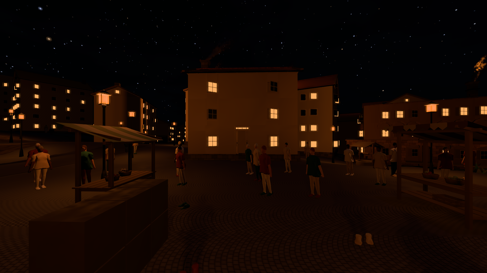

# GPU-PROBE 6d0306cd — GRÜN

Zweig `nacht-lichter-3` · Kopf 6d0306cdac02298512c7b6ea3320f718916e68fe · Läufer omen-gtx1060 · 22.11. 06:03 · Wanduhr ab Push 1234 s · Lauf https://github.com/MiguellD/AnazhRealm/actions/runs/44986260794

Ruf: `gate:webgl-probe gate:nacht-licht:echt bild:stadt-voll@0`

## Läufer omen-gtx1060 — GRÜN

GPU NVIDIA GeForce GTX 1060 · npm ci 35 s (package-lock bf2c0bf2)
Schloss /c/Users/micha/AppData/Local/Temp/claude/gpu-schloss hält „ci-runner 44986260794/1 probe“
- Hook 2026-11-22 05:45:09 start ci-runner 44986260794/1 probe: Schloss genommen (refs/heads/nacht-lichter-3 6d0306cdac02298512c7b6ea3320f718916e68fe ws=C:\actions-runner\_work\AnazhRealm\AnazhRealm)

### gate:webgl-probe — GRÜN · 64 s · Läufer omen-gtx1060

Adapter: [linse-gpu] webgl2/NVIDIA GeForce GTX 1060 (0x00001C60) Direct3D11 vs_5_0 ps_5_0

```text
✅ GRÜN — die Kein-WebGPU-Geschichte ist BEWIESEN: der erzwungene WebGL2-Rückfall bootet eine LEBENDE, sichtbare Welt; die WGSL-Konsumenten + Bundles ruhen hinter der EINEN Backend-Wand, der Rückfall ist LAUT benannt, der Fern-Ring trägt auf CPU.
```

### gate:nacht-licht:echt — GRÜN · 213 s · Läufer omen-gtx1060

Adapter: ungenannt (die Probe nannte keinen Browser-Adapter)

```text
NACHT stadt-voll:third GRUEN: Bodenfleck 13/13 sichtbar (42 in 50 m) = 1 · ohne Karte 3/13 = 0.231 · Kelvin ±33 K (5) · Karte: ein Fleck 2.13 ms, Takt höchstens 5.07 ms, Bau der Mitte 2.88 ms
NACHT dorf:third GRUEN: Bodenfleck 4/4 sichtbar (14 in 50 m) = 1 · ohne Karte 3/4 = 0.75 · Kelvin ±18 K (1) · Karte: ein Fleck 0.82 ms, Takt höchstens 19.69 ms, Bau der Mitte 2.41 ms
NACHT GRUEN
```

### bild:stadt-voll@0 — GRÜN · 143 s · Läufer omen-gtx1060

Adapter: [linse-gpu] nvidia/pascal

```text
Kamera des Spiels → Blick (14.8 m): 842.49 57.57 451.79 857.27 57.57 451.19
 "abnahme": "ABNAHME GRÜN · beweis · Sicht 0.0 % · Leib im Vordergrund 5.6 % (Leib bewohner 5.6 %) · Ziel Blickziel im Bild frei 14.79 m · Luma 11.6 σ 19.5 schwarz 36.6 % weiß 0.0 % · Stand 18.546.364 · Bühne summer sunny 0.00 Tiere gehalten · Gerät WebGPU nvidia pascal · Inhalt bauSatz 26.8 % (≥ 2.0 %), bewohner 3.3 % (≥ 1.0 %) (Nacht: Farbe ungefordert)",
```


