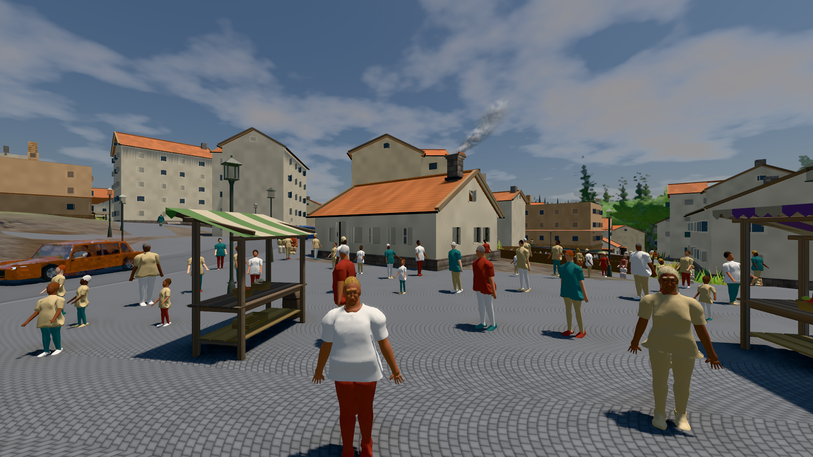

# GPU-PROBE 80329815 — GRÜN

Zweig `ort-ausstattung` · Kopf 803298158c736ec8441bcb19f281ae9dde3ba226 · Läufer radeon-890m · 24.11. 04:55 · Wanduhr ab Push 366 s · Lauf https://github.com/MiguellD/AnazhRealm/actions/runs/45322127542

Ruf: `bild:stadt-voll gate:webgl-probe`

## Läufer radeon-890m — GRÜN

GPU AMD Radeon(TM) 890M Graphics · npm ci 46 s (package-lock e2430794)
Schloss /c/Users/micha/AppData/Local/Temp/claude/gpu-schloss hält „ci-runner 45322127542/1 probe“
- Hook 2026-11-24 04:51:14 start ci-runner 45322127542/1 probe: Schloss genommen (refs/heads/ort-ausstattung 803298158c736ec8441bcb19f281ae9dde3ba226 ws=C:\actions-runner\_work\AnazhRealm\AnazhRealm)

### bild:stadt-voll — GRÜN · 142 s · Läufer radeon-890m

Adapter: [linse-gpu] amd/rdna-3

```text
Kamera des Spiels → Blick (15.0 m): 842.49 57.57 451.79 857.26 57.57 449.21
 "abnahme": "ABNAHME GRÜN · beweis · Sicht 0.0 % · Leib im Vordergrund 4.9 % (Leib bewohner 4.9 %) · Leiber näher als 6 m: 2 von 2 ganz (15 Teile) · Ziel Blickziel im Bild frei 14.99 m · Luma 107.4 σ 33.9 schwarz 0.1 % weiß 0.0 % · Stand 18.546.387 · Bühne summer sunny 0.50 Tiere gehalten · Gerät WebGPU amd rdna-3 · Inhalt bauSatz 19.4 % (≥ 2.0 %) Luma 104, bewohner 7.6 % (≥ 1.0 %) Luma 104",
```



### gate:webgl-probe — GRÜN · 34 s · Läufer radeon-890m

Adapter: [linse-gpu] webgl2/AMD Radeon(TM) 890M Graphics (0x0000150E) Direct3D11 vs_5_0 ps_5_0

```text
✅ GRÜN — die Kein-WebGPU-Geschichte ist BEWIESEN: der erzwungene WebGL2-Rückfall bootet eine LEBENDE, sichtbare Welt; die WGSL-Konsumenten + Bundles ruhen hinter der EINEN Backend-Wand, der Rückfall ist LAUT benannt, der Fern-Ring trägt auf CPU.
```
