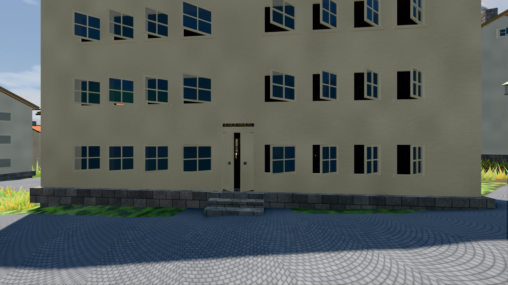

# GPU-PROBE 8574142e — ROT

Zweig `ort-ausstattung` · Kopf 8574142e4d81cdd9ab73b371e8aa8346e4959436 · Läufer gtx1050-desktop · 24.11. 07:17 · Wanduhr ab Push 1658 s · Lauf https://github.com/MiguellD/AnazhRealm/actions/runs/45336023053

Ruf: `bild:ort-zeichen gate:webgl-probe`

## Läufer gtx1050-desktop — ROT

GPU NVIDIA GeForce GTX 1050 · npm ci 64 s (package-lock e2430794)
Schloss /c/Users/User/AppData/Local/Temp/claude/gpu-schloss hält „ci-runner 45336023053/1 probe“
- Hook 2026-11-24 06:56:09 start ci-runner 45336023053/1 probe: wartet auf Schloss von 'hand nacht-laterne (Claude)'
- Hook 2026-11-24 06:56:24 start ci-runner 45336023053/1 probe: Schloss genommen (refs/heads/ort-ausstattung 8574142e4d81cdd9ab73b371e8aa8346e4959436 ws=C:\actions-runner\_work\AnazhRealm\AnazhRealm)

### bild:ort-zeichen — ROT · 357 s · Läufer gtx1050-desktop

Adapter: [linse-gpu] nvidia/pascal · "fehler": "ABNAHME ROT [kein f:relief im Bild: 0.0 % < 0.1 %] · beweis · Sicht 0.0 % · Ziel Blickziel im Bild frei 6 m · Luma 94 σ 41.6 schwarz 2.4 % weiß 0.0 % · Stand 18.546.387 · Bühne summer sunny 0.50 Tiere gehalten

```text
Kamera des Spiels → Blick (6.0 m): 846.41 56.72 472.85 844.24 56.72 478.44
 "fehler": "ABNAHME ROT [kein f:relief im Bild: 0.0 % < 0.1 %] · beweis · Sicht 0.0 % · Ziel Blickziel im Bild frei 6 m · Luma 94 σ 41.6 schwarz 2.4 % weiß 0.0 % · Stand 18.546.387 · Bühne summer sunny 0.50 Tiere gehalten · Gerät WebGPU nvidia pascal · Inhalt f:schild 0.1 % (≥ 0.1 %) Luma 39, f:relief 0.0 % (≥ 0.1 %) · ROT-Bild C:\\actions-runner\\_work\\_temp\\probe\\8574142e-ort-zeichen-rot.png",
```



### gate:webgl-probe — GRÜN · 153 s · Läufer gtx1050-desktop

Adapter: [linse-gpu] webgl2/NVIDIA GeForce GTX 1050 (0x00001C81) Direct3D11 vs_5_0 ps_5_0

```text
✅ GRÜN — die Kein-WebGPU-Geschichte ist BEWIESEN: der erzwungene WebGL2-Rückfall bootet eine LEBENDE, sichtbare Welt; die WGSL-Konsumenten + Bundles ruhen hinter der EINEN Backend-Wand, der Rückfall ist LAUT benannt, der Fern-Ring trägt auf CPU.
```
