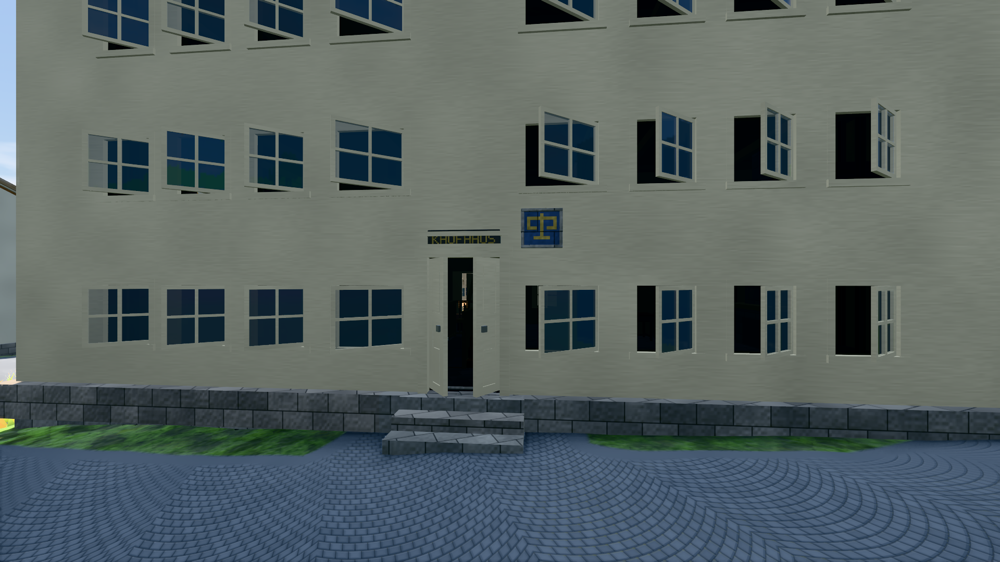

# GPU-PROBE c9e66f03 — GRÜN

Zweig `ort-ausstattung` · Kopf c9e66f034e58eb0ad7de46494160e5a0039a835f · Läufer radeon-890m · 24.11. 08:45 · Wanduhr ab Push 656 s · Lauf https://github.com/MiguellD/AnazhRealm/actions/runs/45348997279

Ruf: `bild:ort-zeichen gate:webgl-probe`

## Läufer radeon-890m — GRÜN

GPU AMD Radeon(TM) 890M Graphics · npm ci 44 s (package-lock e2430794)
Schloss /c/Users/micha/AppData/Local/Temp/claude/gpu-schloss hält „ci-runner 45348997279/1 probe“
- Hook 2026-11-24 08:36:02 start ci-runner 45348997279/1 probe: Schloss genommen (refs/heads/ort-ausstattung c9e66f034e58eb0ad7de46494160e5a0039a835f ws=C:\actions-runner\_work\AnazhRealm\AnazhRealm)

### bild:ort-zeichen — GRÜN · 150 s · Läufer radeon-890m

Adapter: [linse-gpu] amd/rdna-3

```text
Kamera des Spiels → Blick (5.0 m): 846.08 56.71 473.73 844.27 56.71 478.39
 "abnahme": "ABNAHME GRÜN · beweis · Sicht 0.0 % · Ziel Blickziel im Bild frei 5 m · Luma 95.9 σ 34.3 schwarz 2.4 % weiß 0.0 % · Stand 18.546.387 · Bühne summer sunny 0.50 Tiere gehalten · Gerät WebGPU amd rdna-3 · Inhalt f:schild 0.1 % (≥ 0.1 %) Luma 48, f:relief 0.3 % (≥ 0.1 %) Luma 60",
```



### gate:webgl-probe — GRÜN · 52 s · Läufer radeon-890m

Adapter: [linse-gpu] webgl2/AMD Radeon(TM) 890M Graphics (0x0000150E) Direct3D11 vs_5_0 ps_5_0

```text
✅ GRÜN — die Kein-WebGPU-Geschichte ist BEWIESEN: der erzwungene WebGL2-Rückfall bootet eine LEBENDE, sichtbare Welt; die WGSL-Konsumenten + Bundles ruhen hinter der EINEN Backend-Wand, der Rückfall ist LAUT benannt, der Fern-Ring trägt auf CPU.
```
