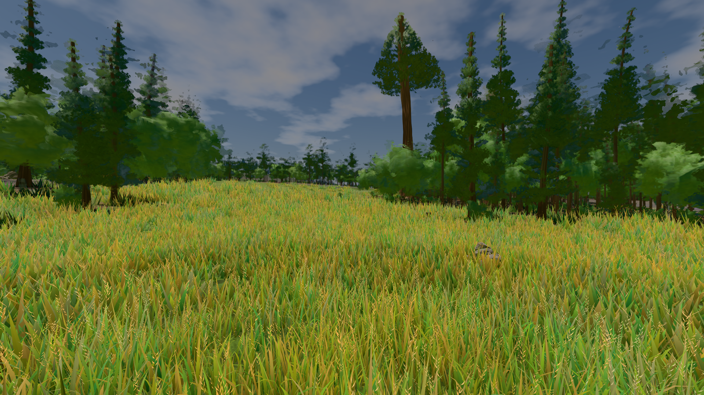

# GPU-PROBE 1dea0abb — GRÜN

Zweig `palette-stoff-spaet` · Kopf 1dea0abb82f26e953e0863e465e27933c52a9fc7 · Läufer radeon-890m · 22.11. 11:06 · Wanduhr ab Push 778 s · Lauf https://github.com/MiguellD/AnazhRealm/actions/runs/45009768757

Ruf: `bild:wiese@0.5 gate:webgl-probe`

## Läufer radeon-890m — GRÜN

GPU AMD Radeon(TM) 890M Graphics · node_modules bleiben (package-lock 5d306b2b)
Schloss /c/Users/micha/AppData/Local/Temp/claude/gpu-schloss hält „ci-runner 45009768757/1 probe“
- Hook 2026-11-22 10:54:48 start ci-runner 45009768757/1 probe: wartet auf Schloss von 'naesse-bild-nachher 2026-11-22T10:54:23+01:00 pid=15392'
- Hook 2026-11-22 10:56:41 start ci-runner 45009768757/1 probe: Schloss genommen (refs/heads/palette-stoff-spaet 1dea0abb82f26e953e0863e465e27933c52a9fc7 ws=C:\actions-runner\_work\AnazhRealm\AnazhRealm)

### bild:wiese@0.5 — GRÜN · 90 s · Läufer radeon-890m

Adapter: [linse-gpu] amd/rdna-3

```text
Kamera des Spiels → Blick (10.0 m): -280.40 29.71 -1045.60 -289.61 29.71 -1049.50
 "abnahme": "ABNAHME GRÜN · beweis · Sicht 0.0 % · Ziel Blickziel im Bild frei 10 m · Luma 99.3 σ 35.5 schwarz 0.0 % weiß 0.0 % · Stand 18.546.366 · Bühne summer sunny 0.50 Tiere gehalten · Gerät WebGPU amd rdna-3 · Inhalt nahWiese 48.5 % (≥ 15.0 %) h 107° Luma 123",
```



### gate:webgl-probe — GRÜN · 134 s · Läufer radeon-890m

Adapter: [linse-gpu] webgl2/AMD Radeon(TM) 890M Graphics (0x0000150E) Direct3D11 vs_5_0 ps_5_0

```text
✅ GRÜN — die Kein-WebGPU-Geschichte ist BEWIESEN: der erzwungene WebGL2-Rückfall bootet eine LEBENDE, sichtbare Welt; die WGSL-Konsumenten + Bundles ruhen hinter der EINEN Backend-Wand, der Rückfall ist LAUT benannt, der Fern-Ring trägt auf CPU.
```
