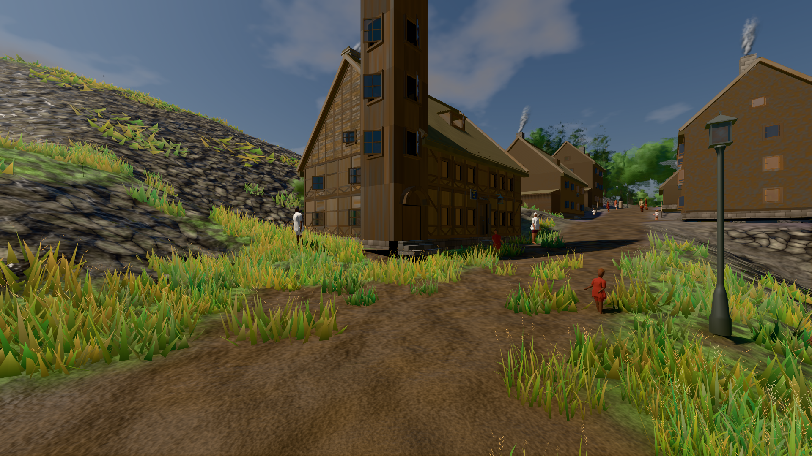

# GPU-PROBE 0d0e4c05 — GRÜN

Zweig `pegel-nach-brand` · Kopf 0d0e4c058d7725b9d7c42e74a5a3e074f3a87898 · Läufer omen-gtx1060 · 27.11. 21:25 · Wanduhr ab Push 1222 s · Lauf https://github.com/MiguellD/AnazhRealm/actions/runs/46061115452

Ruf: `gate:webgl-probe bild:dorf@0.5 gate:stand-takt gate:wetter-wache`

## Läufer omen-gtx1060 — GRÜN

GPU NVIDIA GeForce GTX 1060 · npm ci 52 s (package-lock 23a52b43)
Schloss /c/Users/micha/AppData/Local/Temp/claude/gpu-schloss hält „ci-runner 46061115452/1 probe“
- Hook 2026-11-27 21:09:31 start ci-runner 46061115452/1 probe: wartet auf Schloss von 'omen-hand-macher-gtx-sitzung'
- Hook 2026-11-27 21:12:02 start ci-runner 46061115452/1 probe: Schloss genommen (refs/heads/pegel-nach-brand 0d0e4c058d7725b9d7c42e74a5a3e074f3a87898 ws=C:\actions-runner\_work\AnazhRealm\AnazhRealm)

### gate:webgl-probe — GRÜN · 81 s · Läufer omen-gtx1060

Adapter: [linse-gpu] webgl2/NVIDIA GeForce GTX 1060 (0x00001C60) Direct3D11 vs_5_0 ps_5_0

```text
✅ GRÜN — die Kein-WebGPU-Geschichte ist BEWIESEN: der erzwungene WebGL2-Rückfall bootet eine LEBENDE, sichtbare Welt; die WGSL-Konsumenten + Bundles ruhen hinter der EINEN Backend-Wand, der Rückfall ist LAUT benannt, der Fern-Ring trägt auf CPU.
```

### bild:dorf@0.5 — GRÜN · 96 s · Läufer omen-gtx1060

Adapter: [linse-gpu] nvidia/pascal

```text
Kamera des Spiels → Blick (11.3 m): -720.31 44.15 -922.46 -709.17 44.15 -920.56
 "abnahme": "ABNAHME GRÜN · beweis · Sicht 0.0 % · Ziel Blickziel im Bild frei 11.3 m · Luma 82 σ 29.7 schwarz 0.4 % weiß 0.0 % · Stand 18.546.458 · Bühne summer sunny 0.50 Tiere gehalten · Gerät WebGPU nvidia pascal · Inhalt bauSatz 17.0 % (≥ 2.0 %) Luma 60",
```



### gate:stand-takt — GRÜN · 287 s · Läufer omen-gtx1060

Adapter: ungenannt (die Probe nannte keinen Browser-Adapter)

```text
  ✅ Selbsttest „ein Sprung des Auges (40 m, ohne Takt) lässt die Welt stehen (die Basis)" → rot: FIXPUNKT: die Welt hieß stehend — Sprung: Stufen-Wahl und Streu gingen noch
  ✅ Selbsttest „die Sonde ohne Bestand" → rot: SONDE: Abschnitt der vorigen Kamera, trifft Rinde baum_tanne
  ✅ Selbsttest „Pegel-Stufen" → rot: WASSERNETZ OHNE FIXPUNKT: 37 Wechsel nach dem Stand, zuletzt Chunk -11,-22, Ecke (-462.5, -907.4)
  ✅ Selbsttest „Pendel ungesehen" → rot: BLIND: der Pendel des Pegels wechselt kein Netz
  ✅ Selbsttest „keine Netz-Wache" → rot: LEER: keine Netz-Wache am Bach
✅ SELBSTTEST GRÜN — jeder injizierte Täter fällt rot und wird beim Namen genannt.
✅ SELBSTTEST GRÜN — die Tat-, Nachwuchs-, Brand-, Sukzessions-, Narbe- und Lava-Linse nennen jeden Täter.
  pageErrors: []
✅ GRÜN — STAND-TAKT — im Stand geht kein Fege-Takt und keine langsame Simulation, die gebrochene Wache findet nichts Verschlafenes, ein Bau und jedes Sim-Ereignis wecken, Gehen und Strom arbeiten.
✅ NARBE GRÜN — die Narbe folgt der Front, die Zelle brennt, bis ihre Front sie deckt, das Licht steht bei den Flammen, der Boden liest die Asche-Zeile, die Front ist ein geschlossener Saum, die Zungen pulsen, der Brand leuchtet nachts als Flammen-Fläche, Asche und Rauch tragen die Masse des Holzes; die Lava zündet die Betten um sie auf der Länge ihres Rands, kein Halm steht auf ihrer Decke, sie leuchtet als Flammen-Fläche; die Uhr des Spielers bewegt keinen Prozess, der Sprung der Welt-Uhr ist geschlossen
```

### gate:wetter-wache — GRÜN · 124 s · Läufer omen-gtx1060

Adapter: ungenannt (die Probe nannte keinen Browser-Adapter)

```text
  Halt · nexus      GRUEN  sunny → sunny, Uhr -1000000000; verweigert {"nexus → stormy":2}
  Halt · gesetz     GRUEN  sunny → sunny, Uhr -1000000000; verweigert {"rule:human → rainy":1}
  Halt · mensch     GRUEN  sunny → sunny, Uhr -1000000000; verweigert {"human → rainy":1}
  Halt · mitspieler GRUEN  sunny → sunny, Uhr -1000000000; verweigert {"remote:peer-wache → stormy":1}
  Halt · autoZug    GRUEN  sunny → sunny, Uhr -1000000000; verweigert {}
  Gesetz · GRUEN  Uhr 12:00 → 12:57 (Gang 144.0 s in 1440 Takten; 0 fremde Schreiber), Wetter sunny → sunny (0 Schreiber, 0 Züge)
  Band   · GRUEN  Uhr 12:57 → 13:55 (Gang 144.0 s in 1440 Takten; 0 fremde Schreiber), Wetter frei → stormy (1 Schreiber, 1 Züge)
  Abfluss nach Brand · 8 Punkte am Bach, 2601 verbrannte Zellen, Anteil b 0.981: Tiefe im Regen 0.098 → 1.290 m (×13.234) · Gegenlauf 0.098 m · gepflanzt pegelBrand → null: 0.098 m → ROT an (A) BRAND ✅
  Krone im Klima · 60 Läufe am Ort des Klimas, abflussMittel 0.042: Median 0.050 m (Krone 0.200 m), über ihr 23.3 % der Zeit · gepflanzt abflussMittel 0: Median 0.810 m, 100.0 % → ROT an (A) KRONE ✅
✅ GRÜN — unter der Bühne dreht kein Schreiber das Wetter; frei gehen Uhr und Wetter nach dem Wort des Spielers, die Welt wünscht nur, jeder Schreiber steht beim Namen.
```
