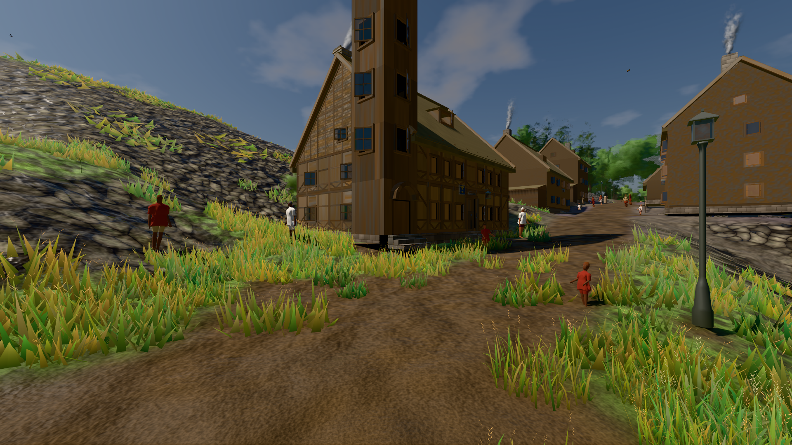

# GPU-PROBE 21235efe — GRÜN

Zweig `pegel-nach-brand` · Kopf 21235efe38edddd768d998f4f2fc8317e4248830 · Läufer omen-gtx1060 · 27.11. 15:35 · Wanduhr ab Push 3597 s · Lauf https://github.com/MiguellD/AnazhRealm/actions/runs/46008368068

Ruf: `gate:webgl-probe bild:dorf@0.5 gate:worker-dichte gate:wetter-wache`

## Läufer omen-gtx1060 — GRÜN

GPU NVIDIA GeForce GTX 1060 · node_modules bleiben (package-lock a873c59e)
Schloss /c/Users/micha/AppData/Local/Temp/claude/gpu-schloss hält „ci-runner 46008368068/1 probe“
- Hook 2026-11-27 15:01:30 start ci-runner 46008368068/1 probe: Schloss genommen (refs/heads/pegel-nach-brand 21235efe38edddd768d998f4f2fc8317e4248830 ws=C:\actions-runner\_work\AnazhRealm\AnazhRealm)

### gate:webgl-probe — GRÜN · 64 s · Läufer omen-gtx1060

Adapter: [linse-gpu] webgl2/NVIDIA GeForce GTX 1060 (0x00001C60) Direct3D11 vs_5_0 ps_5_0

```text
✅ GRÜN — die Kein-WebGPU-Geschichte ist BEWIESEN: der erzwungene WebGL2-Rückfall bootet eine LEBENDE, sichtbare Welt; die WGSL-Konsumenten + Bundles ruhen hinter der EINEN Backend-Wand, der Rückfall ist LAUT benannt, der Fern-Ring trägt auf CPU.
```

### bild:dorf@0.5 — GRÜN · 105 s · Läufer omen-gtx1060

Adapter: [linse-gpu] nvidia/pascal

```text
Kamera des Spiels → Blick (11.3 m): -720.31 44.15 -922.46 -709.17 44.15 -920.56
 "abnahme": "ABNAHME GRÜN · beweis · Sicht 0.0 % · Ziel Blickziel im Bild frei 11.3 m · Luma 81.7 σ 29.7 schwarz 0.4 % weiß 0.0 % · Stand 18.546.453 · Bühne summer sunny 0.50 Tiere gehalten · Gerät WebGPU nvidia pascal · Inhalt bauSatz 17.0 % (≥ 2.0 %) Luma 60",
```



### gate:worker-dichte — GRÜN · 477 s · Läufer omen-gtx1060

Adapter: ungenannt (die Probe nannte keinen Browser-Adapter)

```text
GRÜN   ort.frage.bytes feuert gepflanzt: die Relief-Höhe am Stichpunkt −66°/−180° um 10⁻⁶ m → SHA der ersten Saat 674ee789b558f3f9 ≠ 34fd43fcf4376475 → ROT
GRÜN   anker.jede-saat feuert gepflanzt: die Suche endet bei 512 Proben (der Kern vor der Treppe) → von 4 Saaten ohne Ort bei 512 Proben ohne Anker 4 (w-549d70713064-ybhbkh, w-a35ea78d2ddf-ocd04u, w-2547d735a0a9-u9clj0, w-f3b1679a7155-w49s5c) · Anker im Meer oder Küste > 300 km 0 · von 3 Saaten mit Ort bei 512 verlegt 0
GRÜN   anker.jede-saat nennt  gepflanzt: die Suche beginnt bei 2 048 Proben (immer dicht) → von 4 Saaten ohne Ort bei 512 Proben ohne Anker 0 · Anker im Meer oder Küste > 300 km 0 · von 3 Saaten mit Ort bei 512 verlegt 3 (w-d10e897e3fad-azvhsr, w-e6ea6c6b804e-mr4t9z, w-4a2768b6253a-h4uio8)
GRÜN   anker.jede-saat        von 4 Saaten ohne Ort bei 512 Proben ohne Anker 0 · Anker im Meer oder Küste > 300 km 0 · von 3 Saaten mit Ort bei 512 verlegt 0   [Schwelle 0 · 0 · 0 (B5, die Treppe)]
GRÜN   ort.neigung            Spanne an 45° (anazh-realm-seed): Erde 18.923 K · Neigung 0 0.000 K (0.0 %) · Neigung 45° 33.212 K (1.755×) · dieselbe Saat byte-gleich   [Schwelle Neigung 0 ≤ 10 % der Erd-Spanne, ≠ Erde, Saat byte-gleich]
GRÜN   ort.frage.punkte       Relief-Punkte je Ort der Gipfel-Suche 2,00 (planetOrt 1 + Faden 1; dazu Hülle 2,26: der Regenschatten des Klimas) · je Saat 275 ms (Plan 22 · Meer 131 · Anker 11 · 1380 Orte 111) · 100 Saaten 27,5 s   [Schwelle ≤ 2 Punkte je Ort (Lehre 26: Rufe, nie Sekunden)]
GRÜN   ort.frage.bytes        100 Saaten × 1380 Orte: SHA b1545ac3a13a6f9c = Kern vor dem Schnitt b1545ac3a13a6f9c · Gipfel > 2 km 2804, an konvergenter Grenze 99,0 % (Land 68,2 %)   [Schwelle bit-gleich (FRAGE_SHA), die Station misst ≥ 95 %]
GRÜN   klima.hadley           Kante je Neigung 0° 25.58°/4 · 10° 27.15°/3 · 23.44° 29.64°/3 · 30° 30.80°/3 · 45° 33.89°/3 · 54° 35.52°/3 · 60° 36.53°/2 · 70° 38.10°/2 · 90° 40.91°/2 — 45°/23,44° ×1.1434 · schmaler mit der Neigung nie · mehr Zellen nie · Erde 0.5173714321955878 rad/3 bit-gleich ihrer Kante   [Schwelle 45°/23,44° in ×1.0956…×1.2095 (Guendelman & Kaspi 2019 · Lindzen & Hou 1988), nie schmaler, nie mehr Zellen, Erde bit-gleich]
GRÜN   anker.eis              von 11 Heimaten über dem Eis des Hochglazials unter dem Eis 0 · der Anker des Spiels bit-gleich   [Schwelle 0 unter dem Eis, der Anker des Spiels bit-gleich (B5, die Stufe der Eis-Zeit)]
GRÜN   klima.milankovic       Bahn ↔ La2004 r(Juni 65° N) 0.9747 (1 Ma je ka) · −21 ka Meer -121.12 m, Mittel -5.73 K · Hochstand (1 Ma) 10.72 m · Meer 3 Ma: 41 ka (×33.7 Median), 95 ka (×7.8 Median) · heute Meer 0, ε = Neigung, keine Präzession   [Schwelle r ≥ 0,95 (Laskar 2004) · Meer [−130, −110] m · Mittel [−8, −4] K (Lambeck 2014 · Tierney 2020) · Hochstand [3; 10,72] m · 41 ± 5 und 100 ± 15 ka (LR04) · heute 0]
```

### gate:wetter-wache — GRÜN · 116 s · Läufer omen-gtx1060

Adapter: ungenannt (die Probe nannte keinen Browser-Adapter)

```text
  Halt · emotion    GRUEN  sunny → sunny, Uhr -1000000000; verweigert {"rule:emotion:sorrow → rainy":1}
  Halt · nexus      GRUEN  sunny → sunny, Uhr -1000000000; verweigert {"nexus → stormy":2}
  Halt · gesetz     GRUEN  sunny → sunny, Uhr -1000000000; verweigert {"rule:human → rainy":1}
  Halt · mensch     GRUEN  sunny → sunny, Uhr -1000000000; verweigert {"human → rainy":1}
  Halt · mitspieler GRUEN  sunny → sunny, Uhr -1000000000; verweigert {"remote:peer-wache → stormy":1}
  Halt · autoZug    GRUEN  sunny → sunny, Uhr -1000000000; verweigert {}
  Gesetz · GRUEN  Uhr 12:00 → 12:57 (Gang 144.0 s in 1440 Takten; 0 fremde Schreiber), Wetter sunny → sunny (0 Schreiber, 0 Züge)
  Band   · GRUEN  Uhr 12:57 → 13:55 (Gang 144.0 s in 1440 Takten; 0 fremde Schreiber), Wetter frei → stormy (1 Schreiber, 1 Züge)
  Abfluss nach Brand · 8 Punkte am Bach, 2601 verbrannte Zellen: Tiefe im Regen 0.658 → 0.744 m (×1.131) · Gegenlauf 0.658 m · gepflanzt pegelBrand → null: 0.658 m → ROT an (A) BRAND ✅
✅ GRÜN — unter der Bühne dreht kein Schreiber das Wetter; frei gehen Uhr und Wetter nach dem Wort des Spielers, die Welt wünscht nur, jeder Schreiber steht beim Namen.
```
