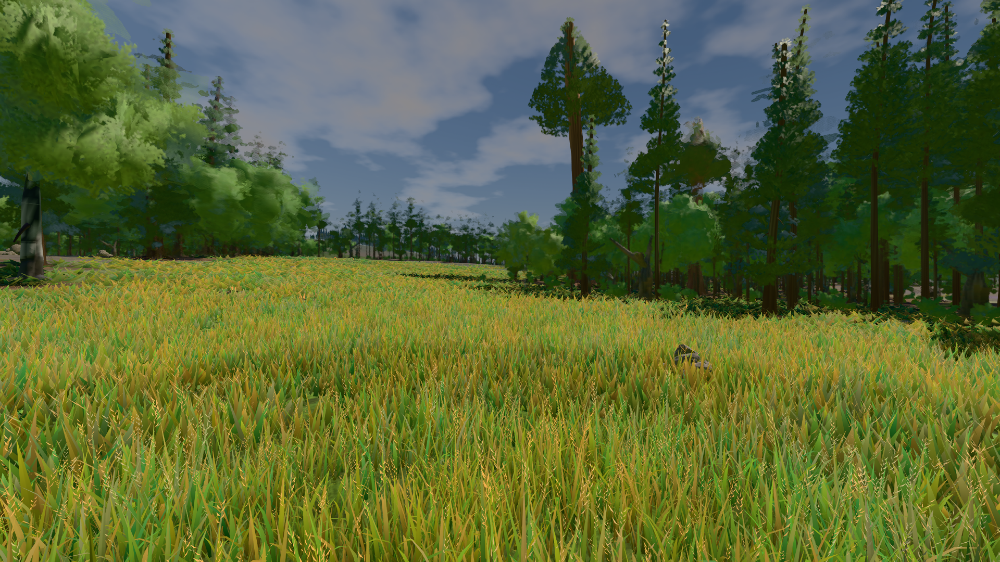

# GPU-PROBE 3ccd19dc — GRÜN

Zweig `rueckfall-drei-2` · Kopf 3ccd19dc28663f427b2cc5ec06a03f40a23c0467 · Läufer omen-gtx1060 · 26.11. 08:31 · Wanduhr ab Push 5385 s · Lauf https://github.com/MiguellD/AnazhRealm/actions/runs/45765364623

Ruf: `bild:wiese@0.5 gate:tag-achse:echt gate:webgl-probe`

## Läufer omen-gtx1060 — GRÜN

GPU NVIDIA GeForce GTX 1060 · npm ci 30 s (package-lock 370a9b0c)
Schloss /c/Users/micha/AppData/Local/Temp/claude/gpu-schloss hält „ci-runner 45765364623/1 probe“
- Hook 2026-11-26 08:14:53 start ci-runner 45765364623/1 probe: Schloss genommen (refs/heads/rueckfall-drei-2 3ccd19dc28663f427b2cc5ec06a03f40a23c0467 ws=C:\actions-runner\_work\AnazhRealm\AnazhRealm)

### bild:wiese@0.5 — GRÜN · 62 s · Läufer omen-gtx1060

Adapter: [linse-gpu] nvidia/pascal

```text
Kamera des Spiels → Blick (10.0 m): -280.40 29.71 -1045.60 -289.61 29.71 -1049.50
 "abnahme": "ABNAHME GRÜN · beweis · Sicht 0.0 % · Ziel Blickziel im Bild frei 10 m · Luma 97.6 σ 36.4 schwarz 0.0 % weiß 0.0 % · Stand 18.546.428 · Bühne summer sunny 0.50 Tiere gehalten · Gerät WebGPU nvidia pascal · Inhalt nahWiese 48.4 % (≥ 15.0 %) h 107° Luma 119",
```



### gate:tag-achse:echt — GRÜN · 134 s · Läufer omen-gtx1060

Adapter: ungenannt (die Probe nannte keinen Browser-Adapter)

```text
TAG genesis GRUEN: Karte 126.3 · Sprung 0.08 (Uhr 0.28) · Buckel 0.00 (Uhr 0) · Sonne 10° -0.68 EV R/B ×1.04 | -0.77 EV R/B ×0.85 · Nacht -0.54 EV Luma 84.7 · REF 1.65 (Uhr 0) · Sicht -0.07 (Uhr 0.5) · ASYNC -0.04 (Uhr 0) nach 3 Bildern (Mutant 10) · sofort -0.70 (Uhr 0.72) EV · nur die Wand (--kurz)
TAG wiese GRUEN: Karte 124.3 · Sprung -0.08 (Uhr 0.732) · Buckel 0.00 (Uhr 0) · Sonne 10° -1.02 EV R/B ×0.87 | -1.24 EV R/B ×0.67 · Nacht -2.37 EV Luma 46.7 · REF 0.44 (Uhr 0) · Sicht -0.02 (Uhr 0.5) · ASYNC 0.01 (Uhr 0.736) nach 3 Bildern (Mutant 10) · sofort -0.68 (Uhr 0.75) EV · nur die Wand (--kurz)
TAG-ACHSE GRUEN
```

### gate:webgl-probe — GRÜN · 62 s · Läufer omen-gtx1060

Adapter: [linse-gpu] webgl2/NVIDIA GeForce GTX 1060 (0x00001C60) Direct3D11 vs_5_0 ps_5_0

```text
✅ GRÜN — die Kein-WebGPU-Geschichte ist BEWIESEN: der erzwungene WebGL2-Rückfall bootet eine LEBENDE, sichtbare Welt; die WGSL-Konsumenten + Bundles ruhen hinter der EINEN Backend-Wand, der Rückfall ist LAUT benannt, der Fern-Ring trägt auf CPU.
```
