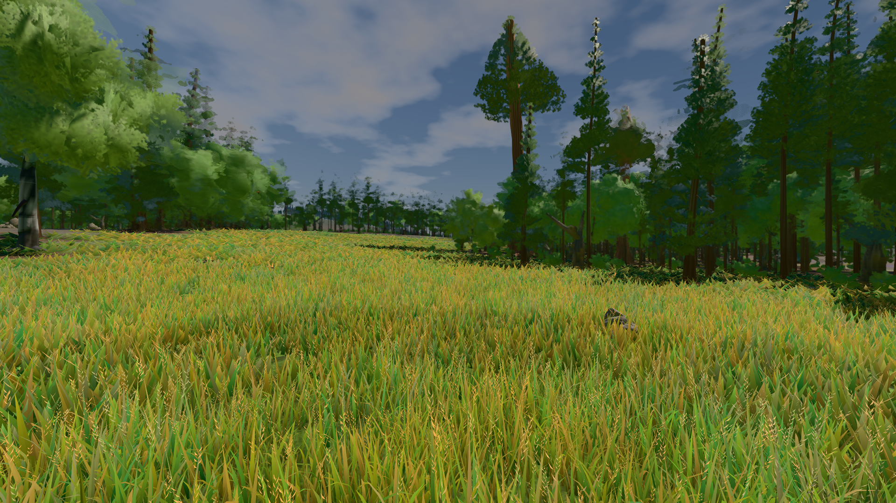

# GPU-PROBE b40fbb73 — GRÜN

Zweig `rueckfall-drei-2` · Kopf b40fbb73bcecf7f22286c808a86a5d0913800e74 · Läufer gtx1050-desktop · 26.11. 07:41 · Wanduhr ab Push 2452 s · Lauf https://github.com/MiguellD/AnazhRealm/actions/runs/45765310484

Ruf: `bild:wiese@0.5 gate:webgl-probe`

## Läufer gtx1050-desktop — GRÜN

GPU NVIDIA GeForce GTX 1050 · npm ci 83 s (package-lock 370a9b0c)
Schloss /c/Users/User/AppData/Local/Temp/claude/gpu-schloss hält „ci-runner 45765310484/1 probe“
- Hook 2026-11-26 07:09:18 start ci-runner 45765310484/1 probe: wartet auf Schloss von 'hand-macher-gtx-sitzung'
- Hook 2026-11-26 07:12:49 start ci-runner 45765310484/1 probe: Schloss genommen (refs/heads/rueckfall-drei-2 b40fbb73bcecf7f22286c808a86a5d0913800e74 ws=C:\actions-runner\_work\AnazhRealm\AnazhRealm)

### bild:wiese@0.5 — GRÜN · 130 s · Läufer gtx1050-desktop

Adapter: [linse-gpu] nvidia/pascal

```text
Kamera des Spiels → Blick (10.0 m): -280.40 29.71 -1045.60 -289.61 29.71 -1049.50
 "abnahme": "ABNAHME GRÜN · beweis · Sicht 0.0 % · Ziel Blickziel im Bild frei 10 m · Luma 97.6 σ 36.4 schwarz 0.0 % weiß 0.0 % · Stand 18.546.428 · Bühne summer sunny 0.50 Tiere gehalten · Gerät WebGPU nvidia pascal · Inhalt nahWiese 48.4 % (≥ 15.0 %) h 107° Luma 119",
```



### gate:webgl-probe — GRÜN · 138 s · Läufer gtx1050-desktop

Adapter: [linse-gpu] webgl2/NVIDIA GeForce GTX 1050 (0x00001C81) Direct3D11 vs_5_0 ps_5_0

```text
✅ GRÜN — die Kein-WebGPU-Geschichte ist BEWIESEN: der erzwungene WebGL2-Rückfall bootet eine LEBENDE, sichtbare Welt; die WGSL-Konsumenten + Bundles ruhen hinter der EINEN Backend-Wand, der Rückfall ist LAUT benannt, der Fern-Ring trägt auf CPU.
```
