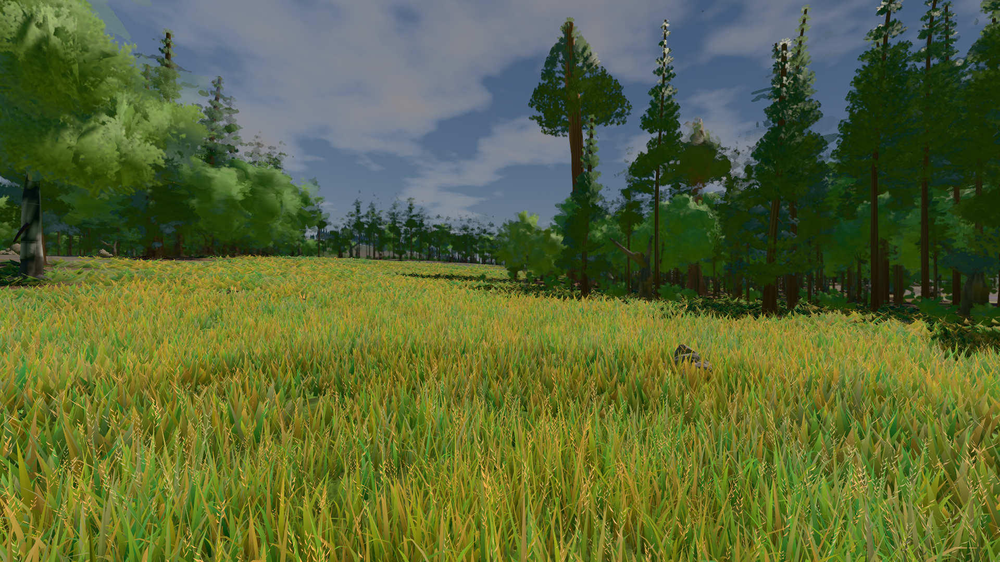

# GPU-PROBE 32f800a5 — GRÜN

Zweig `rueckfall-drei` · Kopf 32f800a538c5d51bb16004ff15648a5107ecf6d0 · Läufer gtx1050-desktop · 26.11. 04:27 · Wanduhr ab Push 1644 s · Lauf https://github.com/MiguellD/AnazhRealm/actions/runs/45746100250

Ruf: `gate:wetter-wache gate:stand-takt bild:wiese@0.5 gate:webgl-probe`

## Läufer gtx1050-desktop — GRÜN

GPU NVIDIA GeForce GTX 1050 · node_modules bleiben (package-lock f07ee913)
Schloss /c/Users/User/AppData/Local/Temp/claude/gpu-schloss hält „ci-runner 45746100250/1 probe“
- Hook 2026-11-26 04:08:35 start ci-runner 45746100250/1 probe: Schloss genommen (refs/heads/rueckfall-drei 32f800a538c5d51bb16004ff15648a5107ecf6d0 ws=C:\actions-runner\_work\AnazhRealm\AnazhRealm)

### gate:wetter-wache — GRÜN · 237 s · Läufer gtx1050-desktop

Adapter: ungenannt (die Probe nannte keinen Browser-Adapter)

```text
✅ SELBSTTEST GRÜN — jeder injizierte Täter fällt rot und wird beim Namen genannt.
  Halt · emotion    GRUEN  sunny → sunny, Uhr -1000000000; verweigert {"rule:emotion:sorrow → rainy":1}
  Halt · nexus      GRUEN  sunny → sunny, Uhr -1000000000; verweigert {"nexus → stormy":2}
  Halt · gesetz     GRUEN  sunny → sunny, Uhr -1000000000; verweigert {"rule:human → rainy":1}
  Halt · mensch     GRUEN  sunny → sunny, Uhr -1000000000; verweigert {"human → rainy":1}
  Halt · mitspieler GRUEN  sunny → sunny, Uhr -1000000000; verweigert {"remote:peer-wache → stormy":1}
  Halt · autoZug    GRUEN  sunny → sunny, Uhr -1000000000; verweigert {}
  Gesetz · GRUEN  Uhr 12:00 → 12:57 (Gang 144.0 s in 1440 Takten; 0 fremde Schreiber), Wetter sunny → sunny (0 Schreiber, 0 Züge)
  Band   · GRUEN  Uhr 12:57 → 13:55 (Gang 144.0 s in 1440 Takten; 0 fremde Schreiber), Wetter frei → stormy (1 Schreiber, 1 Züge)
✅ GRÜN — unter der Bühne dreht kein Schreiber das Wetter; frei gehen Uhr und Wetter nach dem Wort des Spielers, die Welt wünscht nur, jeder Schreiber steht beim Namen.
```

### gate:stand-takt — GRÜN · 578 s · Läufer gtx1050-desktop

Adapter: ungenannt (die Probe nannte keinen Browser-Adapter)

```text
  ✅ Selbsttest „ein Sprung des Auges (40 m, ohne Takt) lässt die Welt stehen (die Basis)" → rot: FIXPUNKT: die Welt hieß stehend — Sprung: Stufen-Wahl und Streu gingen noch
  ✅ Selbsttest „die Sonde ohne Bestand" → rot: SONDE: Abschnitt der vorigen Kamera, trifft Rinde baum_tanne
  ✅ Selbsttest „Pegel-Stufen" → rot: WASSERNETZ OHNE FIXPUNKT: 37 Wechsel nach dem Stand, zuletzt Chunk -11,-22, Ecke (-462.5, -907.4)
  ✅ Selbsttest „Pendel ungesehen" → rot: BLIND: der Pendel des Pegels wechselt kein Netz
  ✅ Selbsttest „keine Netz-Wache" → rot: LEER: keine Netz-Wache am Bach
✅ SELBSTTEST GRÜN — jeder injizierte Täter fällt rot und wird beim Namen genannt.
✅ SELBSTTEST GRÜN — die Tat-, Nachwuchs-, Brand-, Sukzessions-, Narbe- und Lava-Linse nennen jeden Täter.
  pageErrors: []
✅ GRÜN — STAND-TAKT — im Stand geht kein Fege-Takt und keine langsame Simulation, die gebrochene Wache findet nichts Verschlafenes, ein Bau und jedes Sim-Ereignis wecken, Gehen und Strom arbeiten.
✅ NARBE GRÜN — die Narbe folgt der Front, die Zelle brennt, bis ihre Front sie deckt, das Licht steht bei den Flammen, der Boden liest die Asche-Zeile, die Front ist ein geschlossener Saum, die Zungen pulsen, der Brand leuchtet nachts als Flammen-Fläche, Asche und Rauch tragen die Masse des Holzes; die Lava zündet die Betten um sie auf der Länge ihres Rands, kein Halm steht auf ihrer Decke, sie leuchtet als Flammen-Fläche; die Uhr des Spielers bewegt keinen Prozess, der Sprung der Welt-Uhr ist geschlossen
```

### bild:wiese@0.5 — GRÜN · 114 s · Läufer gtx1050-desktop

Adapter: [linse-gpu] nvidia/pascal

```text
Kamera des Spiels → Blick (10.0 m): -280.40 29.71 -1045.60 -289.61 29.71 -1049.50
 "abnahme": "ABNAHME GRÜN · beweis · Sicht 0.0 % · Ziel Blickziel im Bild frei 10 m · Luma 97.6 σ 36.4 schwarz 0.0 % weiß 0.0 % · Stand 18.546.426 · Bühne summer sunny 0.50 Tiere gehalten · Gerät WebGPU nvidia pascal · Inhalt nahWiese 48.4 % (≥ 15.0 %) h 107° Luma 119",
```



### gate:webgl-probe — GRÜN · 126 s · Läufer gtx1050-desktop

Adapter: [linse-gpu] webgl2/NVIDIA GeForce GTX 1050 (0x00001C81) Direct3D11 vs_5_0 ps_5_0

```text
✅ GRÜN — die Kein-WebGPU-Geschichte ist BEWIESEN: der erzwungene WebGL2-Rückfall bootet eine LEBENDE, sichtbare Welt; die WGSL-Konsumenten + Bundles ruhen hinter der EINEN Backend-Wand, der Rückfall ist LAUT benannt, der Fern-Ring trägt auf CPU.
```
