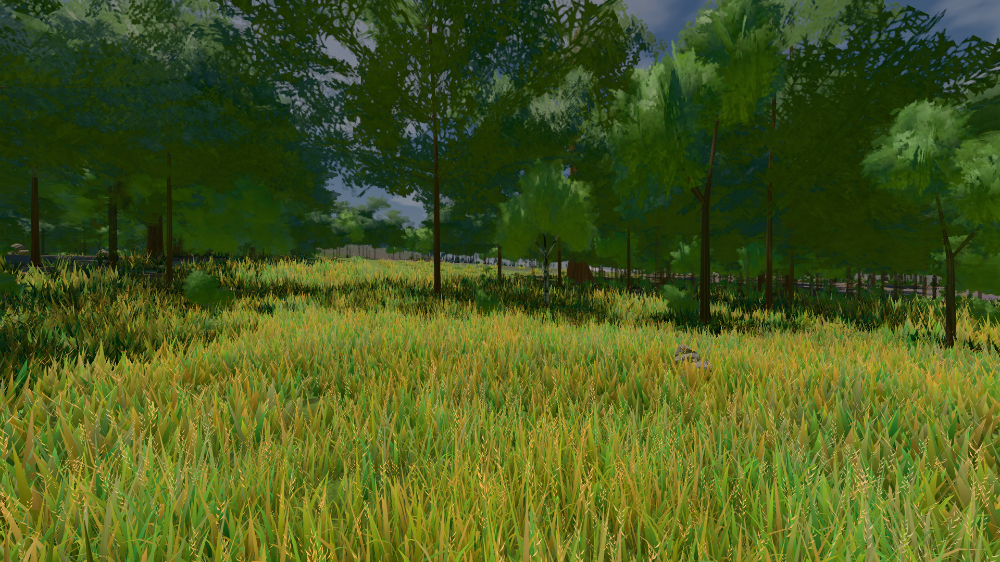

# GPU-PROBE 87984bdb — GRÜN

Zweig `saison-am-laub` · Kopf 87984bdbba1551770484851ddb6ca712bccad065 · Läufer gtx1050-desktop · 20.11. 04:35 · Wanduhr ab Push 607 s · Lauf https://github.com/MiguellD/AnazhRealm/actions/runs/44667638050

Ruf: `bild:wiese@0.5`

## Läufer gtx1050-desktop — GRÜN

GPU NVIDIA GeForce GTX 1050 · node_modules bleiben (package-lock 20e3f8f6)
Schloss /c/Users/User/AppData/Local/Temp/claude/gpu-schloss hält „ci-runner 44667638050/1 probe“
- Hook 2026-11-20 04:32:15 start ci-runner 44667638050/1 probe: wartet auf Schloss von 'hand sicht-arbeit (Claude)'
- Hook 2026-11-20 04:32:30 start ci-runner 44667638050/1 probe: Schloss genommen (refs/heads/saison-am-laub 87984bdbba1551770484851ddb6ca712bccad065 ws=C:\actions-runner\_work\AnazhRealm\AnazhRealm)

### bild:wiese@0.5 — GRÜN · 78 s · Läufer gtx1050-desktop

Adapter: [linse-gpu] nvidia/pascal

```text
Kamera des Spiels → Blick (10.0 m): -280.40 29.71 -1045.60 -289.61 29.71 -1049.50
 "abnahme": "ABNAHME GRÜN · beweis · Sicht 0.0 % · Ziel Blickziel im Bild frei 10 m · Luma 81.9 σ 38.9 schwarz 0.0 % weiß 0.0 % · Stand 18.546.346 · Bühne summer sunny 0.50 Tiere gehalten · Gerät WebGPU nvidia pascal · Inhalt nahWiese 48.2 % (≥ 15.0 %) h 107° Luma 117",
```


