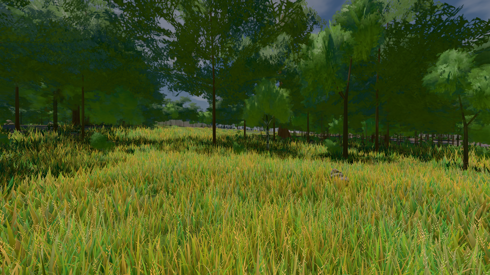

# GPU-PROBE 932d7658 — GRÜN

Zweig `saison-am-laub` · Kopf 932d7658716dff0e118c301eaecc658a5e8fbe96 · Läufer omen-gtx1060 · 20.11. 05:38 · Wanduhr ab Push 243 s · Lauf https://github.com/MiguellD/AnazhRealm/actions/runs/44675278678

Ruf: `bild:wiese@0.5`

## Läufer omen-gtx1060 — GRÜN

GPU NVIDIA GeForce GTX 1060 · node_modules bleiben (package-lock 983fa64e)
Schloss /c/Users/micha/AppData/Local/Temp/claude/gpu-schloss hält „ci-runner 44675278678/1 probe“
- Hook 2026-11-20 05:36:20 start ci-runner 44675278678/1 probe: Schloss genommen (refs/heads/saison-am-laub 932d7658716dff0e118c301eaecc658a5e8fbe96 ws=C:\actions-runner\_work\AnazhRealm\AnazhRealm)

### bild:wiese@0.5 — GRÜN · 45 s · Läufer omen-gtx1060

Adapter: [linse-gpu] nvidia/pascal

```text
Kamera des Spiels → Blick (10.0 m): -280.40 29.71 -1045.60 -289.61 29.71 -1049.50
 "abnahme": "ABNAHME GRÜN · beweis · Sicht 0.0 % · Ziel Blickziel im Bild frei 10 m · Luma 81.9 σ 38.9 schwarz 0.0 % weiß 0.0 % · Stand 18.546.347 · Bühne summer sunny 0.50 Tiere gehalten · Gerät WebGPU nvidia pascal · Inhalt nahWiese 48.2 % (≥ 15.0 %) h 107° Luma 117",
```


