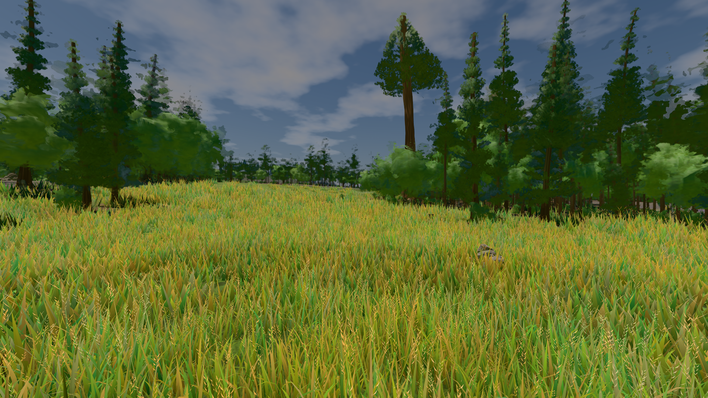
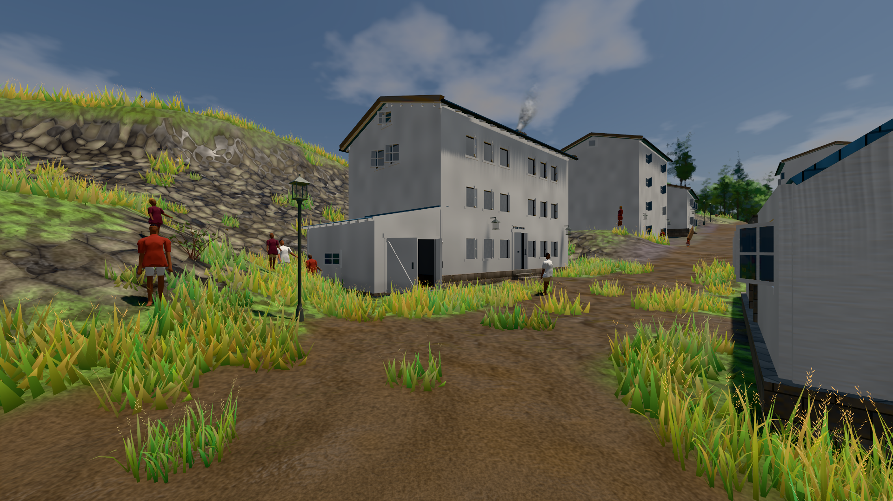

# GPU-PROBE db7a8245 — GRÜN

Zweig `saison-schatten` · Kopf db7a824548ae9884b314b8dc5eaf90b6c0169578 · Läufer radeon-890m · 24.11. 09:42 · Wanduhr ab Push 602 s · Lauf https://github.com/MiguellD/AnazhRealm/actions/runs/45357068134

Ruf: `bild:wiese@0.5 bild:dorf@0.5 gate:kopplung gate:tag-achse:echt gate:webgl-probe`

## Läufer radeon-890m — GRÜN

GPU AMD Radeon(TM) 890M Graphics · node_modules bleiben (package-lock 824358c7)
Schloss /c/Users/micha/AppData/Local/Temp/claude/gpu-schloss hält „ci-runner 45357068134/1 probe“
- Hook 2026-11-24 09:36:00 start ci-runner 45357068134/1 probe: Schloss genommen (refs/heads/saison-schatten db7a824548ae9884b314b8dc5eaf90b6c0169578 ws=C:\actions-runner\_work\AnazhRealm\AnazhRealm)

### bild:wiese@0.5 — GRÜN · 56 s · Läufer radeon-890m

Adapter: [linse-gpu] amd/rdna-3

```text
Kamera des Spiels → Blick (10.0 m): -280.40 29.71 -1045.60 -289.61 29.71 -1049.50
 "abnahme": "ABNAHME GRÜN · beweis · Sicht 0.0 % · Ziel Blickziel im Bild frei 10 m · Luma 99.3 σ 35.5 schwarz 0.0 % weiß 0.0 % · Stand 18.546.396 · Bühne summer sunny 0.50 Tiere gehalten · Gerät WebGPU amd rdna-3 · Inhalt nahWiese 48.5 % (≥ 15.0 %) h 107° Luma 123",
```



### bild:dorf@0.5 — GRÜN · 88 s · Läufer radeon-890m

Adapter: [linse-gpu] amd/rdna-3

```text
Kamera des Spiels → Blick (12.9 m): -715.86 49.01 -932.69 -702.99 49.01 -931.86
 "abnahme": "ABNAHME GRÜN · beweis · Sicht 0.0 % · Ziel Blickziel im Bild frei 12.9 m · Luma 94.7 σ 28.8 schwarz 0.1 % weiß 0.0 % · Stand 18.546.396 · Bühne summer sunny 0.50 Tiere gehalten · Gerät WebGPU amd rdna-3 · Inhalt bauSatz 20.3 % (≥ 2.0 %) Luma 94",
```



### gate:kopplung — GRÜN · 24 s · Läufer radeon-890m

Adapter: ungenannt (die Probe nannte keinen Browser-Adapter)

```text
  ✅ ALLE KOPPLUNGS-INVARIANTEN OK — Wände gleiten (PM_ClipVelocity), Steilhang rutscht, Wind hat EINE Richtung, Gras weicht aus
```

### gate:tag-achse:echt — GRÜN · 135 s · Läufer radeon-890m

Adapter: ungenannt (die Probe nannte keinen Browser-Adapter)

```text
TAG genesis GRUEN: Karte 127.4 · Sprung -0.10 (Uhr 0.722) · Buckel 0.00 (Uhr 0) · Sonne 10° -0.97 EV R/B ×0.91 | -0.82 EV R/B ×1.04 · Nacht -1.82 EV Luma 52.1 · REF 1.42 (Uhr 0.202) · Sicht -0.05 (Uhr 0.5) · ASYNC 0.02 (Uhr 0.8) nach 3 Bildern (Mutant 11) · sofort 1.24 (Uhr 0.33) EV · nur die Wand (--kurz)
TAG wiese GRUEN: Karte 125.4 · Sprung -0.09 (Uhr 0.766) · Buckel 0.00 (Uhr 0) · Sonne 10° -1.16 EV R/B ×2.29 | -1.47 EV R/B ×0.87 · Nacht -3.39 EV Luma 35.3 · REF -0.25 (Uhr 0.72) · Sicht -0.06 (Uhr 0.27) · ASYNC 0.01 (Uhr 0.798) nach 3 Bildern (Mutant 9) · sofort -0.69 (Uhr 0.72) EV · nur die Wand (--kurz)
TAG-ACHSE GRUEN
```

### gate:webgl-probe — GRÜN · 51 s · Läufer radeon-890m

Adapter: [linse-gpu] webgl2/AMD Radeon(TM) 890M Graphics (0x0000150E) Direct3D11 vs_5_0 ps_5_0

```text
✅ GRÜN — die Kein-WebGPU-Geschichte ist BEWIESEN: der erzwungene WebGL2-Rückfall bootet eine LEBENDE, sichtbare Welt; die WGSL-Konsumenten + Bundles ruhen hinter der EINEN Backend-Wand, der Rückfall ist LAUT benannt, der Fern-Ring trägt auf CPU.
```
