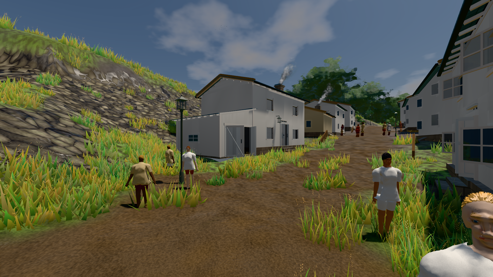

# GPU-PROBE 9f70eaca — GRÜN

Zweig `samen-ein-baum` · Kopf 9f70eaca10fa99797bedadf2d343ec72eb3fc26d · Läufer radeon-890m · 20.11. 16:33 · Wanduhr ab Push 1014 s · Lauf https://github.com/MiguellD/AnazhRealm/actions/runs/44761703549

Ruf: `gate:settlement bild:dorf@0.5`

## Läufer radeon-890m — GRÜN

GPU AMD Radeon(TM) 890M Graphics · node_modules bleiben (package-lock e5aaa49c)
Schloss /c/Users/micha/AppData/Local/Temp/claude/gpu-schloss hält „ci-runner 44761703549/1 probe“
- Hook 2026-11-20 16:20:27 start ci-runner 44761703549/1 probe: wartet auf Schloss von ''
- Hook 2026-11-20 16:20:44 start ci-runner 44761703549/1 probe: Schloss genommen (refs/heads/samen-ein-baum 9f70eaca10fa99797bedadf2d343ec72eb3fc26d ws=C:\actions-runner\_work\AnazhRealm\AnazhRealm)

### gate:settlement — GRÜN · 385 s · Läufer radeon-890m

Adapter: ungenannt (die Probe nannte keinen Browser-Adapter)

```text
  ✅ C-K5d: DAS ERWACHEN IN RATEN — je Takt höchstens EIN Schritt — 157 Takte, das erste Haus im Takt 4, der längste Takt 17 18.2 ms: wege 1,Takt 21 16.8 ms: laternen 32,Takt 23 14.7 ms: laternen 30,Takt 19 11.9 ms: laternen 32
  ✅ C-K5d Selbsttest: der Voll-Bau im Takt des Erwachens ist ROT — Takt 0 445 ms: erdbau 2 · haeuser 140 · wege 1 · laternen 98 · ausstattung 18
  ✅ C-K5b: EIN VORRAT JE ZELLE — höchstens EIN Export — {"exporte":{"-3,-3":1,"-2,-4":1,"-3,-5":1,"-5,-3":1},"alle":5,"nachZug":0,"trasse":[{"zelle":"-2,-4","versatzM":0,"aussen":0,"hang":0.09,"v2":{"ort":{"x":-413.9300455232014,"z":-834.0475590256095},"roads":[{"pts":[{"x":0,"z":0,"th":0.11730156454723328},{"x":2.9793841696005297,"z":0.35109823402256213,"th":0.12604195087961853},{"x":5.955585840728416,"z":0.7282236942815863,"th":0.1311168954838142},{"x":8.929835303203921,"z":1.120448291883732,"th":0.13206396270574194},{"x":11.903711968818845,"z":1.5154895273403097,"th":0.13909380991431
  ✅ C-K5b: NACH DEM ZUG STEHT DIE WELT — {"exporte":{"-3,-3":1,"-2,-4":1,"-3,-5":1,"-5,-3":1},"alle":5,"nachZug":0,"trasse":[{"zelle":"-2,-4","versatzM":0,"aussen":0,"hang":0.09,"v2":{"ort":{"x":-413.9300455232014,"z":-834.0475590256095},"roads":[{"pts":[{"x":0,"z":0,"th":0.11730156454723328},{"x":2.9793841696005297,"z":0.35109823402256213,"th":0.12604195087961853},{"x":5.955585840728416,"z":0.7282236942815863,"th":0.1311168954838142},{"x":8.929835303203921,"z":1.120448291883732,"th":0.13206396270574194},{"x":11.903711968818845,"z":1.5154895273403097,"th":0.1390938099143128},{"x":14.874738
  ✅ C-K5b Selbsttest: EIN Vorrat zur Zeit ist ROT — Zelle -3,-5: 370 Exporte · Zelle -5,-3: 370 Exporte {"exporte":{"-3,-5":370,"-5,-3":370},"alle":740,"nachZug":148,"trasse":[{"zelle":"-5,-3","versatzM":0,"aussen":0,"hang":0.07,"v2":{"ort":{"x":-1167.8117647058823,"z":-651.7960784313725},"roads":[{"pts":[{"x":0,"z":0,"th":0},{"x":3,"z":0,"th":-0.009110535928979516},{"x":5.999875498063791,"z":-0.027331229692771443,"th":-0.0026639885174632076},{"x":8.999864852817854,"z":-0.035323185792221184,"th":-0.014656255784545182},{"x":11.999542649835073,"z":-0.07929037903814241,"th":-0.19674033345962
  ✅ C-K3: DIE TRASSE AM ORT — 5 Dörfer stehen am Ort ihres Höhen-Rasters, Gassen-Gefälle p95 ≤ 12 % am Grund ohne Erdbau — [{"zelle":"-2,-4","versatzM":0,"aussen":0,"hang":0.09,"p95":8.7,"fremd":6.3,"erdbauM3":57},{"zelle":"-3,-5","versatzM":0,"aussen":0,"hang":0.09,"p95":8.5,"fremd":6.9,"erdbauM3":93},{"zelle":"-5,-3","versatzM":0,"aussen":0,"hang":0.07,"p95":9,"fremd":23.5,"erdbauM3":77},{"zelle":"-4,-4","versatzM":0,"aussen":0,"p95":8.7,"fremd":30.3,"erdbauM3":358},{"zelle":"Akt","versatzM":0,"aussen":0,"p95":10,"fremd":25.3,"erdbauM3":378}]
  ✅ C-K3: DIE HANGDÖRFER — 4 Dörfer über der alten Wand 0,35, Gassen p95 ≤ 12 %, Erdbau-Median, 1 Grundriss-Leser — [{"zelle":"-1,-12","versatzM":0,"aussen":0,"hang":0.57,"p95":11.2,"fremd":46.7,"erdbauM3":744},{"zelle":"-3,-12","versatzM":0,"aussen":0,"hang":0.51,"p95":10.7,"fremd":50,"erdbauM3":441},{"zelle":"-3,-14","versatzM":0,"aussen":0,"hang":0.38,"p95":9.1,"fremd":24.5,"erdbauM3":507},{"zelle":"-1,-14","versatzM":0,"aussen":0,"hang":0.49,"p95":8.5,"fremd":37,"erdbauM3":596}]
  ✅ C-K3 Selbsttest: die Gassen am Grund 24 m daneben sind ROT — [{"zelle":"-1,-12","versatzM":0,"aussen":0,"hang":0.57,"p95":11.2,"fremd":46.7,"erdbauM3":744},{"zelle":"-3,-12","versatzM":0,"aussen":0,"hang":0.51,"p95":10.7,"fremd":50,"erdbauM3":441},{"zelle":"-3,-14","versatzM":0,"aussen":0,"hang":0.38,"p95":9.1,"fremd":24.5,"erdbauM3":507},{"zelle":"-1,-14","versatzM":0,"aussen":0,"hang":0.49,"p95":8.5,"fremd":37,"erdbauM3":596}]
  ✅ C-K3 Selbsttest: die Wand 0,35 zurück trägt am Hang-Ort keine vier Hangdörfer (ROT) — [{"zelle":"-1,-12","versatzM":0,"aussen":0,"hang":0.57,"p95":11.2,"fremd":46.7,"erdbauM3":744},{"zelle":"-3,-12","versatzM":0,"aussen":0,"hang":1.05,"p95":13.4,"fremd":87.2,"erdbauM3":754}]
✅ GRÜN — DER SETTLEMENT-KANAL N5.7 STEHT.
```

### bild:dorf@0.5 — GRÜN · 75 s · Läufer radeon-890m

Adapter: [linse-gpu] amd/rdna-3

```text
Kamera des Spiels → Blick (11.7 m): -720.31 44.15 -922.46 -708.82 44.15 -920.28
 "abnahme": "ABNAHME GRÜN · beweis · Sicht 0.0 % · Leib im Vordergrund 3.5 % (Leib bewohner 3.5 %) · Ziel Blickziel im Bild frei 11.69 m · Luma 88.1 σ 31.6 schwarz 0.1 % weiß 0.0 % · Stand 18.546.351 · Bühne summer sunny 0.50 Tiere gehalten · Gerät WebGPU amd rdna-3 · Inhalt bauSatz 15.8 % (≥ 2.0 %) Luma 80",
```


