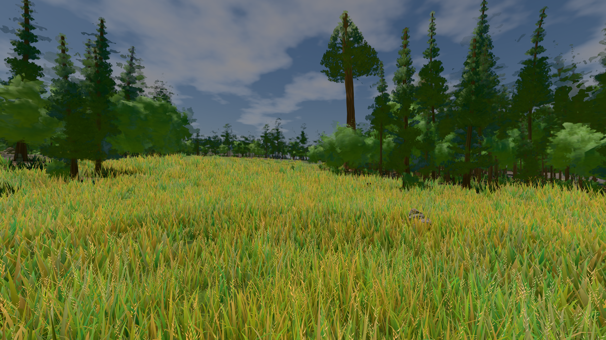

# GPU-PROBE 77693dde — GRÜN

Zweig `samen-tier-leser` · Kopf 77693dde3390a38e9fcda45126c4ccfcc4f21603 · Läufer omen-gtx1060 · 21.11. 10:30 · Wanduhr ab Push 554 s · Lauf https://github.com/MiguellD/AnazhRealm/actions/runs/44889163483

Ruf: `gate:kreatur-leben gate:studio-begehen bild:wiese@0.5`

## Läufer omen-gtx1060 — GRÜN

GPU NVIDIA GeForce GTX 1060 · node_modules bleiben (package-lock 42ac545e)
Schloss /c/Users/micha/AppData/Local/Temp/claude/gpu-schloss hält „ci-runner 44889163483/1 probe“
- Hook 2026-11-21 10:21:34 start ci-runner 44889163483/1 probe: wartet auf Schloss von 'omen-punkte-gtx-sitzung'
- Hook 2026-11-21 10:23:36 start ci-runner 44889163483/1 probe: Schloss genommen (refs/heads/samen-tier-leser 77693dde3390a38e9fcda45126c4ccfcc4f21603 ws=C:\actions-runner\_work\AnazhRealm\AnazhRealm)

### gate:kreatur-leben — GRÜN · 53 s · Läufer omen-gtx1060

Adapter: ungenannt (die Probe nannte keinen Browser-Adapter)

```text
  ✅ Spanne des Lebens-Gesetzes [Neugeborenes < 1 < größtes Erwachsenes]
  ✅ Bestand = Gesetz: Lauf 4 zahlengleich (Saat 1 · 2, Jahre 0–40, Spur von Wolf und Beute gegen die Vorlage)
  ✅ Bestand = Gesetz, Selbsttest: der Mutant V½ 246 → 300 fällt ROT
  ✅ Gau, der Akt (E2): „aus“ nimmt den Kopf, „ein“ setzt ihn mit seinem Leib, ein fremder Takt-Stempel wirft
  ✅ Gau, Determinismus (G3): zwei Läufe byte-gleich · EIN „aus“ am Takt 100 weicht ab · derselbe Akt wieder byte-gleich
  ✅ Gau, Stand-Rundreise (G4): packen → entpacken → weiterrechnen = durchrechnen, byte-gleich (412480 Bytes am 32er-Raster)
  ✅ Gau, Selbsttest: der Mutant „der Akt wirkt an einer Kopie“ fällt ROT
  ✅ Gau, Selbsttest: der Mutant „der Wirt verliert den Akt“ fällt ROT
  ✅ Gau, Selbsttest: der Mutant „der Stand vergisst die Fraß-Schicht“ fällt ROT
✅ GRÜN — DIE KREATUR-SEELE IST GESCHLOSSEN: jedes Aktions-Profil zeigt auf ein Feld der Haltung.
```

### gate:studio-begehen — GRÜN · 244 s · Läufer omen-gtx1060

Adapter: [linse-gpu] nvidia/pascal

```text
  ✅ Selbsttest „huelle" macht B1 Hülle nach Promotion + B1 Hülle nach Demotion rot — B1 Hülle nach Promotion: 10 von 10 Häusern zu | B1 Hülle nach Demotion: 0 von 2 Häusern (Geister)
  ✅ Selbsttest „kopf" macht B3 Kopf rot — B3 Kopf: 26 von 120 Treppen-Läufen enden im Solid
  ✅ Selbsttest „kappe" macht B3 Steigen rot — B3 Steigen: 21 von 24 Treppen erreichen ihre Höhe (EG→OG 9/9 · OG→OG 12/12 · Speicher 0/3)
  ✅ Selbsttest „spur" macht B3 Steigen rot — B3 Steigen: 15 von 24 Treppen erreichen ihre Höhe (EG→OG 9/9 · OG→OG 3/12 · Speicher 3/3)
  ✅ Selbsttest „austritt" macht B3 Kopfraum rot — B3 Kopfraum: 11 Austritte unter 1.7 m (min 0.99 m — der Kopf steht im Dach)
  ✅ Selbsttest „dachlos" macht B3 Dach rot — B3 Dach: 4 Speicher-Austritte ohne Dach über dem Kopf (der Lauf steigt durch das Dach)
  ✅ Selbsttest „platte" macht B4 Keller-Decke rot — B4 Keller-Decke = Boden-Platte in 7 von 8
  ✅ Selbsttest „flach" macht B5 Weltgrund rot — B5 Weltgrund: die Häuser stehen eben (Spanne 0 m)
✅ gate:studio-begehen grün
```

### bild:wiese@0.5 — GRÜN · 53 s · Läufer omen-gtx1060

Adapter: [linse-gpu] nvidia/pascal

```text
Kamera des Spiels → Blick (10.0 m): -280.40 29.71 -1045.60 -289.61 29.71 -1049.50
 "abnahme": "ABNAHME GRÜN · beweis · Sicht 0.0 % · Ziel Blickziel im Bild frei 10 m · Luma 99.4 σ 35.4 schwarz 0.0 % weiß 0.0 % · Stand 18.546.355 · Bühne summer sunny 0.50 Tiere gehalten · Gerät WebGPU nvidia pascal · Inhalt nahWiese 48.4 % (≥ 15.0 %) h 107° Luma 123",
```


