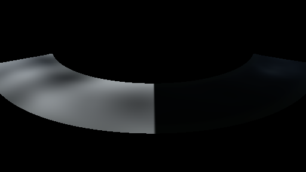
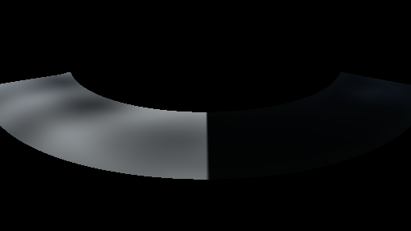

# GPU-PROBE 2bb0461e — ROT

Zweig `seegang-spiegel` · Kopf 2bb0461e90097089d2b265b7957af08be170ad1f · Läufer gtx1050-desktop · 28.11. 04:19 · Wanduhr ab Push 2319 s · Lauf https://github.com/MiguellD/AnazhRealm/actions/runs/46099237362

Ruf: `gate:wasser-leben:bild gate:pruefbuehne-licht gate:weltbild-frost:echt gate:studio-begehen gate:webgl-probe`

## Läufer gtx1050-desktop — ROT

GPU NVIDIA GeForce GTX 1050 · npm ci 155 s (package-lock a2abdcfe)
Schloss /c/Users/User/AppData/Local/Temp/claude/gpu-schloss hält „ci-runner 46099237362/1 probe“
- Hook 2026-11-28 03:41:44 start ci-runner 46099237362/1 probe: Schloss genommen (refs/heads/seegang-spiegel 2bb0461e90097089d2b265b7957af08be170ad1f ws=C:\actions-runner\_work\AnazhRealm\AnazhRealm)

### gate:wasser-leben:bild — GRÜN · 130 s · Läufer gtx1050-desktop

Adapter: [linse-gpu] nvidia/pascal

```text
  ✅ B8 Weißkappe: Flaute 0.00 % · Wind 0,8 4.45 % der See · B9 Glanz der Zenit-Sonne: frei 45.92 · hinter dem Grat 3.67 (Luma-Mittel der Mitte) · B10 Spiegel ohne Feld: deckt 1 der See
WASSER-LEBEN GRÜN
```






### gate:pruefbuehne-licht — GRÜN · 112 s · Läufer gtx1050-desktop

Adapter: [linse-gpu] nvidia/pascal

```text
  S0 BODEN-PROGRAMM 1/1: 108534 Zeichen WGSL (gebuchter Stand 108011, ZUWACHS +523 — Auskunft, kein Urteil) · Pipeline asynchron → GRÜN · kalt 2804 · 2613 · 2268 · 2770 · 3242 · 2756 · 2382 · 2226 · 3063 ms, Median 2756 ms · ÷ K17 derselben Sitzung 0,78 (Auskunft, kein Zeit-Urteil)
  SELBSTTEST S0 NACHT (die Sicht des Mondes): getroffen — ohne Mond-Sicht „S0 Nacht: das Licht der Nacht trifft keinen Boden 1–3 m (Mond-Sicht 0 an jedem Pixel des Rings, Mond 22.08°)“ · schwarz 8 % im Licht → ROT · schwarz 8 % allein im Schatten grün
✅ S0 BILD GRÜN: die Feuerstelle trägt den Feuerkreis aus 2 m in der Ausgabe · Nacht {"luma":43.3,"schwarz":0,"gesetz":45.05} (98 s, nvidia/pascal · Holz kienspan)
```

### gate:weltbild-frost:echt — ROT · 1055 s · Läufer gtx1050-desktop

Adapter: [linse-gpu] nvidia/pascal · DECKEL 960 s

```text

> anazhrealm@18.546.463 gate:weltbild-frost:echt
> node scripts/diag-weltbild-frost.cjs --echt

[linse-gpu] nvidia/pascal
```

### gate:studio-begehen — GRÜN · 590 s · Läufer gtx1050-desktop

Adapter: [linse-gpu] nvidia/pascal

```text
  ✅ Selbsttest „ruecken" macht B3 Speicher rot — B3 Speicher: 2 Häuser mit Dachraum ohne Speicherlauf, obwohl am First Kopfraum steht (#0 635014 provenzalisch/kirche Speicher zu: First 2.68 m, Stufe 0.2 m, Stehraum 3.21 m · #2 723323 provenzalisch/pfarrhaus Speicher zu: First 2.80 m, Stufe 0.2 m, Stehraum 3.54 m)
[stall-akte] Stderr [14752:248:1128/041020.128:ERROR:services\on_device_model\public\cpp\service_client.cc:37] Unexpected on_device_model service disconnect; reason: 1, description: Error loading backend.
[stall-akte] Stderr [14752:15108:1128/041153.101:ERROR:google_apis\gcm\engine\mcs_client.cc:702]   Error code: 401  Error message: Authentication Failed: wrong_secret
  ✅ Selbsttest „platte" macht B4 Keller-Decke rot — B4 Keller-Decke = Boden-Platte in 7 von 8
[stall-akte] Stderr [14752:248:1128/041020.128:ERROR:services\on_device_model\public\cpp\service_client.cc:37] Unexpected on_device_model service disconnect; reason: 1, description: Error loading backend.
[stall-akte] Stderr [14752:15108:1128/041153.101:ERROR:google_apis\gcm\engine\mcs_client.cc:702]   Error code: 401  Error message: Authentication Failed: wrong_secret
  ✅ Selbsttest „flach" macht B5 Weltgrund rot — B5 Weltgrund: die Häuser stehen eben (Spanne 0 m)
[stall-akte] Stderr [14752:248:1128/041020.128:ERROR:services\on_device_model\public\cpp\service_client.cc:37] Unexpected on_device_model service disconnect; reason: 1, description: Error loading backend.
[stall-akte] Stderr [14752:15108:1128/041153.101:ERROR:google_apis\gcm\engine\mcs_client.cc:702]   Error code: 401  Error message: Authentication Failed: wrong_secret
✅ gate:studio-begehen grün
```

### gate:webgl-probe — GRÜN · 132 s · Läufer gtx1050-desktop

Adapter: [linse-gpu] webgl2/NVIDIA GeForce GTX 1050 (0x00001C81) Direct3D11 vs_5_0 ps_5_0

```text
✅ GRÜN — die Kein-WebGPU-Geschichte ist BEWIESEN: der erzwungene WebGL2-Rückfall bootet eine LEBENDE, sichtbare Welt; die WGSL-Konsumenten + Bundles ruhen hinter der EINEN Backend-Wand, der Rückfall ist LAUT benannt, der Fern-Ring trägt auf CPU.
```
