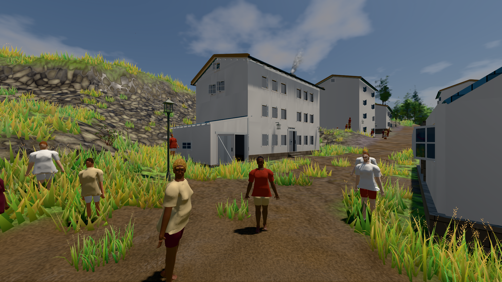

# GPU-PROBE a857b2bd — GRÜN

Zweig `siedlung-heap` · Kopf a857b2bd5827b4b05ac00827374dae5dbf7f6309 · Läufer omen-gtx1060 · 21.11. 08:52 · Wanduhr ab Push 676 s · Lauf https://github.com/MiguellD/AnazhRealm/actions/runs/44881410756

Ruf: `gate:profiband bild:dorf`

## Läufer omen-gtx1060 — GRÜN

GPU NVIDIA GeForce GTX 1060 · node_modules bleiben (package-lock 42ac545e)
Schloss /c/Users/micha/AppData/Local/Temp/claude/gpu-schloss hält „ci-runner 44881410756/1 probe“
- Hook 2026-11-21 08:42:11 start ci-runner 44881410756/1 probe: wartet auf Schloss von 'omen-tier-kt3b'
- Hook 2026-11-21 08:49:30 start ci-runner 44881410756/1 probe: Schloss genommen (refs/heads/siedlung-heap a857b2bd5827b4b05ac00827374dae5dbf7f6309 ws=C:\actions-runner\_work\AnazhRealm\AnazhRealm)

### gate:profiband — GRÜN · 62 s · Läufer omen-gtx1060

Adapter: ungenannt (die Probe nannte keinen Browser-Adapter)

```text
✅ SELBST-TEST: Re-Mint: die Gesamt-Zeile vramMB ist höchstens die Summe der Erzeuger (zwei Läufe 6,0 + 4,0 und 5,9 + 4,1 → Erzeuger 5,9 + 4,0, Gesamt 10,0 → 9,9, beim Namen)
✅ SELBST-TEST: Gerät × Sicht: amd rdna-3 → radeon, nvidia pascal → gtx, SwiftShader → keins; first → ego, third → third; geraet (EIN Gerät) und eine Kamera „drohne" brechen den Haushalt
✅ SELBST-TEST: Gang: Heap je Minute und VRAM-Drift urteilen, der Halter steht beim Pfad
✅ SELBST-TEST: Weg: der Speicher folgt dem Blick — N1 · N2 · N3 rot beim Pfad ihres Halters
✅ SELBST-TEST: Runde: Behälter mit Anlage, Geometrie mit Geburts-Stelle, Zell-Gedächtnis außerhalb des Blicks und unangemeldetes rot beim Namen, die geräumte Runde grün
✅ SELBST-TEST: Runde: der JS-Heap-Zuwachs steht beim Besteller (Datei:Zeile) und der Stelle, ein voll gelaufener Cache grün, Splitter benannt
✅ SELBST-TEST: Soll des Turms: die Stufe 0 je Auftrag ist rot bei sollTon, je Bau einmal grün
✅ SELBST-TEST: Ferne Siedlung: der Abschied ohne die Takt-Felder ist rot bei aktivListe, der Stamm grün
✅ SELBSTTEST GRÜN — die Band-Wand feuert (47/47)
✅ DIE BAND-WAND steht — H1 Haushalt 208/208 Befehle · 680000/680000 Dreiecke in 14 Klassen (keine Sammelzeile) · H2 Ratsche 14 Klassen × 3 Pässe je Ort × Gerät × Sicht · H2b 12 Ratschen frisch an V18.546.355 · H4 Täter-Klasse des Stamms: 17 Schlüssel-Formen · Messorte wiese × radeon × ego (V18.545.0, gemessen 66 von 84) · wiese × radeon × third (V18.545.0, gemessen 66 von 84) · wiese × gtx × ego (V18.546.55, gemessen 72 von 84) · wiese × gtx × third (V18.546.55, gemessen 72 von 84) · genesis × radeon × ego (V18.545.0, gemessen 66 von 84) · genesis × radeon × th
```

### bild:dorf — GRÜN · 85 s · Läufer omen-gtx1060

Adapter: [linse-gpu] nvidia/pascal

```text
Kamera des Spiels → Blick (12.9 m): -715.86 49.01 -932.69 -702.99 49.01 -931.86
 "abnahme": "ABNAHME GRÜN · beweis · Sicht 0.0 % · Leib im Vordergrund 3.8 % (Leib bewohner 3.8 %) · Ziel Blickziel im Bild frei 12.9 m · Luma 95 σ 31.7 schwarz 0.2 % weiß 0.0 % · Stand 18.546.355 · Bühne summer sunny 0.50 Tiere gehalten · Gerät WebGPU nvidia pascal · Inhalt bauSatz 20.4 % (≥ 2.0 %) Luma 93",
```


