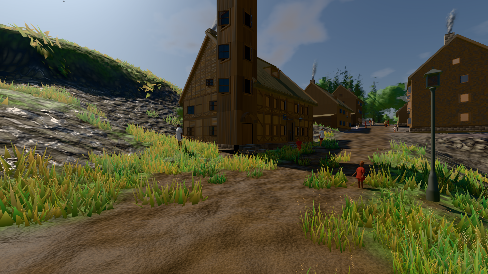
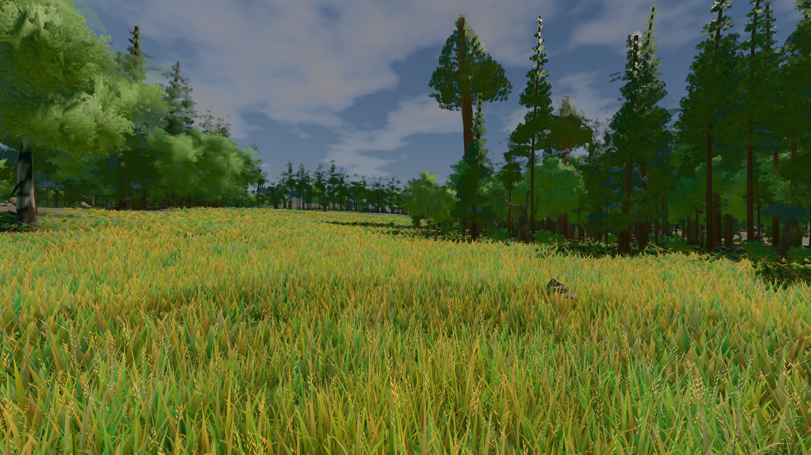

# GPU-PROBE 13d6c260 — GRÜN

Zweig `spanne-auge` · Kopf 13d6c2605f51a5b69ae44d0b23a3ddc731b89ca5 · Läufer radeon-890m · 26.11. 08:54 · Wanduhr ab Push 1676 s · Lauf https://github.com/MiguellD/AnazhRealm/actions/runs/45775376766

Ruf: `gate:webgl-probe bild:dorf@0.42 bild:wiese@0.5 gate:tag-achse:echt`

## Läufer radeon-890m — GRÜN

GPU AMD Radeon(TM) 890M Graphics · node_modules bleiben (package-lock fda62849)
Schloss /c/Users/micha/AppData/Local/Temp/claude/gpu-schloss hält „ci-runner 45775376766/1 probe“
- Hook 2026-11-26 08:32:05 start ci-runner 45775376766/1 probe: wartet auf Schloss von 'punkte-radeon-sitzungpid=24676'
- Hook 2026-11-26 08:37:47 start ci-runner 45775376766/1 probe: Schloss genommen (refs/heads/spanne-auge 13d6c2605f51a5b69ae44d0b23a3ddc731b89ca5 ws=C:\actions-runner\_work\AnazhRealm\AnazhRealm)

### gate:webgl-probe — GRÜN · 72 s · Läufer radeon-890m

Adapter: [linse-gpu] webgl2/AMD Radeon(TM) 890M Graphics (0x0000150E) Direct3D11 vs_5_0 ps_5_0

```text
✅ GRÜN — die Kein-WebGPU-Geschichte ist BEWIESEN: der erzwungene WebGL2-Rückfall bootet eine LEBENDE, sichtbare Welt; die WGSL-Konsumenten + Bundles ruhen hinter der EINEN Backend-Wand, der Rückfall ist LAUT benannt, der Fern-Ring trägt auf CPU.
```

### bild:dorf@0.42 — GRÜN · 100 s · Läufer radeon-890m

Adapter: [linse-gpu] amd/rdna-3

```text
Kamera des Spiels → Blick (11.3 m): -720.31 44.15 -922.46 -709.17 44.15 -920.56
 "abnahme": "ABNAHME GRÜN · beweis · Sicht 0.0 % · Ziel Blickziel im Bild frei 11.3 m · Luma 83.3 σ 45.6 schwarz 0.3 % weiß 0.0 % · Stand 18.546.430 · Bühne summer sunny 0.42 Tiere gehalten · Gerät WebGPU amd rdna-3 · Inhalt bauSatz 16.9 % (≥ 2.0 %) Luma 37",
```



### bild:wiese@0.5 — GRÜN · 66 s · Läufer radeon-890m

Adapter: [linse-gpu] amd/rdna-3

```text
Kamera des Spiels → Blick (10.0 m): -280.40 29.71 -1045.60 -289.61 29.71 -1049.50
 "abnahme": "ABNAHME GRÜN · beweis · Sicht 0.0 % · Ziel Blickziel im Bild frei 10 m · Luma 97.6 σ 36.3 schwarz 0.0 % weiß 0.0 % · Stand 18.546.430 · Bühne summer sunny 0.50 Tiere gehalten · Gerät WebGPU amd rdna-3 · Inhalt nahWiese 48.4 % (≥ 15.0 %) h 107° Luma 119",
```



### gate:tag-achse:echt — GRÜN · 260 s · Läufer radeon-890m

Adapter: ungenannt (die Probe nannte keinen Browser-Adapter)

```text
TAG genesis GRUEN: Karte 126.3 · Sprung 0.08 (Uhr 0.28) · Buckel 0.00 (Uhr 0) · Sonne 10° -0.67 EV R/B ×1.04 | -0.76 EV R/B ×0.85 · Nacht -0.54 EV Luma 84.7 · REF 1.65 (Uhr 0) · Sicht -0.06 (Uhr 0.5) · ASYNC -0.02 (Uhr 0) nach 3 Bildern (Mutant 10) · sofort -0.69 (Uhr 0.72) EV · nur die Wand (--kurz)
TAG wiese GRUEN: Karte 123.8 · Sprung -0.08 (Uhr 0.732) · Buckel 0.00 (Uhr 0) · Sonne 10° -1.02 EV R/B ×0.88 | -1.24 EV R/B ×0.67 · Nacht -2.37 EV Luma 46.6 · REF 0.44 (Uhr 0) · Sicht -0.01 (Uhr 0.27) · ASYNC 0.01 (Uhr 0) nach 3 Bildern (Mutant 9) · sofort -0.68 (Uhr 0.75) EV · nur die Wand (--kurz)
TAG-ACHSE GRUEN
```
