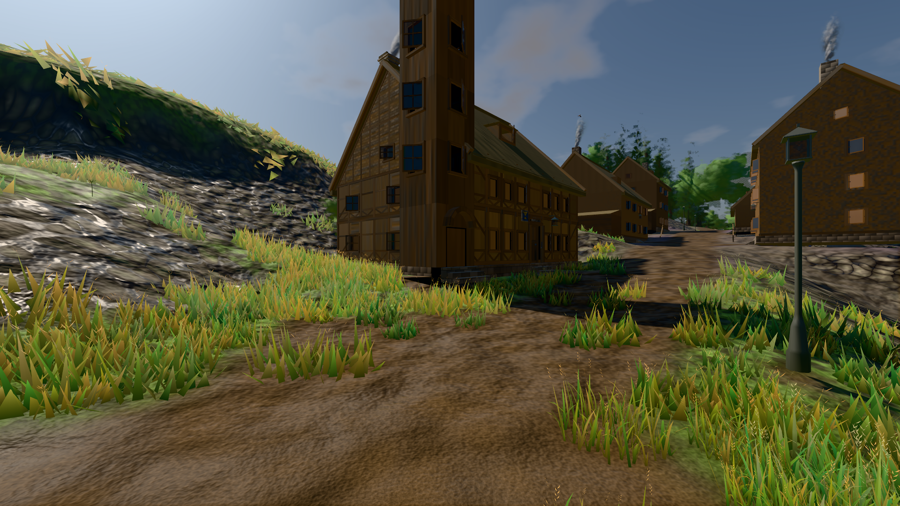
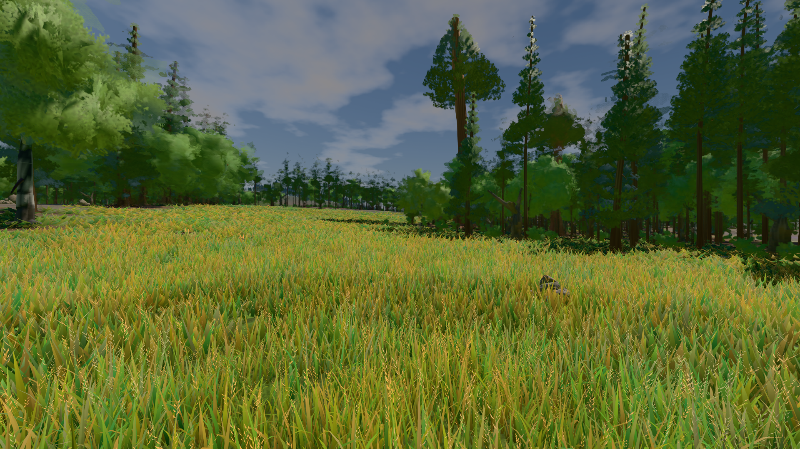

# GPU-PROBE 7fadccbb — GRÜN

Zweig `spanne-auge` · Kopf 7fadccbb60d7568e7828e0d62a7558b3af51066d · Läufer gtx1050-desktop · 26.11. 07:04 · Wanduhr ab Push 1037 s · Lauf https://github.com/MiguellD/AnazhRealm/actions/runs/45763820057

Ruf: `gate:webgl-probe bild:dorf@0.42 bild:wiese@0.5`

## Läufer gtx1050-desktop — GRÜN

GPU NVIDIA GeForce GTX 1050 · npm ci 114 s (package-lock 15400fe9)
Schloss /c/Users/User/AppData/Local/Temp/claude/gpu-schloss hält „ci-runner 45763820057/1 probe“
- Hook 2026-11-26 06:48:25 start ci-runner 45763820057/1 probe: wartet auf Schloss von 'hand-macher-gtx-sitzung'
- Hook 2026-11-26 06:53:28 start ci-runner 45763820057/1 probe: Schloss genommen (refs/heads/spanne-auge 7fadccbb60d7568e7828e0d62a7558b3af51066d ws=C:\actions-runner\_work\AnazhRealm\AnazhRealm)

### gate:webgl-probe — GRÜN · 159 s · Läufer gtx1050-desktop

Adapter: [linse-gpu] webgl2/NVIDIA GeForce GTX 1050 (0x00001C81) Direct3D11 vs_5_0 ps_5_0

```text
✅ GRÜN — die Kein-WebGPU-Geschichte ist BEWIESEN: der erzwungene WebGL2-Rückfall bootet eine LEBENDE, sichtbare Welt; die WGSL-Konsumenten + Bundles ruhen hinter der EINEN Backend-Wand, der Rückfall ist LAUT benannt, der Fern-Ring trägt auf CPU.
```

### bild:dorf@0.42 — GRÜN · 186 s · Läufer gtx1050-desktop

Adapter: [linse-gpu] nvidia/pascal

```text
Kamera des Spiels → Blick (11.3 m): -720.31 44.15 -922.46 -709.17 44.15 -920.56
 "abnahme": "ABNAHME GRÜN · beweis · Sicht 0.0 % · Ziel Blickziel im Bild frei 11.3 m · Luma 83.4 σ 45.7 schwarz 0.3 % weiß 0.0 % · Stand 18.546.429 · Bühne summer sunny 0.42 Tiere gehalten · Gerät WebGPU nvidia pascal · Inhalt bauSatz 17.0 % (≥ 2.0 %) Luma 37",
```



### bild:wiese@0.5 — GRÜN · 117 s · Läufer gtx1050-desktop

Adapter: [linse-gpu] nvidia/pascal

```text
Kamera des Spiels → Blick (10.0 m): -280.40 29.71 -1045.60 -289.61 29.71 -1049.50
 "abnahme": "ABNAHME GRÜN · beweis · Sicht 0.0 % · Ziel Blickziel im Bild frei 10 m · Luma 97.4 σ 36.6 schwarz 0.0 % weiß 0.0 % · Stand 18.546.429 · Bühne summer sunny 0.50 Tiere gehalten · Gerät WebGPU nvidia pascal · Inhalt nahWiese 48.4 % (≥ 15.0 %) h 107° Luma 119",
```


