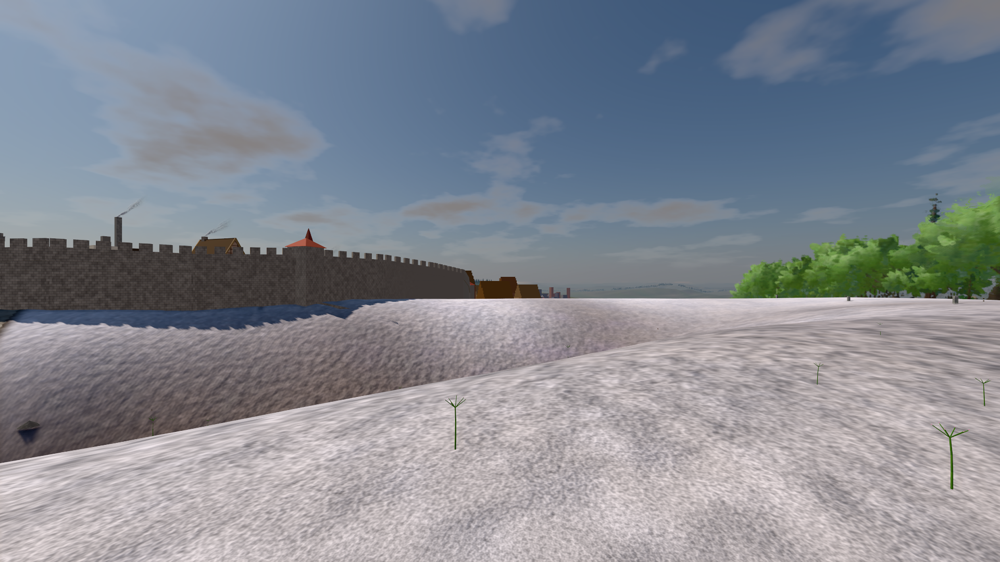
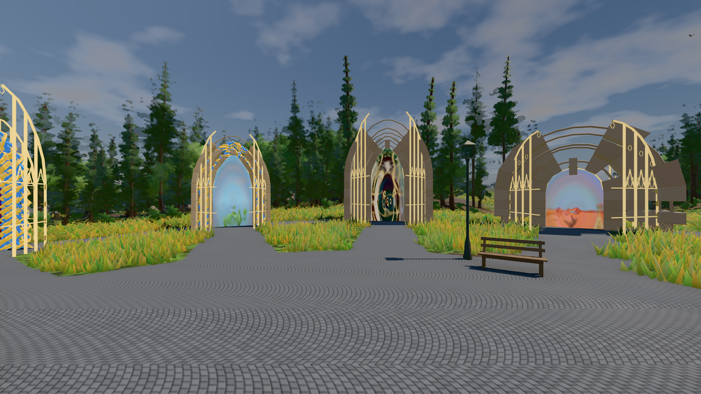

# GPU-PROBE bf0d3955 — ROT

Zweig `spanne-auge` · Kopf bf0d3955e9381b506c21db5cd36d21993dcc9f0b · Läufer radeon-890m · 26.11. 04:21 · Wanduhr ab Push 1257 s · Lauf https://github.com/MiguellD/AnazhRealm/actions/runs/45746144727

Ruf: `gate:tag-achse:echt bild:gipfel-blick@0.5 bild:genesis@0.5 gate:webgl-probe`

## Läufer radeon-890m — ROT

GPU AMD Radeon(TM) 890M Graphics · npm ci 55 s (package-lock f07ee913)
Schloss /c/Users/micha/AppData/Local/Temp/claude/gpu-schloss hält „ci-runner 45746144727/1 probe“
- Hook 2026-11-26 04:09:58 start ci-runner 45746144727/1 probe: Schloss genommen (refs/heads/spanne-auge bf0d3955e9381b506c21db5cd36d21993dcc9f0b ws=C:\actions-runner\_work\AnazhRealm\AnazhRealm)

### gate:tag-achse:echt — GRÜN · 160 s · Läufer radeon-890m

Adapter: ungenannt (die Probe nannte keinen Browser-Adapter)

```text
TAG genesis GRUEN: Karte 126.3 · Sprung 0.07 (Uhr 0.28) · Buckel 0.00 (Uhr 0) · Sonne 10° -0.67 EV R/B ×1.04 | -0.75 EV R/B ×0.85 · Nacht -0.54 EV Luma 84.7 · REF 1.65 (Uhr 0) · Sicht -0.07 (Uhr 0.5) · ASYNC 0.03 (Uhr 0) nach 3 Bildern (Mutant 10) · sofort -0.69 (Uhr 0.72) EV · nur die Wand (--kurz)
TAG wiese GRUEN: Karte 123.8 · Sprung -0.08 (Uhr 0.732) · Buckel 0.00 (Uhr 0) · Sonne 10° -1.02 EV R/B ×0.87 | -1.24 EV R/B ×0.67 · Nacht -2.37 EV Luma 46.7 · REF 0.44 (Uhr 0) · Sicht -0.01 (Uhr 0.28) · ASYNC -0.01 (Uhr 0) nach 3 Bildern (Mutant 9) · sofort -0.68 (Uhr 0.75) EV · nur die Wand (--kurz)
TAG-ACHSE GRUEN
```

### bild:gipfel-blick@0.5 — ROT · 228 s · Läufer radeon-890m

Adapter: [linse-gpu] amd/rdna-3 · "fehler": "ABNAHME ROT [Ziel Blickziel verdeckt von kamm-krone in 155.66 m · kein fern-ring im Bild: 0.5 % < 2.0 %] · beweis · Sicht 0.0 % · Ziel Blickziel im Bild VERDECKT 1176.4 m · Luma 137 σ 39.2 schwarz 0.0 % weiß 0

```text
Kamera des Spiels → Blick (1176.4 m): -433.60 174.09 -3146.40 686.37 174.09 -3506.39
 "fehler": "ABNAHME ROT [Ziel Blickziel verdeckt von kamm-krone in 155.66 m · kein fern-ring im Bild: 0.5 % < 2.0 %] · beweis · Sicht 0.0 % · Ziel Blickziel im Bild VERDECKT 1176.4 m · Luma 137 σ 39.2 schwarz 0.0 % weiß 0.0 % · Stand 18.546.426 · Bühne summer sunny 0.50 Tiere gehalten · Gerät WebGPU amd rdna-3 · Inhalt bodenSatz 46.1 % (≥ 5.0 %) Luma 166, fern-ring 0.5 % (≥ 2.0 %) Luma 114 · ROT-Bild C:\\actions-runner\\_work\\_temp\\probe\\bf0d3955-gipfel-blick-0.5-rot.png",
```



### bild:genesis@0.5 — GRÜN · 61 s · Läufer radeon-890m

Adapter: [linse-gpu] amd/rdna-3

```text
Kamera des Spiels → Blick (10.0 m): 0.00 92.40 0.00 -10.00 92.40 0.00
 "abnahme": "ABNAHME GRÜN · beweis · Sicht 0.0 % · Ziel Blickziel im Bild frei 10 m · Luma 108.4 σ 31.9 schwarz 0.0 % weiß 0.0 % · Stand 18.546.426 · Bühne summer sunny 0.50 Tiere gehalten · Gerät WebGPU amd rdna-3 · Inhalt bodenSatz 36.6 % (≥ 15.0 %) Luma 110, portal-membran 2.7 % (≥ 0.3 %) Luma 140",
```



### gate:webgl-probe — GRÜN · 70 s · Läufer radeon-890m

Adapter: [linse-gpu] webgl2/AMD Radeon(TM) 890M Graphics (0x0000150E) Direct3D11 vs_5_0 ps_5_0

```text
✅ GRÜN — die Kein-WebGPU-Geschichte ist BEWIESEN: der erzwungene WebGL2-Rückfall bootet eine LEBENDE, sichtbare Welt; die WGSL-Konsumenten + Bundles ruhen hinter der EINEN Backend-Wand, der Rückfall ist LAUT benannt, der Fern-Ring trägt auf CPU.
```
