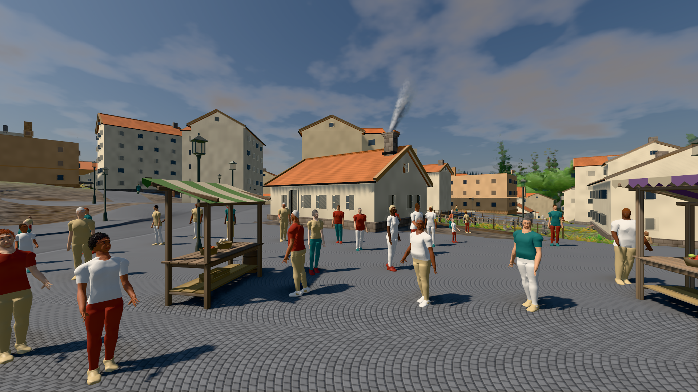

# GPU-PROBE a39ca363 — ROT

Zweig `stand-lebt` · Kopf a39ca363184634c6f8802a7ef4717c37d17de8d8 · Läufer gtx1050-desktop · 26.11. 11:29 · Wanduhr ab Push 2300 s · Lauf https://github.com/MiguellD/AnazhRealm/actions/runs/45795856065

Ruf: `gate:pruefbuehne-licht gate:weltbild-frost:echt gate:studio-begehen bild:stadt-voll@0.55 gate:webgl-probe`

## Läufer gtx1050-desktop — ROT

GPU NVIDIA GeForce GTX 1050 · npm ci 59 s (package-lock 0b75c854)
Schloss /c/Users/User/AppData/Local/Temp/claude/gpu-schloss hält „ci-runner 45795856065/1 probe“
- Hook 2026-11-26 11:00:59 start ci-runner 45795856065/1 probe: Schloss genommen (refs/heads/stand-lebt a39ca363184634c6f8802a7ef4717c37d17de8d8 ws=C:\actions-runner\_work\AnazhRealm\AnazhRealm)

### gate:pruefbuehne-licht — ROT · 101 s · Läufer gtx1050-desktop

Adapter: [linse-gpu] nvidia/pascal · ⛔ S0 Himmel: nach dem Sprung auf Mitternacht trägt die Umgebung die Bestrahlung 3.289e-8, der Himmel des Orts 2.74e-8 — die Himmels-Umgebung (`_ensureSkyEnvironment`) folgt dem Sprung der Uhr nicht: gemalt vor der Luft-F

```text
  S0 BODEN-PROGRAMM 1/1: 108011 Zeichen WGSL (gebuchter Stand 108011, ±0 — Auskunft, kein Urteil) · Pipeline asynchron → GRÜN · kalt 2032 · 2147 · 2089 · 2751 · 1999 · 2220 · 2750 · 2494 · 2215 ms, Median 2215 ms · ÷ K17 derselben Sitzung 0,78 (Auskunft, kein Zeit-Urteil)
    ⛔ S0 Himmel: nach dem Sprung auf Mitternacht trägt die Umgebung die Bestrahlung 3.289e-8, der Himmel des Orts 2.74e-8 — die Himmels-Umgebung (`_ensureSkyEnvironment`) folgt dem Sprung der Uhr nicht: gemalt vor der Luft-Farbe (`_dayNightApplyLuft`) oder vom Sprung in der Raten-Drossel (SKY_ENV_REGEN_MIN_MS) gehalten
    ⛔ S0 Himmel: der Himmel der Nacht fehlt — um Mitternacht trägt die Umgebung 3.289e-8, der Himmel des Orts 2.74e-8, das Gesetz allein im Sternen-Licht π · nachtHimmel = 3.108e-8 (Sonne -22.08°) — die Tafeln tragen Mond und Sterne nicht (`__weltLicht.tafelLicht` aus `_atmoTakt`: `AnazhRealm.MOONLIGHT`, `_atmoSternenLicht`)
  SELBSTTEST S0 NACHT (die Sicht des Mondes): getroffen — ohne Mond-Sicht „S0 Nacht: das Licht der Nacht trifft keinen Boden 1–3 m (Mond-Sicht 0 an jedem Pixel des Rings, Mond 22.08°)“ · schwarz 8 % im Licht → ROT · schwarz 8 % allein im Schatten grün
⛔ S0 BILD ROT · Nacht {"luma":50.2,"schwarz":0,"gesetz":52.37} (83 s, nvidia/pascal · Holz kienspan)
```

### gate:weltbild-frost:echt — GRÜN · 473 s · Läufer gtx1050-desktop

Adapter: [linse-gpu] nvidia/pascal

```text
  ✅ P2 kein writeBuffer schief: der Pfad und ein Index ungerader Länge der Ich-Bühne — 927538 writeBuffer, keiner schief
  ✅ T1 die Index-Wache nennt den Index über der Vertex-Zahl beim Namen — Vendor- und Storage-Index — gezeichnet nach 43 Bildern · Scene/frost-taeter-bereich: Index 3 ≥ 3 Vertices im gezeichneten Bereich | Scene/frost-taeter-speicher: Index 3 ≥ 3 Vertices im gezeichneten Bereich
  ✅ T3 die Puffer-Wache nennt den schiefen writeBuffer beim Namen, WebGPU wirft — frost-taeter-puffer · Uint16Array · Versatz 0 · 6 B · q.writeBuffer (stamm/dirigent-ankunft.js:253:36) < pptr:;page.%3Ccomputed%3E%20(C%3A%5Cactions-runner%5C_work%5CAnazhRealm%5Cgpu-probe%5Cscripts%5Clib%5Cwelt-boot.cjs%3A1136%3A22):6:23 · geworfen: Failed to execute 'writeBuffer' on 'GPUQueue': Number of bytes to write must be a multiple of 4
  ✅ T4 ein fremder Fehler im Bau einer Pipeline markiert keine Pipeline — der Abgriff schließt r184s Bereich, die GPU-Wache zählt den Fehler — 2 Bauten, 2 fremde Validierungen, 2 Bereiche geschlossen, GPU-Wache +2, Marken: keine
  ✅ T4 der Mutant (main 6699a813: r184s Fehler-Bereich bleibt über das Versprechen des Baus offen) markiert die Pipeline des Täters — 1 Bauten, 1 fremde Validierungen, 0 Bereiche geschlossen, GPU-Wache +1, Marken: renderPipeline_frost-taeter-fremd-mutant_3410 · T4 mit beiden Läufen in 3201 ms
  ✅ T2 die Index-Wache nennt den geweiteten Index beim Pfad — Group/BundleGroup/Group/mensch/torso/head/Mesh: 7962 × Uint32Array = 31848 B gebunden, der Puffer trägt 15924 B
  ✅ T2 die GPU-Wache des Spiels zählt die Validierung — {"n":190}
  ✅ T2 der eigene Hörer hört die Validierung (Device oder r184-Fehler-Bereich) — 374 Meldungen: konsole: Write range (bufferOffset: 0, size: 16) does not fit in [Buffer "frost-taeter-fremd"] size (8). | konsole: THREE.Write range (bufferOffset: 0, size: 16) does not fit in [Buffer "frost-taeter-fremd"] size (8).
  ✅ T2 die Bild-Probe erkennt das stehende Bild — 0.95 % der Blöcke bewegt
✅ GRÜN — DIE FROST-WAND steht — durch Werkstatt, Ich- und Hof-Bühne trägt jeder Index-Puffer der Welt-GPU sein Format, kein Device meldet, das Bild folgt der Kamera; die Täter (Index über der Vertex-Zahl, ein fremd geweiteter Mensch-Index) nennen die Wachen beim Namen, ein fremder Fehler im Bau einer Pipeline markiert keine, und das stehende Bild wird erkannt.
```

### gate:studio-begehen — GRÜN · 515 s · Läufer gtx1050-desktop

Adapter: [linse-gpu] nvidia/pascal

```text
  ✅ Selbsttest „ruecken" macht B3 Speicher rot — B3 Speicher: 2 Häuser mit Dachraum ohne Speicherlauf, obwohl am First Kopfraum steht (#0 635014 provenzalisch/kirche Speicher zu: First 2.68 m, Stufe 0.2 m, Stehraum 3.21 m · #2 723323 provenzalisch/pfarrhaus Speicher zu: First 2.80 m, Stufe 0.2 m, Stehraum 3.54 m)
[stall-akte] Stderr [12724:4488:1126/111508.623:ERROR:services\on_device_model\public\cpp\service_client.cc:37] Unexpected on_device_model service disconnect; reason: 1, description: Error loading backend.
[stall-akte] Stderr [12724:3948:1126/111645.333:ERROR:google_apis\gcm\engine\mcs_client.cc:702]   Error code: 401  Error message: Authentication Failed: wrong_secret
  ✅ Selbsttest „platte" macht B4 Keller-Decke rot — B4 Keller-Decke = Boden-Platte in 7 von 8
[stall-akte] Stderr [12724:4488:1126/111508.623:ERROR:services\on_device_model\public\cpp\service_client.cc:37] Unexpected on_device_model service disconnect; reason: 1, description: Error loading backend.
[stall-akte] Stderr [12724:3948:1126/111645.333:ERROR:google_apis\gcm\engine\mcs_client.cc:702]   Error code: 401  Error message: Authentication Failed: wrong_secret
  ✅ Selbsttest „flach" macht B5 Weltgrund rot — B5 Weltgrund: die Häuser stehen eben (Spanne 0 m)
[stall-akte] Stderr [12724:4488:1126/111508.623:ERROR:services\on_device_model\public\cpp\service_client.cc:37] Unexpected on_device_model service disconnect; reason: 1, description: Error loading backend.
[stall-akte] Stderr [12724:3948:1126/111645.333:ERROR:google_apis\gcm\engine\mcs_client.cc:702]   Error code: 401  Error message: Authentication Failed: wrong_secret
✅ gate:studio-begehen grün
```

### bild:stadt-voll@0.55 — GRÜN · 390 s · Läufer gtx1050-desktop

Adapter: [linse-gpu] nvidia/pascal

```text
Kamera des Spiels → Blick (15.0 m): 842.49 57.57 451.79 857.26 57.57 449.21
 "abnahme": "ABNAHME GRÜN · beweis · Sicht 0.0 % · Leib im Vordergrund 4.9 % (Leib bewohner 4.9 %) · Leiber näher als 6 m: 4 von 4 ganz (32 Teile) · Ziel Blickziel im Bild frei 14.99 m · Luma 107.4 σ 35.4 schwarz 0.0 % weiß 0.0 % · Stand 18.546.431 · Bühne summer sunny 0.55 Tiere gehalten · Gerät WebGPU nvidia pascal · Inhalt bauSatz 19.4 % (≥ 2.0 %) Luma 127, bewohner 7.2 % (≥ 1.0 %) Luma 112",
```



### gate:webgl-probe — GRÜN · 123 s · Läufer gtx1050-desktop

Adapter: [linse-gpu] webgl2/NVIDIA GeForce GTX 1050 (0x00001C81) Direct3D11 vs_5_0 ps_5_0

```text
✅ GRÜN — die Kein-WebGPU-Geschichte ist BEWIESEN: der erzwungene WebGL2-Rückfall bootet eine LEBENDE, sichtbare Welt; die WGSL-Konsumenten + Bundles ruhen hinter der EINEN Backend-Wand, der Rückfall ist LAUT benannt, der Fern-Ring trägt auf CPU.
```
