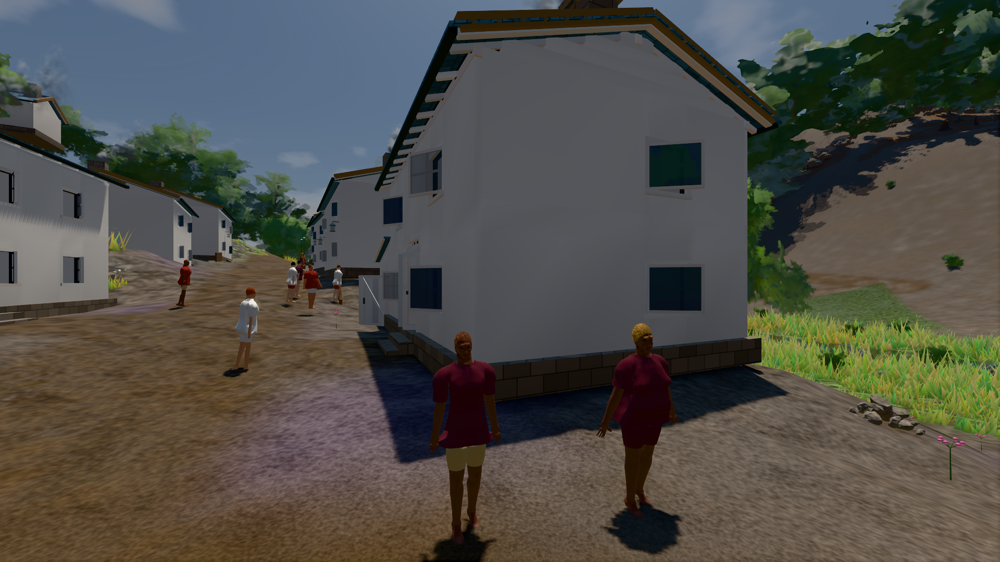

# GPU-PROBE 3e76deb8 — GRÜN

Zweig `stein-ein-gesetz` · Kopf 3e76deb833caf68d970105a0738f0eda707ae251 · Läufer gtx1050-desktop · 19.11. 19:36 · Wanduhr ab Push 1002 s · Lauf https://github.com/MiguellD/AnazhRealm/actions/runs/44586585944

Ruf: `gate:haus-fern bild:dorf@0.5`

## Läufer gtx1050-desktop — GRÜN

GPU NVIDIA GeForce GTX 1050 · node_modules bleiben (package-lock b38d03a8)
Schloss /c/Users/User/AppData/Local/Temp/claude/gpu-schloss hält „ci-runner 44586585944/1 probe“
- Hook 2026-11-19 19:22:23 start ci-runner 44586585944/1 probe: Schloss genommen (refs/heads/stein-ein-gesetz 3e76deb833caf68d970105a0738f0eda707ae251 ws=C:\actions-runner\_work\AnazhRealm\AnazhRealm)

### gate:haus-fern — GRÜN · 637 s · Läufer gtx1050-desktop

Adapter: ungenannt (die Probe nannte keinen Browser-Adapter)

```text
✅ GRÜN — jede Stufe wirft den grundriss-treuen Fernkörper, zeigt sich erst ≤ 1 px von der L0, kein Querfirst, der Körper liegt innen, jedes Türblatt sitzt an seinem Scharnier, jedes Fenster ist Glas in jeder Stufe.
```

### bild:dorf@0.5 — GRÜN · 148 s · Läufer gtx1050-desktop

Adapter: [linse-gpu] nvidia/pascal

```text
Kamera des Spiels → Blick (5.2 m): -704.22 39.69 -880.02 -703.03 39.69 -874.96
 "abnahme": "ABNAHME GRÜN · beweis · Sicht 0.0 % · Ziel Blickziel im Bild frei 5.2 m · Luma 77.7 σ 31 schwarz 0.2 % weiß 0.0 % · Stand 18.546.343 · Bühne summer sunny 0.50 Tiere gehalten · Gerät WebGPU nvidia pascal · Inhalt bauSatz 28.7 % (≥ 2.0 %) Luma 79",
```


