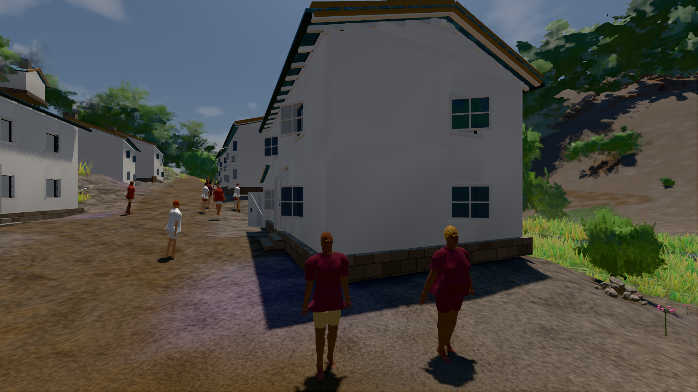

# GPU-PROBE 935703a5 — ROT

Zweig `stein-ein-gesetz` · Kopf 935703a5a90f0e2ef4043f93cdbaedd0a6c962d5 · Läufer gtx1050-desktop · 19.11. 21:07 · Wanduhr ab Push 858 s · Lauf https://github.com/MiguellD/AnazhRealm/actions/runs/44603004133

Ruf: `gate:haus-fern bild:dorf@0.5`

## Läufer gtx1050-desktop — ROT

GPU NVIDIA GeForce GTX 1050 · node_modules bleiben (package-lock 5b670d1f)
Schloss /c/Users/User/AppData/Local/Temp/claude/gpu-schloss hält „ci-runner 44603004133/1 probe“
- Hook 2026-11-19 20:57:52 start ci-runner 44603004133/1 probe: Schloss genommen (refs/heads/stein-ein-gesetz 935703a5a90f0e2ef4043f93cdbaedd0a6c962d5 ws=C:\actions-runner\_work\AnazhRealm\AnazhRealm)

### gate:haus-fern — ROT · 443 s · Läufer gtx1050-desktop

Adapter: ungenannt (die Probe nannte keinen Browser-Adapter) · ❌ ROT — 1 Verletzung(en): alemannisch/s7: Glas L1: Farbe 0.153 von der L0 entfernt

```text
❌ ROT — 1 Verletzung(en): alemannisch/s7: Glas L1: Farbe 0.153 von der L0 entfernt
```

### bild:dorf@0.5 — GRÜN · 124 s · Läufer gtx1050-desktop

Adapter: [linse-gpu] nvidia/pascal

```text
Kamera des Spiels → Blick (5.2 m): -704.22 39.69 -880.02 -703.01 39.69 -874.96
 "abnahme": "ABNAHME GRÜN · beweis · Sicht 0.0 % · Ziel Blickziel im Bild frei 5.2 m · Luma 75.8 σ 30.9 schwarz 0.2 % weiß 0.0 % · Stand 18.546.344 · Bühne summer sunny 0.50 Tiere gehalten · Gerät WebGPU nvidia pascal · Inhalt bauSatz 29.7 % (≥ 2.0 %) Luma 79",
```


