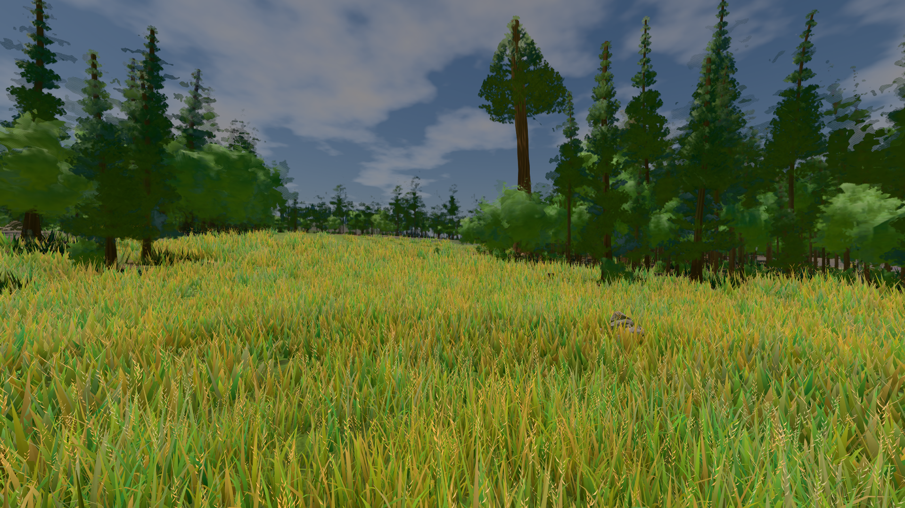

# GPU-PROBE 91e968cd — GRÜN

Zweig `stempel-erbt-probe` · Kopf 91e968cd00b8eb43968d0b2ee4da558ee8eee126 · Läufer omen-gtx1060 · 22.11. 13:38 · Wanduhr ab Push 216 s · Lauf https://github.com/MiguellD/AnazhRealm/actions/runs/45023005124

Ruf: `bild:wiese@0.5 gate:webgl-probe`

## Läufer omen-gtx1060 — GRÜN

GPU NVIDIA GeForce GTX 1060 · npm ci 42 s (package-lock 98869e32)
Schloss /c/Users/micha/AppData/Local/Temp/claude/gpu-schloss hält „ci-runner 45023005124/1 probe“
- Hook 2026-11-22 13:35:00 start ci-runner 45023005124/1 probe: wartet auf Schloss von 'omen-punkte-gtx-sitzung'
- Hook 2026-11-22 13:35:15 start ci-runner 45023005124/1 probe: Schloss genommen (refs/heads/stempel-erbt-probe 91e968cd00b8eb43968d0b2ee4da558ee8eee126 ws=C:\actions-runner\_work\AnazhRealm\AnazhRealm)

### bild:wiese@0.5 — GRÜN · 50 s · Läufer omen-gtx1060

Adapter: [linse-gpu] nvidia/pascal

```text
Kamera des Spiels → Blick (10.0 m): -280.40 29.71 -1045.60 -289.61 29.71 -1049.50
 "abnahme": "ABNAHME GRÜN · beweis · Sicht 0.0 % · Ziel Blickziel im Bild frei 10 m · Luma 99.3 σ 35.6 schwarz 0.0 % weiß 0.0 % · Stand 18.546.368 · Bühne summer sunny 0.50 Tiere gehalten · Gerät WebGPU nvidia pascal · Inhalt nahWiese 48.5 % (≥ 15.0 %) h 107° Luma 123",
```



### gate:webgl-probe — GRÜN · 54 s · Läufer omen-gtx1060

Adapter: [linse-gpu] webgl2/NVIDIA GeForce GTX 1060 (0x00001C60) Direct3D11 vs_5_0 ps_5_0

```text
✅ GRÜN — die Kein-WebGPU-Geschichte ist BEWIESEN: der erzwungene WebGL2-Rückfall bootet eine LEBENDE, sichtbare Welt; die WGSL-Konsumenten + Bundles ruhen hinter der EINEN Backend-Wand, der Rückfall ist LAUT benannt, der Fern-Ring trägt auf CPU.
```
