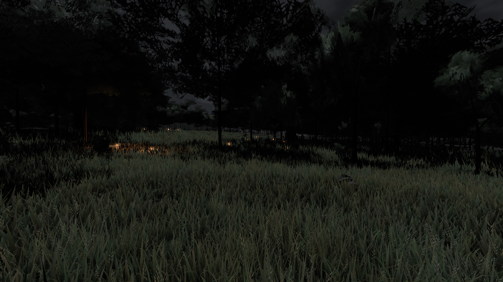

# GPU-PROBE 88a5e936 — GRÜN

Zweig `stern-bild` · Kopf 88a5e9363921b6722e4b9c5d5249dd9b2319d4ef · Läufer omen-gtx1060 · 20.11. 03:15 · Wanduhr ab Push 496 s · Lauf https://github.com/MiguellD/AnazhRealm/actions/runs/44658564633

Ruf: `bild:wiese@0.02`

## Läufer omen-gtx1060 — GRÜN

GPU NVIDIA GeForce GTX 1060 · node_modules bleiben (package-lock 20e3f8f6)
Schloss /c/Users/micha/AppData/Local/Temp/claude/gpu-schloss hält „ci-runner 44658564633/1 probe“
- Hook 2026-11-20 03:09:16 start ci-runner 44658564633/1 probe: wartet auf Schloss von 'omen-samen-bild-neu'
- Hook 2026-11-20 03:09:32 start ci-runner 44658564633/1 probe: Schloss genommen (refs/heads/stern-bild 88a5e9363921b6722e4b9c5d5249dd9b2319d4ef ws=C:\actions-runner\_work\AnazhRealm\AnazhRealm)

### bild:wiese@0.02 — GRÜN · 49 s · Läufer omen-gtx1060

Adapter: [linse-gpu] nvidia/pascal

```text
Kamera des Spiels → Blick (10.0 m): -280.40 29.71 -1045.60 -289.61 29.71 -1049.50
 "abnahme": "ABNAHME GRÜN · beweis · Sicht 0.0 % · Ziel Blickziel im Bild frei 10 m · Luma 19.1 σ 18.1 schwarz 34.6 % weiß 0.0 % · Stand 18.546.346 · Bühne summer sunny 0.02 Tiere gehalten · Gerät WebGPU nvidia pascal · Inhalt nahWiese 48.2 % (≥ 15.0 %) (Nacht: Farbe ungefordert)",
```


