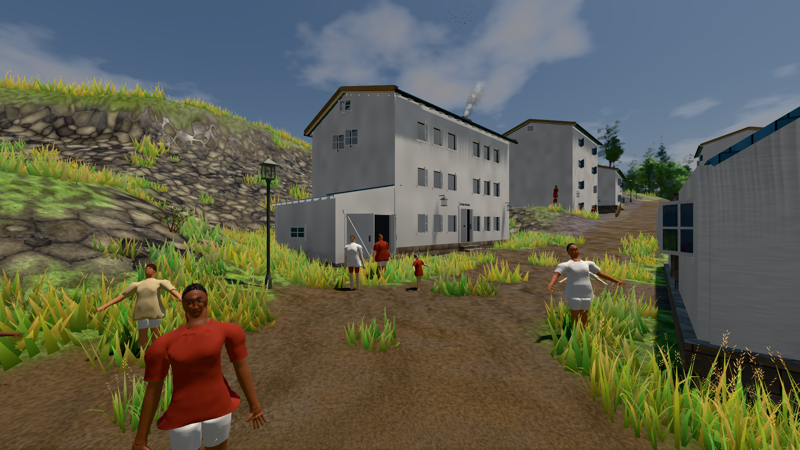

# GPU-PROBE 813034f4 — NACHGEGEBEN

Zweig `stoffstrom-kette-2` · Kopf 813034f4b6eb8b330cf0249f3b52bbf5b40b5e33 · Läufer gtx1050-desktop · 23.11. 19:37 · Wanduhr ab Push 1056 s · Lauf https://github.com/MiguellD/AnazhRealm/actions/runs/45237187031

Ruf: `bild:dorf@0.5 gate:studio-begehen gate:webgl-probe`

## Läufer gtx1050-desktop — NACHGEGEBEN

GPU NVIDIA GeForce GTX 1050 · node_modules bleiben (package-lock e8483713)
Schloss /c/Users/User/AppData/Local/Temp/claude/gpu-schloss hält „ci-runner 45237187031/1 probe“
- Hook 2026-11-23 19:20:05 start ci-runner 45237187031/1 probe: Schloss genommen (refs/heads/stoffstrom-kette-2 813034f4b6eb8b330cf0249f3b52bbf5b40b5e33 ws=C:\actions-runner\_work\AnazhRealm\AnazhRealm)

### bild:dorf@0.5 — GRÜN · 176 s · Läufer gtx1050-desktop

Adapter: [linse-gpu] nvidia/pascal

```text
Kamera des Spiels → Blick (12.9 m): -715.86 49.01 -932.69 -702.99 49.01 -931.86
 "abnahme": "ABNAHME GRÜN · beweis · Sicht 0.0 % · Leib im Vordergrund 4.2 % (Leib bewohner 4.2 %) · Leiber näher als 6 m: 1 von 1 ganz (7 Teile) · Ziel Blickziel im Bild frei 12.9 m · Luma 94.4 σ 30.8 schwarz 0.1 % weiß 0.0 % · Stand 18.546.384 · Bühne summer sunny 0.50 Tiere gehalten · Gerät WebGPU nvidia pascal · Inhalt bauSatz 20.2 % (≥ 2.0 %) Luma 96",
```



### gate:studio-begehen — GRÜN · 506 s · Läufer gtx1050-desktop

Adapter: [linse-gpu] nvidia/pascal

```text
[stall-akte] Stderr [8752:10708:1123/192634.411:ERROR:services\on_device_model\public\cpp\service_client.cc:37] Unexpected on_device_model service disconnect; reason: 1, description: Error loading backend.
  ✅ Selbsttest „dachlos" macht B3 Dach rot — B3 Dach: 7 Speicher-Austritte ohne Dach über dem Kopf (der Lauf steigt durch das Dach)
[stall-akte] Stderr [8752:10708:1123/192634.411:ERROR:services\on_device_model\public\cpp\service_client.cc:37] Unexpected on_device_model service disconnect; reason: 1, description: Error loading backend.
  ✅ Selbsttest „ruecken" macht B3 Speicher rot — B3 Speicher: 2 Häuser mit Dachraum ohne Speicherlauf, obwohl am First Kopfraum steht (#0 635014 provenzalisch/kirche Speicher zu: First 2.68 m, Stufe 0.2 m, Stehraum 3.21 m · #2 723323 provenzalisch/pfarrhaus Speicher zu: First 2.80 m, Stufe 0.2 m, Stehraum 3.54 m)
[stall-akte] Stderr [8752:10708:1123/192634.411:ERROR:services\on_device_model\public\cpp\service_client.cc:37] Unexpected on_device_model service disconnect; reason: 1, description: Error loading backend.
  ✅ Selbsttest „platte" macht B4 Keller-Decke rot — B4 Keller-Decke = Boden-Platte in 7 von 8
[stall-akte] Stderr [8752:10708:1123/192634.411:ERROR:services\on_device_model\public\cpp\service_client.cc:37] Unexpected on_device_model service disconnect; reason: 1, description: Error loading backend.
  ✅ Selbsttest „flach" macht B5 Weltgrund rot — B5 Weltgrund: die Häuser stehen eben (Spanne 0 m)
[stall-akte] Stderr [8752:10708:1123/192634.411:ERROR:services\on_device_model\public\cpp\service_client.cc:37] Unexpected on_device_model service disconnect; reason: 1, description: Error loading backend.
✅ gate:studio-begehen grün
```

### gate:webgl-probe — NACHGEGEBEN · 2 s · Läufer gtx1050-desktop

Adapter: ungenannt (die Probe nannte keinen Browser-Adapter) · NACHGEGEBEN: Karten-Job „echt gtx1050 (GPU-Wände auf der Karte)“ (Lauf 45239251779) wartet auf diesen Läufer (gtx1050-gpu)

```text
NACHGEGEBEN: Karten-Job „echt gtx1050 (GPU-Wände auf der Karte)“ (Lauf 45239251779) wartet auf diesen Läufer (gtx1050-gpu)
```
