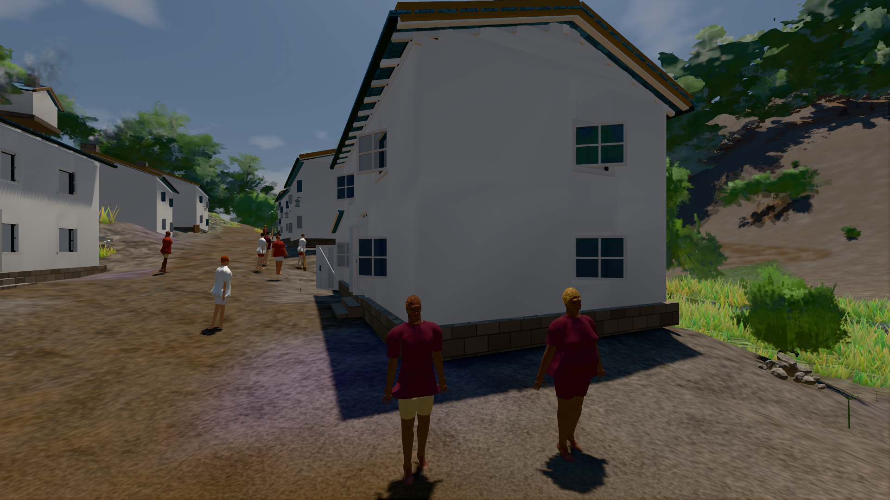

# GPU-PROBE d61b891a — GRÜN

Zweig `streu-gestalt-am-ort` · Kopf d61b891a736d609910519cbc7d50103aca30ff06 · Läufer gtx1050-desktop · 20.11. 14:07 · Wanduhr ab Push 495 s · Lauf https://github.com/MiguellD/AnazhRealm/actions/runs/44740305334

Ruf: `gate:pruefbuehne-licht bild:dorf@0.5`

## Läufer gtx1050-desktop — GRÜN

GPU NVIDIA GeForce GTX 1050 · npm ci 62 s (package-lock e5aaa49c)
Schloss /c/Users/User/AppData/Local/Temp/claude/gpu-schloss hält „ci-runner 44740305334/1 probe“
- Hook 2026-11-20 13:59:24 start ci-runner 44740305334/1 probe: wartet auf Schloss von 'hand stufe-b1y-2 (Claude)'
- Hook 2026-11-20 14:00:25 start ci-runner 44740305334/1 probe: Schloss genommen (refs/heads/streu-gestalt-am-ort d61b891a736d609910519cbc7d50103aca30ff06 ws=C:\actions-runner\_work\AnazhRealm\AnazhRealm)

### gate:pruefbuehne-licht — GRÜN · 112 s · Läufer gtx1050-desktop

Adapter: [linse-gpu] nvidia/pascal

```text
  S0 BODEN-PROGRAMM 1/1: 101568 Zeichen WGSL (Ratsche ≤ 104162) · Pipeline asynchron → GRÜN · kalt 1808 · 1746 · 1764 · 1746 · 1938 · 1743 · 1784 · 2110 · 2004 ms, Median 1784 ms · ÷ K17 derselben Sitzung 0,72 (Auskunft, kein Zeit-Urteil)
✅ S0 BILD GRÜN: die Feuerstelle trägt den Feuerkreis aus 2 m in der Ausgabe · Nacht {"luma":22.3,"schwarz":0} (70 s, nvidia/pascal · Holz kienspan)
```

### bild:dorf@0.5 — GRÜN · 167 s · Läufer gtx1050-desktop

Adapter: [linse-gpu] nvidia/pascal

```text
Kamera des Spiels → Blick (5.2 m): -704.22 39.69 -880.02 -703.01 39.69 -874.96
 "abnahme": "ABNAHME GRÜN · beweis · Sicht 0.0 % · Ziel Blickziel im Bild frei 5.2 m · Luma 75.8 σ 30.9 schwarz 0.2 % weiß 0.0 % · Stand 18.546.351 · Bühne summer sunny 0.50 Tiere gehalten · Gerät WebGPU nvidia pascal · Inhalt bauSatz 29.7 % (≥ 2.0 %) Luma 79",
```


