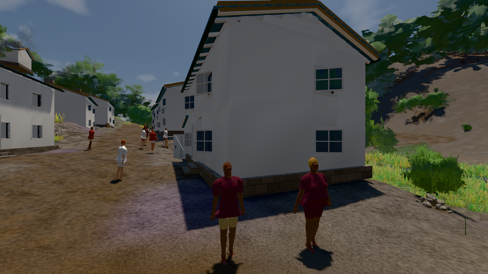

# GPU-PROBE fca6ce96 — GRÜN

Zweig `streu-gestalt-am-ort` · Kopf fca6ce96aacaf7294a464a7379f221ceb0ee9edc · Läufer radeon-890m · 20.11. 14:43 · Wanduhr ab Push 653 s · Lauf https://github.com/MiguellD/AnazhRealm/actions/runs/44745272171

Ruf: `gate:pruefbuehne-licht gate:weltbild-frost:echt bild:dorf@0.5`

## Läufer radeon-890m — GRÜN

GPU AMD Radeon(TM) 890M Graphics · npm ci 38 s (package-lock e5aaa49c)
Schloss /c/Users/micha/AppData/Local/Temp/claude/gpu-schloss hält „ci-runner 44745272171/1 probe“
- Hook 2026-11-20 14:38:29 start ci-runner 44745272171/1 probe: Schloss genommen (refs/heads/streu-gestalt-am-ort fca6ce96aacaf7294a464a7379f221ceb0ee9edc ws=C:\actions-runner\_work\AnazhRealm\AnazhRealm)

### gate:pruefbuehne-licht — GRÜN · 47 s · Läufer radeon-890m

Adapter: [linse-gpu] amd/rdna-3

```text
  S0 BODEN-PROGRAMM 1/1: 101568 Zeichen WGSL (Ratsche ≤ 104162) · Pipeline asynchron → GRÜN · kalt 893 · 857 · 1030 · 966 · 865 · 837 · 928 · 811 · 954 ms, Median 893 ms · ÷ K17 derselben Sitzung 0,81 (Auskunft, kein Zeit-Urteil)
✅ S0 BILD GRÜN: die Feuerstelle trägt den Feuerkreis aus 2 m in der Ausgabe · Nacht {"luma":22.3,"schwarz":0} (33 s, amd/rdna-3 · Holz kienspan)
```

### gate:weltbild-frost:echt — GRÜN · 103 s · Läufer radeon-890m

Adapter: [linse-gpu] amd/rdna-3

```text
  ✅ S6 der JS-Speicher fällt mit dem Abschied zurück — 255.5 → 259.6 MB nach 10 Erscheinungen und Abschied (Soll ≤ +20 MB)
  ✅ Nachlauf: kein verspätetes Wort einer Validierung
  ✅ P2 kein writeBuffer schief: der Pfad und ein Index ungerader Länge der Ich-Bühne — 211010 writeBuffer, keiner schief
  ✅ T1 die Index-Wache nennt den Index über der Vertex-Zahl beim Namen — Vendor- und Storage-Index — gezeichnet nach 69 Bildern · Scene/frost-taeter-bereich: Index 3 ≥ 3 Vertices im gezeichneten Bereich | Scene/frost-taeter-speicher: Index 3 ≥ 3 Vertices im gezeichneten Bereich
  ✅ T3 die Puffer-Wache nennt den schiefen writeBuffer beim Namen, WebGPU wirft — frost-taeter-puffer · Uint16Array · Versatz 0 · 6 B · q.writeBuffer (stamm/dirigent-ankunft.js:253:36) < pptr:;page.%3Ccomputed%3E%20(C%3A%5Cactions-runner%5C_work%5CAnazhRealm%5Cgpu-probe%5Cscripts%5Clib%5Cwelt-boot.cjs%3A1027%3A22):6:23 · geworfen: Failed to execute 'writeBuffer' on 'GPUQueue': Number of bytes to write must be a multiple of 4
  ✅ T2 die Index-Wache nennt den geweiteten Index beim Pfad — Group/BundleGroup/Group/mensch/torso/head/Mesh: 7962 × Uint32Array = 31848 B gebunden, der Puffer trägt 15924 B
  ✅ T2 die GPU-Wache des Spiels zählt die Validierung — {"n":345}
  ✅ T2 der eigene Hörer hört die Validierung (Device oder r184-Fehler-Bereich) — 690 Meldungen: device 0: Index range (first: 0, count: 7962, format: IndexFormat::Uint32) does not fit in index buffer size (15924). | device 0: [Invalid RenderBundle from RenderBundleEncoder "renderBundleEncoder"] is invalid due to a previous error.
  ✅ T2 die Bild-Probe erkennt das stehende Bild — 0.00 % der Blöcke bewegt
✅ GRÜN — DIE FROST-WAND steht — durch Werkstatt, Ich- und Hof-Bühne trägt jeder Index-Puffer der Welt-GPU sein Format, kein Device meldet, das Bild folgt der Kamera; die Täter (Index über der Vertex-Zahl, ein fremd geweiteter Mensch-Index) nennen die Wachen beim Namen, und das stehende Bild wird erkannt.
```

### bild:dorf@0.5 — GRÜN · 68 s · Läufer radeon-890m

Adapter: [linse-gpu] amd/rdna-3

```text
Kamera des Spiels → Blick (5.2 m): -704.22 39.69 -880.02 -703.01 39.69 -874.96
 "abnahme": "ABNAHME GRÜN · beweis · Sicht 0.0 % · Ziel Blickziel im Bild frei 5.2 m · Luma 76.1 σ 30.8 schwarz 0.2 % weiß 0.0 % · Stand 18.546.351 · Bühne summer sunny 0.50 Tiere gehalten · Gerät WebGPU amd rdna-3 · Inhalt bauSatz 29.7 % (≥ 2.0 %) Luma 80",
```


