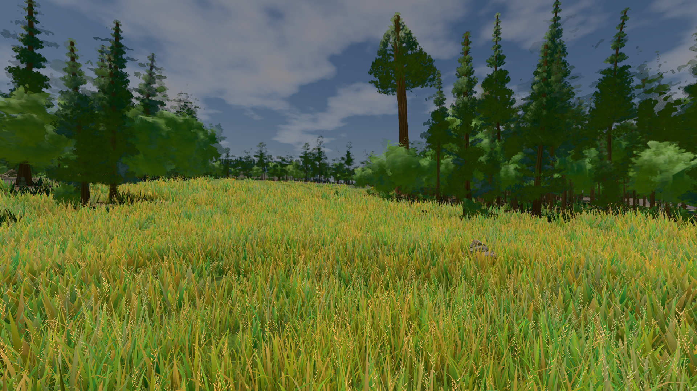

# GPU-PROBE 0dd2a800 — GRÜN

Zweig `stufe-ein-auge` · Kopf 0dd2a800d195f2f139e1ac688fdbdaf124557d31 · Läufer gtx1050-desktop · 21.11. 20:13 · Wanduhr ab Push 309 s · Lauf https://github.com/MiguellD/AnazhRealm/actions/runs/44939337008

Ruf: `gate:profiband bild:wiese@0.5`

## Läufer gtx1050-desktop — GRÜN

GPU NVIDIA GeForce GTX 1050 · node_modules bleiben (package-lock ffaac91c)
Schloss /c/Users/User/AppData/Local/Temp/claude/gpu-schloss hält „ci-runner 44939337008/1 probe“
- Hook 2026-11-21 20:09:00 start ci-runner 44939337008/1 probe: Schloss genommen (refs/heads/stufe-ein-auge 0dd2a800d195f2f139e1ac688fdbdaf124557d31 ws=C:\actions-runner\_work\AnazhRealm\AnazhRealm)

### gate:profiband — GRÜN · 111 s · Läufer gtx1050-desktop

Adapter: ungenannt (die Probe nannte keinen Browser-Adapter)

```text
✅ SELBST-TEST: Re-Mint: die Gesamt-Zeile vramMB ist höchstens die Summe der Erzeuger (zwei Läufe 6,0 + 4,0 und 5,9 + 4,1 → Erzeuger 5,9 + 4,0, Gesamt 10,0 → 9,9, beim Namen)
✅ SELBST-TEST: Gerät × Sicht: amd rdna-3 → radeon, nvidia pascal → gtx, SwiftShader → keins; first → ego, third → third; geraet (EIN Gerät) und eine Kamera „drohne" brechen den Haushalt
✅ SELBST-TEST: Gang: Heap je Minute und VRAM-Drift urteilen, der Halter steht beim Pfad
✅ SELBST-TEST: Weg: der Speicher folgt dem Blick — N1 · N2 · N3 rot beim Pfad ihres Halters
✅ SELBST-TEST: Runde: Behälter mit Anlage, Geometrie mit Geburts-Stelle, Zell-Gedächtnis außerhalb des Blicks und unangemeldetes rot beim Namen, die geräumte Runde grün
✅ SELBST-TEST: Runde: der JS-Heap-Zuwachs steht beim Besteller (Datei:Zeile) und der Stelle, ein voll gelaufener Cache grün, Splitter benannt
✅ SELBST-TEST: Soll des Turms: die Stufe 0 je Auftrag ist rot bei sollTon, je Bau einmal grün
✅ SELBST-TEST: Ferne Siedlung: der Abschied ohne die Takt-Felder ist rot bei aktivListe, der Stamm grün
✅ SELBSTTEST GRÜN — die Band-Wand feuert (48/48)
✅ DIE BAND-WAND steht — H1 Haushalt 208/208 Befehle · 680000/680000 Dreiecke in 14 Klassen (keine Sammelzeile) · H2 Ratsche 14 Klassen × 3 Pässe je Ort × Gerät × Sicht · H2b 12 Ratschen frisch an V18.546.361 · H4 Täter-Klasse des Stamms: 17 Schlüssel-Formen · Messorte wiese × radeon × ego (V18.545.0, gemessen 66 von 84) · wiese × radeon × third (V18.545.0, gemessen 66 von 84) · wiese × gtx × ego (V18.546.55, gemessen 72 von 84) · wiese × gtx × third (V18.546.55, gemessen 72 von 84) · genesis × radeon × ego (V18.545.0, gemessen 66 von 84) · genesis × radeon × th
```

### bild:wiese@0.5 — GRÜN · 98 s · Läufer gtx1050-desktop

Adapter: [linse-gpu] nvidia/pascal

```text
Kamera des Spiels → Blick (10.0 m): -280.40 29.71 -1045.60 -289.61 29.71 -1049.50
 "abnahme": "ABNAHME GRÜN · beweis · Sicht 0.0 % · Ziel Blickziel im Bild frei 10 m · Luma 99.3 σ 35.5 schwarz 0.0 % weiß 0.0 % · Stand 18.546.361 · Bühne summer sunny 0.50 Tiere gehalten · Gerät WebGPU nvidia pascal · Inhalt nahWiese 48.5 % (≥ 15.0 %) h 107° Luma 123",
```


